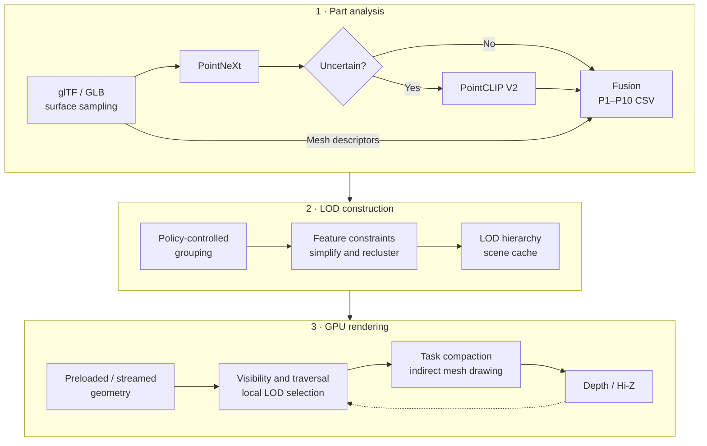
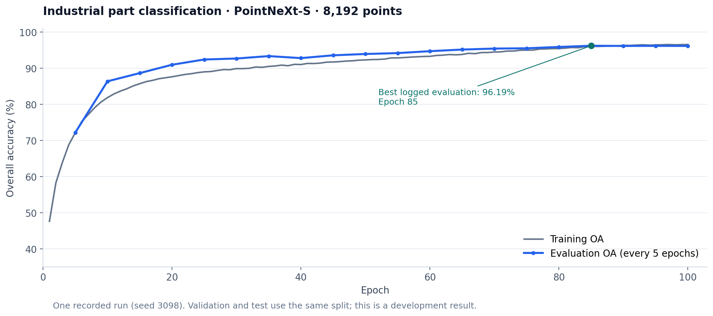

<div align="center">

# Industrial Semantic LOD

### Semantic and Structure-Aware Cluster LOD for GPU-Driven Industrial Rendering

**工业三维模型的语义结构感知集群 LOD 与 GPU 驱动渲染**

[English](README.md) · [简体中文](README.zh-CN.md)


<sub>Industrial assembly illustration from the supplied thesis figures; not a renderer screenshot.</sub>

[Overview](#overview) · [Pipeline](#pipeline) · [Experiments](#recorded-experiments) · [Build](#build-and-run) · [Semantic workflow](#semantic-analysis-workflow) · [Code map](#code-map)

</div>

## Overview

Industrial assemblies contain parts with very different simplification needs: repeated fasteners, thin plates, transmission components, fluid interfaces, and geometrically sensitive details. This research project connects **part-level semantic and geometric analysis** to **local cluster LOD construction**, then renders the hierarchy through a Vulkan pipeline with GPU traversal, visibility filtering, and indirect mesh drawing.

The offline analysis combines a **14-class PointNeXt classifier**, **PointCLIP V2 inference gated by prediction uncertainty**, and **explicit mesh descriptors**. It produces P1–P10 policies that control simplification, local feature protection, grouping, and runtime error scaling. The renderer supports preloaded geometry and group-level streaming, retaining coarse representations while finer data is unavailable.

The thesis calls the analysis framework **ISPointNet**. In this implementation, its supervised encoder is `PointNextEncoder`; fusion and policy mapping are deterministic rules. The project integrates these components with a cluster LOD rendering foundation related to [NVIDIA's Vulkan Cluster LOD sample](https://github.com/nvpro-samples/vk_lod_clusters) and [meshoptimizer](https://github.com/zeux/meshoptimizer).

| Research component | Implemented behavior |
| :--- | :--- |
| Semantic analysis | Industrial part classification with confidence and margin extraction |
| Open-vocabulary evidence | Multi-view PointCLIP V2 inference on uncertain parts; full inference for comparison configurations |
| Structure-aware policies | Mesh scale, proportions, compactness, and complexity inform P1–P10 allocation |
| Local geometry constraints | Feature importance and vertex protection for boundaries, sharp edges, circular boundary loops, and thin-wall cues |
| GPU-driven rendering | Hierarchy traversal, local LOD selection, subgroup compaction, and indirect mesh drawing |
| Visibility and residency | Assembly prefiltering, frustum/Hi-Z tests, optional adaptive two-pass culling, and streaming |

## Pipeline



The default open-branch gate triggers when PointNeXt confidence is below **0.70** or the top1–top2 margin is below **0.08**.

**Model policies and local features work at different scales.** The policy specifies a part's overall protection preference. Local feature analysis adds weighted attributes and vertex protection during group simplification. Repeated grouping, simplification, and reclustering preserve cross-level generation relationships for runtime selection.

<p align="center">
  <br>
  <sub>Structure-preservation schematic from the supplied figures; illustrative, not a measured before/after experiment.</sub>
</p>

## Recorded experiments

These results come from existing training logs and policy outputs. The documentation review checked all **30 scene/configuration CSVs** against the aggregate statistics. It did not retrain models or run a new rendering benchmark. [Evidence metadata and coverage checks](docs/data/readme-evidence.json)

### 1. Industrial part classification

| Setting / metric | Recorded value |
| :--- | ---: |
| Classes / points per sample | 14 / 8,192 |
| Training / evaluation samples | 61,711 / 15,372 |
| Training epochs / recorded seed | 100 / 3098 |
| Best logged evaluation OA | **96.19%** |
| mAcc after reloading the best checkpoint | **93.86%** |
| Selected checkpoint epoch | 85 |



**Evaluation scope.** Validation and test both use the `test` split, and the dataset maps `val` to `test`. These values describe the recorded development evaluation, not an independent held-out test. OA is overall accuracy; mAcc is mean class accuracy. The figure plots evaluation only at the logged five-epoch evaluation intervals.

The reloaded checkpoint reports 98.99% accuracy for screws/bolts/studs and 76.21% for pipe fittings/valves/nozzles, showing why per-class analysis matters alongside the overall score. [Training log](tools/pointnext_lod/PointNeXt/log/industrial_part/industrial_part-train-pointnext-s-14class/log.txt) · [Configuration](tools/pointnext_lod/PointNeXt/cfgs/industrial_part/pointnext-s-14class-randomrot-8192-fast.yaml) · [Dataset implementation](tools/pointnext_lod/PointNeXt/openpoints/dataset/industrial_part.py)

### 2. Five industrial scenes

| Scene | Meshes | Source triangles | PointCLIP candidates | Candidate share |
| :--- | ---: | ---: | ---: | ---: |
| `a` | 24,259 | 50,138,563 | 12,252 | 50.50% |
| `b` | 63,063 | 78,514,530 | 29,115 | 46.17% |
| `c` | 61,467 | 126,985,435 | 35,437 | 57.65% |
| `o1778` | 1,778 | 5,469,879 | 920 | 51.74% |
| `o3049` | 3,049 | 6,087,168 | 1,762 | 57.79% |
| **Total** | **153,616** | **267,195,575** | **79,486** | **51.74%** |

Triangle counts were checked from GLB triangle-primitive accessor counts. They describe source geometry, not triangles submitted per frame. These scenes have one mesh-bearing node per mesh. Scene `a` contains an assembly hierarchy; the other four have flat node structures, which limits assembly-level filtering opportunities. [Candidate statistics](analysis_reports/lod_pointnext_confidence_candidate_summary.csv)

### 3. Six semantic policy configurations

**N** denotes PointNeXt, **C** denotes PointCLIP V2, and **G** denotes explicit geometric structure evidence. Every configuration has 153,616 policy records across the five scenes.

| Configuration | PointCLIP coverage | P1–P3 | P8–P10 | `allow_cull` output |
| :--- | ---: | ---: | ---: | ---: |
| N | 0.00% | 73.78% | 23.46% | 63.41% |
| C | 100.00% | 87.82% | <0.01% | 87.78% |
| N + G | 0.00% | 45.50% | 21.53% | 44.17% |
| C + G | 100.00% | 8.40% | 0.19% | 4.22% |
| N + C | 51.74% | 68.54% | 22.01% | 58.83% |
| **N + C + G · default** | **51.74%** | **46.27%** | **22.08%** | **42.59%** |


Adding G to N changes 31.78% of policy assignments; adding candidate-only C to N changes 8.41%. Moving from N + C to the full configuration changes 30.82%. Candidate records have mean PointNeXt confidence of 0.40–0.46, compared with 0.78–0.79 for records that skip the open branch. These observations describe policy behavior and the concentration of open-branch work on uncertain inputs. [Aggregate CSV](analysis_reports/lod_ablation_aggregate_summary.csv) · [Policy transitions](analysis_reports/lod_pairwise_change_totals.csv) · [Existing analysis](analysis_reports/LOD_ALL_DATA_ANALYSIS_REPORT.md)

**Interpretation.** P1–P3 indicate lower protection and P8–P10 higher protection; these are policy classes, not geometric LOD levels. A more conservative distribution does not establish better geometric fidelity. The six configurations use different fusion rules/weights, and full versus candidate inference also differs in prompt-role filtering, so this is an engineering configuration comparison rather than a controlled branch ablation. `allow_cull` is exported policy metadata; the current GPU visibility path does not consume its flag to decide culling. Its percentage is not an observed culling rate.

### Experiment coverage

| Experiment | Evidence currently available |
| :--- | :--- |
| 14-class PointNeXt training | Completed run, per-class results, configuration, and checkpoints |
| PointNeXt / candidate-only / full PointCLIP scene inference | Outputs for all five scenes |
| Six policy configurations | 30 complete policy CSVs, distributions, and transition summaries |
| GPU timing, geometry fidelity, and streaming tradeoffs | Implementation and instrumentation exist; no complete controlled benchmark dataset identified in this review |
| PointNet / PointNet++ comparisons | Configuration files exist; completed comparative results were not identified |

The [project review](analysis_reports/PROJECT_REVIEW_20261014.md) maps code to the thesis and explains the evidence boundaries.

## Build and run

### Requirements

- Windows with a C++20 compiler; the existing local build uses Visual Studio 2022.
- CMake **3.22+**, Git, and Vulkan SDK **1.4.309.0+**.
- A GPU/driver supporting the device features requested in [main.cpp](src/app/main.cpp), including EXT mesh shaders, shader clocks, float atomics, fragment shading rate, and 64-bit image atomics. NV-specific features are also requested; check device initialization before assuming compatibility.
- `nvpro_core2`, meshoptimizer, and cgltf. The dependency finder downloads `nvpro_core2` at `03297bee1f997208951cc104abb5ecc3e1f987ed` if a local copy is unavailable.

### Build

Run from the repository root:

```powershell
cmake -S . -B build -G "Visual Studio 17 2022" -A x64
cmake --build build --config Release
```

The CMake target takes the source directory name. In the current `t1` checkout, the existing Release executable is **`_bin/Release/t1.exe`**. Renaming the checkout directory changes the target name on a fresh configuration.

```powershell
# Open a scene
.\_bin\Release\t1.exe --scene "path\to\model.glb"

# Precompute a cache without interactive rendering
.\_bin\Release\t1.exe --scene "path\to\model.glb" --processingonly 1

# Enable group streaming
.\_bin\Release\t1.exe --scene "path\to\model.glb" --streaming 1

# Enable adaptive two-pass culling
.\_bin\Release\t1.exe --scene "path\to\model.glb" --culling 1 --twopassculling 1 --adaptivetwopassculling 1
```

Adaptive two-pass logic requires `twopassculling` to be enabled. Its decision uses scene cluster count and view-projection matrix change; enabling only `adaptivetwopassculling` does not activate the second pass.

For a local dependency copy, place `nvpro_core2` under the project, its parent, its grandparent, or `build/_deps`. `-DNVPROCORE2_DOWNLOAD=OFF` disables automatic fetching but still requires an accessible local copy.

## Semantic analysis workflow

The renderer and offline neural inference have separate dependencies. Provide input GLBs, a compatible PointNeXt checkpoint, OpenPoints CUDA extensions, and the PointCLIP V2/CLIP environment before running the semantic scripts.

From **Anaconda Prompt / cmd.exe** at the repository root:

```bat
rem Put input models under _downloaded_resources\*.glb
rem Override these default environment names if needed
set POINTNEXT_CONDA_ENV=gpt-pointnext
set POINTCLIP_CONDA_ENV=PointCLIPV2_LOD
run_all_glb_pointnext_pointclipv2_fused.bat
```

The batch runs full PointNeXt analysis, gated PointCLIP inference, and policy fusion in that order. It expects the checkpoint at:

```text
tools/pointnext_lod/PointNeXt/log/industrial_part/
  industrial_part-train-pointnext-s-14class/checkpoint/
    industrial_part-train-pointnext-s-14class_ckpt_best.pth
```

For each `<scene>`, it writes:

```text
lod_analysis_outputs/
  <scene>_pointnext_analysis.csv
  <scene>_pointclipv2_candidates.csv
  <scene>_pointnext_pointclip_merged.csv
  <scene>_lod_constraints_fused.csv
  <scene>_lod_constraints_fused_summary.json
```

The root batch skips existing neural outputs. If the model, checkpoint, or prompts change, archive or regenerate the corresponding outputs before interpreting a new run.

For the existing five-scene comparison, after generating candidate outputs:

```bat
conda activate PointCLIPV2_LOD
tools\pointclipv2\run_pointclipv2_full_5_glbs.bat
tools\pointclipv2\run_lod_ablation_5_glbs.bat
```

Generate full PointCLIP outputs first: the comparison batch falls back to candidate outputs when full files are missing. Select a configuration through **Semantic LOD Strategy** in the UI or `--semanticlodmode`:

| CLI value | Configuration |
| ---: | :--- |
| 0 | PointNeXt |
| 1 | PointCLIP V2 |
| 2 | PointNeXt + structure |
| 3 | PointCLIP V2 + structure |
| 4 | PointNeXt + PointCLIP V2 |
| **5** | **PointNeXt + PointCLIP V2 + structure** |

**Value 0 is a PointNeXt policy mode, not a semantic-disable switch.** The loader searches for the selected configuration CSV, then fused CSV, then ordinary constraints. Check the logged resolved CSV path when comparing modes. Semantic policy hashes participate in cache compatibility checks. For an explicit rebuild, use `--processingonly 1 --autoloadcache 0`; use distinct `--cachesuffix` values to retain caches for different experiments.

## Code map

```text
src/
  app/           Application, parameters, UI, and frame scheduling
  scene/         glTF import, semantic policies, cluster LOD, compression
  meshlod/       Grouping, feature constraints, simplification, hierarchy
  renderer/      Vulkan resources, Hi-Z, preloading, and cluster renderer
  streaming/     Group residency, request processing, and transfers
  core/          Serialization and cache support
shaders/
  traversal/     Assembly visibility, hierarchy traversal, local selection
  render/        Mesh and fragment shaders
  streaming/     Residency updates and age-based filtering
  post/          Hi-Z construction and background passes
  interface/     Shared CPU/GPU structures
tools/
  pointnext_lod/ PointNeXt inference and semantic/structure policy mapping
  pointclipv2/   Open-vocabulary inference, fusion, comparison generation
analysis_reports/  Recorded policy summaries and technical reviews
docs/              README figures and evidence metadata
```

| Start here | Purpose |
| :--- | :--- |
| [main.cpp](src/app/main.cpp) | Vulkan feature requests and application startup |
| [scene_semantic_lod.cpp](src/scene/scene_semantic_lod.cpp) | CSV resolution, policy derivation, and configuration mapping |
| [clusterlod.cpp](src/scene/clusterlod.cpp) | Policy injection and cluster hierarchy construction |
| [meshlod_simplify.h](src/meshlod/meshlod_simplify.h) | Local feature analysis and constrained simplification |
| [renderer_clusters_lod.cpp](src/renderer/renderer_clusters_lod.cpp) | GPU passes, synchronization, and adaptive two-pass decision |
| [assembly_visibility.comp.glsl](shaders/traversal/assembly_visibility.comp.glsl) | Assembly-level screen-space and Hi-Z filtering |
| [traversal_run.comp.glsl](shaders/traversal/traversal_run.comp.glsl) | GPU hierarchy task processing |
| [build_lod_constraints_from_analysis.py](tools/pointnext_lod/build_lod_constraints_from_analysis.py) | Role fusion and P1–P10 policy generation |

Frequently used controls include `--loderror`, `--featureconstraints`, `--featureimportanceweight`, `--assemblymininstances`, `--assemblylodpixels`, `--maxgeomegabytes`, and `--maxtransfermegabytes`. See [parameter registration](src/app/lodclusters_config.cpp) for the current supported names.

## Documentation and foundations

- [中文说明](README.zh-CN.md)
- [Code and experiment review](analysis_reports/PROJECT_REVIEW_20261014.md)
- [Semantic analysis workflow](POINTNEXT_POINTCLIPV2_SEMANTIC_LOD_FULL_WORKFLOW.md)
- [Semantic LOD technical analysis](SEMANTIC_LOD_STRATEGY_TECHNICAL_ANALYSIS.md)
- [Six-configuration experiment design](LOD_ABLATION_EXPERIMENT_DESIGN.md)
- [Recorded five-scene policy analysis](analysis_reports/LOD_ALL_DATA_ANALYSIS_REPORT.md)
- [Figure provenance](docs/assets/README.md)

This project uses and adapts established rendering and point-cloud components. See the original [Vulkan Cluster LOD sample](https://github.com/nvpro-samples/vk_lod_clusters), [nvpro_core2](https://github.com/nvpro-samples/nvpro_core2), [meshoptimizer](https://github.com/zeux/meshoptimizer), [PointNeXt](https://github.com/guochengqian/PointNeXt), and [PointCLIP V2](https://github.com/yangyangyang127/PointCLIP_V2) for their methods and upstream licensing. The industrial semantic-policy integration and runtime extensions should be evaluated separately from these foundations.

**Artifact availability.** `_downloaded_resources/` and `lod_analysis_outputs/` are ignored by Git. The README publishes compact results and provenance, not the complete local scene dataset or per-mesh outputs. Inspect checkpoint files in a checkout before attempting inference. No repository-wide license file was identified in this review; consult component licenses before reuse.
