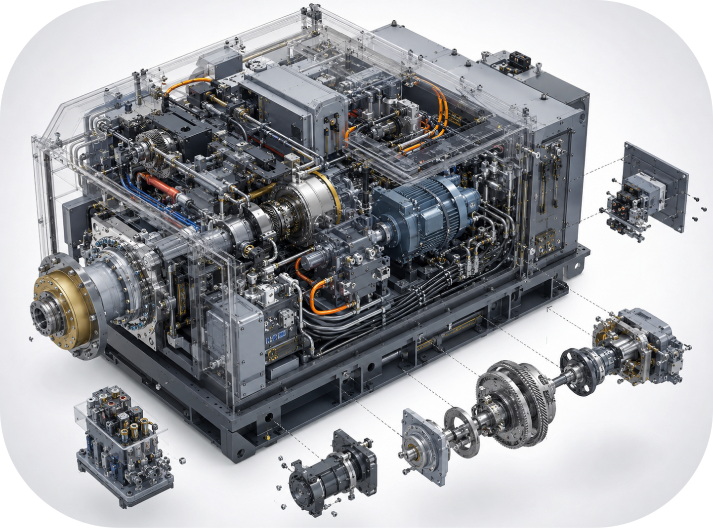
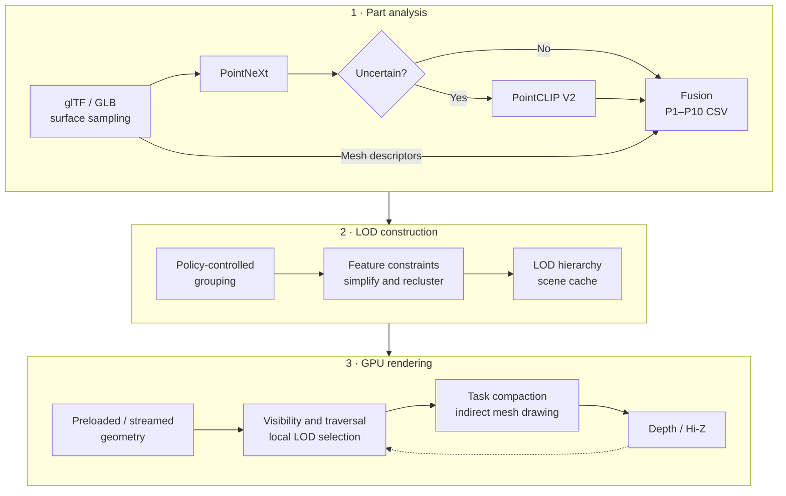
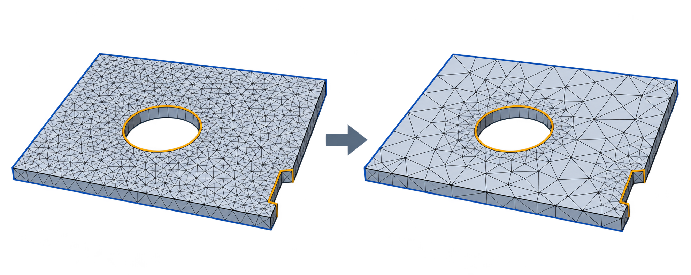
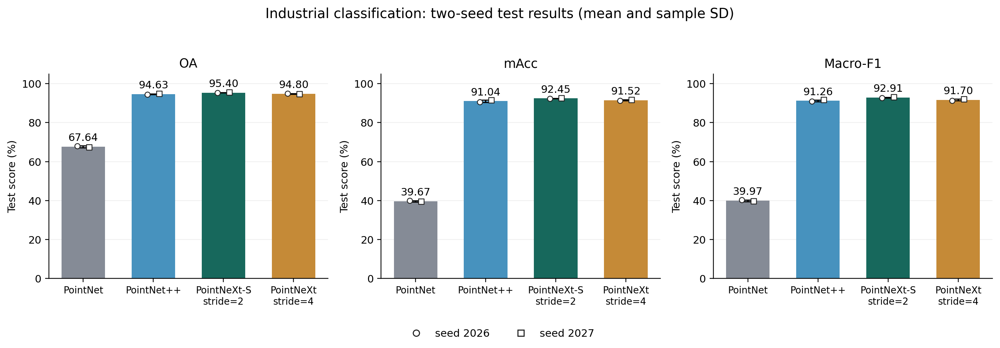
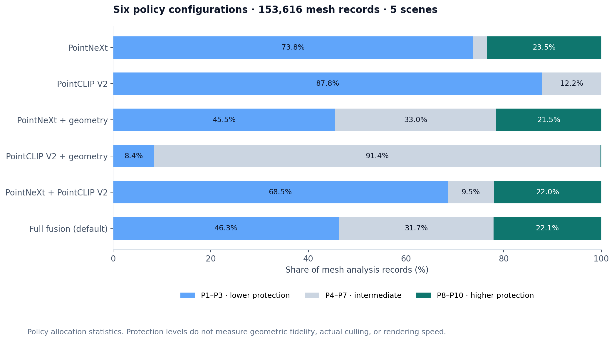

<div align="center">

# Industrial Semantic LOD

### Semantic and Structure-Aware Cluster LOD for GPU-Driven Industrial Rendering

**工业三维模型的语义结构感知集群 LOD 与 GPU 驱动渲染**

[English](README.md) · [简体中文](README.zh-CN.md)




<sub>Industrial assembly illustration from the supplied thesis figures; not a renderer screenshot.</sub>

[Overview](#overview) · [Pipeline](#pipeline) · [Experiments](#recorded-experiments) · [Key techniques](#key-techniques) · [Usage](#complete-usage-workflow) · [Code map](#code-map)

</div>

## Overview

Industrial assemblies contain parts with very different simplification needs: repeated fasteners, thin plates, transmission components, fluid interfaces, and geometrically sensitive details. This research project connects **part-level semantic and geometric analysis** to **local cluster LOD construction**, then renders the hierarchy through a Vulkan pipeline with GPU traversal, visibility filtering, and indirect mesh drawing.

The offline analysis combines a **14-class PointNeXt classifier**, **PointCLIP V2 inference gated by prediction uncertainty**, and **explicit mesh descriptors**. It produces P1–P10 policies that control simplification, local feature protection, grouping, and runtime error scaling. The renderer supports preloaded geometry and group-level streaming, retaining coarse representations while finer data is unavailable.

The thesis calls the analysis framework **ISPointNet**. In this implementation, its supervised encoder is `PointNextEncoder`; fusion and policy mapping are deterministic rules. The project integrates these components with a cluster LOD rendering foundation related to [NVIDIA's Vulkan Cluster LOD sample](https://github.com/nvpro-samples/vk_lod_clusters) and [meshoptimizer](https://github.com/zeux/meshoptimizer).

| Research component | Implemented behavior |
| :--- | :--- |
| Semantic analysis | Industrial part classification with confidence and margin extraction |
| Open-vocabulary evidence | Multi-view PointCLIP V2 inference on uncertain parts; full inference for comparison configurations |
| Structure-aware policies | Mesh scale, proportions, compactness, and complexity inform P1–P10 allocation |
| Local geometry constraints | Feature importance and vertex protection for boundaries, sharp edges, circular boundary loops, and thin-wall cues |
| GPU-driven rendering | Hierarchy traversal, local LOD selection, subgroup compaction, and indirect mesh drawing |
| Visibility and residency | Assembly prefiltering, frustum/Hi-Z tests, optional adaptive two-pass culling, and streaming |

## Pipeline



The default open-branch gate triggers when PointNeXt confidence is below **0.70** or the top1–top2 margin is below **0.08**.

**Model policies and local features work at different scales.** The policy specifies a part's overall protection preference. Local feature analysis adds weighted attributes and vertex protection during group simplification. Repeated grouping, simplification, and reclustering preserve cross-level generation relationships for runtime selection.

<p align="center">
  <br>
  <sub>Structure-preservation schematic from the supplied figures; illustrative, not a measured before/after experiment.</sub>
</p>

## Key techniques

The thesis organizes the method around **offline semantic/structure-aware LOD construction** and **online GPU-driven rasterization with hierarchical visibility**. The following components implement that connection.

### Multi-source semantic and structural reasoning

ISPointNet combines supervised category evidence, gated open-vocabulary evidence, and explicit mesh descriptors. PointNeXt provides known industrial classes and uncertainty; PointCLIP V2 supplements ambiguous parts; structure describes scale, proportions, and complexity. Their fused structural role is mapped to simplification controls rather than used only as a display label.

### Multiple policies for cluster LOD construction

The renderer exposes six evidence configurations, and each produces **P1–P10 part policies**. Lower-protection policies favor reducing repeated or small geometry; higher-protection policies retain more detail for structural, motion, and precision roles. Policies jointly control target retention, hierarchy decay, group scale, feature weight, hard-protection budget, and error scaling.

Within each cluster group, weighted feature attributes and vertex protection guide simplification. Grouping, simplification, and reclustering recursively create coarse clusters while retaining their generating-group associations. Model-level policies set the overall preference; boundary, sharp-edge, circular-loop, and thin-wall cues guide local constraints. [Policy integration](src/scene/scene_semantic_lod.cpp) · [Constrained simplification](src/meshlod/meshlod_simplify.h)

### GPU hierarchy search and local precision selection

The spatial hierarchy narrows the search with bounds, visibility, and projected error. Candidate groups then select individual clusters using cross-level generation relationships and residency. This permits different parts of the same model to use different detail levels, including accessible coarse candidates when finer generating groups have not arrived. [Traversal](shaders/traversal/traversal_run.comp.glsl)

### Hierarchical visibility and adaptive two-pass culling

Filtering spans **assembly → instance → spatial node → cluster**, using imported assembly bounds, frustum tests, screen size, and hierarchical depth. Small projected assemblies can take a coarse-LOD path when the imported hierarchy supports it.

The first pass uses historical visibility information to filter geometry and renders it with the current camera. An optional second pass builds an intermediate Hi-Z from the first-pass depth, rechecks visibility, and supplements newly visible geometry. Adaptive activation uses cluster count and view-projection matrix change to decide when the extra pass runs; it requires the two-pass switch to be enabled. [Assembly visibility](shaders/traversal/assembly_visibility.comp.glsl) · [Pass scheduling](src/renderer/renderer_clusters_lod.cpp)

### Task compaction and indirect mesh drawing

Subgroup voting and prefix offsets compact accepted clusters into a continuous list with batched atomic reservations. GPU-generated indirect parameters determine mesh workgroup count. Mesh shaders expand the selected local geometry, followed by rasterization and fragment shading; depth feeds subsequent Hi-Z construction. [Task setup](shaders/build/build_setup.comp.glsl) · [Mesh shader](shaders/render/clusters.mesh.glsl)

### Automatic group streaming and residency management

With `--streaming 1`, GPU traversal identifies missing groups and generates deduplicated requests. CPU processing schedules data preparation and transfer within configured budgets, then publishes geometry addresses through residency updates. The hierarchy and lowest-detail data remain available; coarse candidates can cover the wait for finer groups. Age-based reclamation unloads unused dynamic groups.

Once enabled, loading follows runtime demand rather than manual per-part uploads. Geometry budget, per-frame transfer budget, resident-group capacity, and load/unload request limits govern this process. Inspect Streaming memory and Profiler to assess a scene's working set. [Streaming implementation](src/streaming/streaming.cpp)

## Recorded experiments

The current classifier uses the completed two-seed encoder comparison from `gpt`. The default deployment is PointNeXt-S, seed 2027, epoch 98, selected by validation macro-F1. [Deployment and experiment provenance](experiments/pointnext/encoder-compare-two-seeds-20261019/README.md) · [Checkpoint manifest](models/pointnext/deployment.json)

The five-scene and six-policy tables below are historical observations from the previous deployment. Their raw outputs have been archived; they are not scene results for the new checkpoint. New-checkpoint full inference, fusion and six-policy comparisons are complete for the current `a.glb` (1,778 meshes): [scene analysis](analysis_reports/a_seed2027_20261019/analysis_report.md). Three additional named production-line scenes now have full inference, six-policy comparisons and a [CAD name/hierarchy audit](analysis_reports/named_scenes_20261019/三场景名称层级与语义分析.md), covering 6,261 mesh nodes. Their readers accumulate parent transforms and distinguish unique meshes from instantiated triangles. Names and hierarchy remain auxiliary audit evidence; neural inference does not consume them yet. Actual LOD/rendering evaluation requires separate runs. [Historical evidence metadata](docs/data/readme-evidence.json)

The latest [four-scene full semantic test and overall assessment](analysis_reports/four_scenes_20261019/四模型全量测试与整体评价.md) adds the K31 riveting machine, covering 7,742 mesh nodes. The re-exported connector machine was inferred again; unchanged speaker/vent scenes reused content-verified neural snapshots with regenerated policies and reports. Historical reports remain intact. Device/process context and both pooled-node and equal-scene summaries are provided; ground-truth accuracy and actual LOD/rendering performance remain unmeasured.

Run **`run_open_semantic_v2.bat`** for the upgraded open branch: a 66-label/12-family taxonomy, pose/local views, independent surface-normal shading, cross-render agreement, three-level abstention and explicit semantic identities with unified N/C/G fusion. A seventh renderer strategy adds separately marked CAD context. [Usage and method](tools/pointclipv2/OPEN_SEMANTIC_V2.md) · [Upgrade comparison](analysis_reports/open_semantic_v2_20261019/开放语义分支升级与对照分析.md). Engineering thresholds remain uncalibrated; evidence coverage and policy changes are not accuracy gains.

Run **`run_adaptive_p10_comparison.bat`** for the current ten-profile geometry policy; `run_assembly_context_comparison.bat` forwards to it. Strategy seven uses assembly/CAD evidence (CLI index 6); strategy six excludes leaf/ancestor names. `--policies-only` and `--no-export` remain supported. Run `run_adaptive_p10_runtime_validation.bat` separately for real application memory/GPU timing and image diagnostics. [Current definitions](tools/pointclipv2/ADAPTIVE_P10_V4.md) · [Six-scene validation](analysis_reports/adaptive_p10_v4_20261020/P1-P10策略重构与六模型验证.md). The old runner remains `run_assembly_context_v3_legacy.bat` and its [v3 report](analysis_reports/assembly_context_v3_20261020/六模型结构树辅助与策略优化实验报告.md) is preserved. Name-assisted outputs are not blind recognition accuracy; GPU timings are not interactive desktop FPS.

The full paired ablation is available as a [six-mode/tree comparison](analysis_reports/six_scene_factorial_ablation_20261020/六模型六组合与结构树消融分析.md) and an [Excel workbook](analysis_reports/six_scene_factorial_ablation_20261020/六模型六组合与结构树消融完整对比.xlsx). All 72 primary conditions disable leaf-name hints and incumbent migration guards; H0 removes all parent assistance. Topology-only, G-only and metadata controls are separate. Experimental policy files do not replace deployed results.

### 1. Industrial part classification

| Configuration | Test OA | Test mAcc | Test macro-F1 |
| :--- | ---: | ---: | ---: |
| PointNet | 67.64±0.47 | 39.67±0.33 | 39.97±0.43 |
| PointNet++ | 94.63±0.23 | 91.04±0.58 | 91.26±0.46 |
| PointNeXt-S, stride 2 | **95.40±0.03** | **92.45±0.04** | **92.91±0.21** |
| PointNeXt, stride 4 | 94.80±0.13 | 91.52±0.21 | 91.70±0.48 |



**Evaluation scope.** Percentages are mean ± sample SD across training seeds 2026 and 2027 (n=2, ddof=1). The shared grouped split has 53,654/11,517/11,542 train/validation/test samples, 14 classes and 8,192 XYZ points. Validation macro-F1 selects each checkpoint. Both seeds share the test set; this is an internal holdout from an existing source, not an external assembly evaluation or a significance claim.

Deployment uses seed 2027: its validation macro-F1 is 92.17%, versus 91.61% for seed 2026. The selected run's test OA/mAcc/macro-F1 are 95.43%/92.48%/93.06%; these single-run values differ from the two-seed averages above. The previous seed-3098 development evaluation (96.19% OA) remains a [historical record](experiments/pointnext/industrial-part-14class/README.md).

### 2. Five industrial scenes (previous model, historical)

| Scene | Meshes | Source triangles | PointCLIP candidates | Candidate share |
| :--- | ---: | ---: | ---: | ---: |
| `a` | 24,259 | 50,138,563 | 12,252 | 50.50% |
| `b` | 63,063 | 78,514,530 | 29,115 | 46.17% |
| `c` | 61,467 | 126,985,435 | 35,437 | 57.65% |
| `o1778` | 1,778 | 5,469,879 | 920 | 51.74% |
| `o3049` | 3,049 | 6,087,168 | 1,762 | 57.79% |
| **Total** | **153,616** | **267,195,575** | **79,486** | **51.74%** |

Triangle counts were checked from GLB triangle-primitive accessor counts. They describe source geometry, not triangles submitted per frame. These scenes have one mesh-bearing node per mesh. Scene `a` contains an assembly hierarchy; the other four have flat node structures, which limits assembly-level filtering opportunities. [Candidate statistics](analysis_reports/lod_pointnext_confidence_candidate_summary.csv)

### 3. Six semantic policy configurations (previous model, historical)

**N** denotes PointNeXt, **C** denotes PointCLIP V2, and **G** denotes explicit geometric structure evidence. Every configuration has 153,616 policy records across the five scenes.

| Configuration | PointCLIP coverage | P1–P3 | P8–P10 | `allow_cull` output |
| :--- | ---: | ---: | ---: | ---: |
| N | 0.00% | 73.78% | 23.46% | 63.41% |
| C | 100.00% | 87.82% | <0.01% | 87.78% |
| N + G | 0.00% | 45.50% | 21.53% | 44.17% |
| C + G | 100.00% | 8.40% | 0.19% | 4.22% |
| N + C | 51.74% | 68.54% | 22.01% | 58.83% |
| **N + C + G · default** | **51.74%** | **46.27%** | **22.08%** | **42.59%** |



Adding G to N changes 31.78% of policy assignments; adding candidate-only C to N changes 8.41%. Moving from N + C to the full configuration changes 30.82%. Candidate records have mean PointNeXt confidence of 0.40–0.46, compared with 0.78–0.79 for records that skip the open branch. These observations describe policy behavior and the concentration of open-branch work on uncertain inputs. [Aggregate CSV](analysis_reports/lod_ablation_aggregate_summary.csv) · [Policy transitions](analysis_reports/lod_pairwise_change_totals.csv) · [Existing analysis](analysis_reports/LOD_ALL_DATA_ANALYSIS_REPORT.md)

**Interpretation.** P1–P3 indicate lower protection and P8–P10 higher protection; these are policy classes, not geometric LOD levels. A more conservative distribution does not establish better geometric fidelity. The six configurations use different fusion rules/weights, and full versus candidate inference also differs in prompt-role filtering, so this is an engineering configuration comparison rather than a controlled branch ablation. `allow_cull` is exported policy metadata; the current GPU visibility path does not consume its flag to decide culling. Its percentage is not an observed culling rate.

### Experiment coverage

| Experiment | Evidence currently available |
| :--- | :--- |
| 14-class encoder comparison | Four configurations × two seeds; metrics, histories, per-class outputs and configurations imported |
| Current PointNeXt-S deployment | Seed 2027, epoch 98; strict state loading and 8,192-point GPU forward check passed |
| New-checkpoint scene inference and fusion | Current a: 1,778 supervised/full-open records, 1,136 gated-open records; six configurations and independent geometry diagnostics complete |
| Historical five-scene / six-policy comparison | Previous model's 30 policy CSVs and aggregate observations; not new-model results |
| GPU timing, geometry fidelity, and streaming tradeoffs | Implementation and instrumentation exist; no complete controlled benchmark dataset identified in this review |

The [project review](analysis_reports/PROJECT_REVIEW_20261014.md) maps code to the thesis and explains the evidence boundaries.

## Complete usage workflow

Follow **environment setup → labeled data and supervised training → multi-source scene analysis → LOD preprocessing → rendering**. The classifier is trained once for the supported industrial categories and reused for new scenes. PointCLIP V2 uses pretrained CLIP weights. [Detailed English guide](docs/guides/end-to-end.md) · [完整中文流程](docs/guides/end-to-end.zh-CN.md)

### 1. Configure the environments

| Component | Software and hardware |
| :--- | :--- |
| PointNeXt | Python 3.10, PyTorch 2.2.0 / torchvision 0.17.0, CUDA 12.1, NumPy 1.26.4, OpenPoints CUDA extension |
| PointCLIP V2 | Separate CUDA environment, pretrained CLIP ViT-B/16 |
| Extension build | CUDA Toolkit with `nvcc`, Visual Studio C++ build tools |
| Renderer | C++20, Visual Studio 2022, CMake 3.22+, Git, Vulkan SDK 1.4.309.0+ |

The GPU/driver must support the extensions requested in [main.cpp](src/app/main.cpp), including EXT mesh shaders and the requested atomic/clock/shading-rate features. CUDA supports offline inference; Vulkan supports runtime rendering.

Use **Anaconda Prompt / cmd.exe**. Replace the checkout path if needed:

```bat
set PROJECT_ROOT=E:\vk_lod_clusters1\t1
cd /d "%PROJECT_ROOT%"
conda env create -f tools\pointnext_lod\environment_pointnext.yml
conda env create -f tools\pointclipv2\environment_pointclipv2.yml
conda activate gpt-pointnext
python -c "import torch,numpy; print(torch.__version__,torch.version.cuda,numpy.__version__,torch.cuda.is_available())"
```

Activate working existing environments instead of recreating them. In a Visual Studio Native Tools prompt with Conda available, compile the PointNeXt extension:

```bat
conda activate gpt-pointnext
set CUDA_HOME=C:\Program Files\NVIDIA GPU Computing Toolkit\CUDA\v12.1
set PATH=%CUDA_HOME%\bin;%PATH%
cd /d "%PROJECT_ROOT%\tools\pointnext_lod\PointNeXt\openpoints\cpp\pointnet2_batch"
python -m pip install . --no-build-isolation
cd /d "%PROJECT_ROOT%"
python -c "import sys; sys.path.insert(0,r'tools/pointnext_lod/PointNeXt'); from openpoints.cpp.pointnet2_batch import pointnet2_cuda; print('CUDA extension OK')"
```

Conda's CUDA runtime does not replace the compiler toolkit. If you switch terminals, set `PROJECT_ROOT` again and activate the environment. The existing local extension is preserved, but a fresh checkout must build its own compatible binary. [Environment and import troubleshooting](docs/guides/end-to-end.md#1-prerequisites-and-software-environments)

### 2. Prepare labeled point clouds and scene geometry

```text
datasets/industrial_part_14class/        # labeled training/evaluation data
  classes.txt                          # 0–13, fixed class order, tab-separated
  train_list.txt
  val_list.txt
  test_list.txt
  screws_bolts_studs/part_0001.npy       # normalized XYZ point cloud [N, 3]
_downloaded_resources/
  your_scene.glb                       # unlabeled scene for analysis/rendering
```

Prepare area-weighted surface samples, centered and scaled consistently with inference. The recipe uses **8,192 XYZ points**. List rows are `relative/path.npy<TAB>class_index<TAB>class_name`, using actual tabs. Class indices must match [the 14-class catalog](tools/pointnext_lod/industrial_part_14classes.txt). Split original parts/families before generating sampled or rotated copies.

The repository includes a dataset adapter, not a raw-CAD dataset converter. Prepare labeled `.npy` samples separately. For scene analysis, export **GLB 2.0 with readable POSITION data and triangle-list primitives**, consistent units and stable mesh/node IDs. STEP/IGES must first be exported to triangulated GLB. The C++ renderer additionally accepts `.gltf` and scene `.cfg`; the root analysis batch scans `.glb` files. [Input contracts](docs/guides/end-to-end.md#2-prepare-labeled-training-data)

### 3. Train PointNeXt and select the best checkpoint

**Training uses a compatible complete external PointNeXt project.** This checkout vendors inference modules and recipes but does not contain `examples/classification/main.py`. Prepare the full training project, copy the industrial adapter/recipe, and register `IndustrialPartPointCloud` following [the training setup](docs/guides/end-to-end.md#3-prepare-a-complete-pointnext-training-project). Record its commit; the original external launcher is not bundled.

After that setup, run from the external training checkout:

```bat
conda activate gpt-pointnext
set TRAINING_ROOT=D:\PointNeXt-training
cd /d "%TRAINING_ROOT%"
set CUDA_VISIBLE_DEVICES=0
python examples/classification/main.py --cfg cfgs/industrial_part/pointnext-s-14class-randomrot-8192-fast.yaml ^
  dataset.common.data_dir="%PROJECT_ROOT%\datasets\industrial_part_14class" ^
  dataset.val.list_file=val_list.txt dataset.test.list_file=test_list.txt ^
  root_dir="%PROJECT_ROOT%\.artifacts\training\pointnext" seed=3098
```

The industrial recipe uses 14 classes, 100 epochs, AdamW, cosine scheduling, random rotation, label smoothing, and AMP. Explicit validation/test list overrides support separate evaluation sets; the historical run used a shared split. This command documents the external launcher interface, not a newly executed training run.

Copy the selected best checkpoint from its actual run directory to:

```text
models/pointnext/industrial-part-14class-best.pth
```

Its encoder, classification head, and 14-class ordering must match the analysis configuration. Generic ModelNet40 weights are incompatible. Set `POINTNEXT_CKPT` to an absolute path to use another compatible file. Best weights remain local under `models/`; latest weights and TensorBoard events stay under `.artifacts/`. If a compatible trained industrial checkpoint is already available, reuse it without retraining for each GLB.

### 4. Run multi-source semantic analysis

At the repository root:

```bat
cd /d "%PROJECT_ROOT%"
set POINTNEXT_CONDA_ENV=gpt-pointnext
set POINTCLIP_CONDA_ENV=PointCLIPV2_LOD
run_all_glb_pointnext_pointclipv2_fused.bat
```

The batch switches environments and runs three stages:

1. Full PointNeXt classification and geometry extraction → `<scene>_pointnext_analysis.csv`.
2. Uncertainty-gated PointCLIP V2 → `<scene>_pointclipv2_candidates.csv`.
3. Semantic/structure fusion → `<scene>_lod_constraints_fused.csv` and summary JSON.

Files are written under `lod_analysis_outputs/`. CLIP ViT-B/16 may download its pretrained weights on first use. Existing neural outputs are skipped; after changing the scene, checkpoint, classes, or prompts, archive and regenerate the corresponding outputs as a set.

For six-configuration comparisons on the existing five named scenes:

```bat
conda activate PointCLIPV2_LOD
tools\pointclipv2\run_pointclipv2_full_5_glbs.bat
tools\pointclipv2\run_lod_ablation_5_glbs.bat
```

Generate full PointCLIP first; the comparison batch falls back to candidate outputs if full files are missing. Full inference is for comparison configurations, while default fusion uses the candidate branch.

### 5. Build the engine and construct cluster LOD

```bat
cd /d "%PROJECT_ROOT%"
cmake -S . -B build -G "Visual Studio 17 2022" -A x64
cmake --build build --config Release
_bin\Release\t1.exe --scene "_downloaded_resources\your_scene.glb" ^
  --semanticlodmode 5 --processingonly 1 --autoloadcache 0 --processingpartial 1
```

Replace `your_scene` with the actual name. The existing `t1` checkout outputs **`_bin/Release/t1.exe`**; the target name follows the source directory name. `nvpro_core2` is found locally or downloaded at pinned commit `03297bee1f997208951cc104abb5ecc3e1f987ed`. For local-only dependency use, configure with `-DNVPROCORE2_DOWNLOAD=OFF` and provide an accessible `nvpro_core2` copy.

This engine preprocessing step consumes semantic policies, builds constrained cluster LOD, and writes a `.glb.zippp` cache. **Semantic analysis creates policy CSVs; engine preprocessing creates the renderable LOD cache.** `--processingpartial 1` supports partial preprocessing/resume.

### 6. Open the scene and enable runtime features

```bat
_bin\Release\t1.exe --scene "_downloaded_resources\your_scene.glb" --semanticlodmode 5

rem Automatic group streaming with example budgets
_bin\Release\t1.exe --scene "_downloaded_resources\your_scene.glb" ^
  --semanticlodmode 5 --streaming 1 --maxgeomegabytes 2048 --maxtransfermegabytes 64

rem Streaming plus adaptive two-pass culling
_bin\Release\t1.exe --scene "_downloaded_resources\your_scene.glb" ^
  --semanticlodmode 5 --streaming 1 --culling 1 ^
  --twopassculling 1 --adaptivetwopassculling 1
```

Budgets above are illustrative starting values, not measured recommendations. The adaptive flag requires two-pass and culling to be enabled. Fixed two-pass uses `--twopassculling 1 --adaptivetwopassculling 0`.

| `--semanticlodmode` | Configuration |
| ---: | :--- |
| 0 | PointNeXt |
| 1 | PointCLIP V2 |
| 2 | PointNeXt + structure |
| 3 | PointCLIP V2 + structure |
| 4 | PointNeXt + PointCLIP V2 |
| **5** | **PointNeXt + PointCLIP V2 + structure** |

Value 0 is not a semantic-disable switch. The loader searches selected configuration CSVs before fused/ordinary fallback. Check the actual loaded path when comparing modes. Policy hashes participate in cache compatibility; use distinct `--cachesuffix` values for separate experiments.

Inspect **Semantic LOD Policy Distribution**, the semantic visualization mode, Statistics, Streaming memory, and Profiler. `--loderror` controls runtime display precision; feature and assembly controls are described below and in [parameter registration](src/app/lodclusters_config.cpp).

## Code map

```text
src/
  app/           Application, parameters, UI, and frame scheduling
  scene/         glTF import, semantic policies, cluster LOD, compression
  meshlod/       Grouping, feature constraints, simplification, hierarchy
  renderer/      Vulkan resources, Hi-Z, preloading, and cluster renderer
  streaming/     Group residency, request processing, and transfers
  core/          Serialization and cache support
shaders/
  traversal/     Assembly visibility, hierarchy traversal, local selection
  render/        Mesh and fragment shaders
  streaming/     Residency updates and age-based filtering
  post/          Hi-Z construction and background passes
  interface/     Shared CPU/GPU structures
tools/
  pointnext_lod/ PointNeXt inference and semantic/structure policy mapping
  pointclipv2/   Open-vocabulary inference, fusion, comparison generation
analysis_reports/  Recorded policy summaries and technical reviews
experiments/       Selected training logs and run configuration
models/            Local inference weights (ignored) and model notes
docs/              Guides, methods, README figures, and evidence metadata
```

| Start here | Purpose |
| :--- | :--- |
| [main.cpp](src/app/main.cpp) | Vulkan feature requests and application startup |
| [scene_semantic_lod.cpp](src/scene/scene_semantic_lod.cpp) | CSV resolution, policy derivation, and configuration mapping |
| [clusterlod.cpp](src/scene/clusterlod.cpp) | Policy injection and cluster hierarchy construction |
| [meshlod_simplify.h](src/meshlod/meshlod_simplify.h) | Local feature analysis and constrained simplification |
| [renderer_clusters_lod.cpp](src/renderer/renderer_clusters_lod.cpp) | GPU passes, synchronization, and adaptive two-pass decision |
| [assembly_visibility.comp.glsl](shaders/traversal/assembly_visibility.comp.glsl) | Assembly-level screen-space and Hi-Z filtering |
| [traversal_run.comp.glsl](shaders/traversal/traversal_run.comp.glsl) | GPU hierarchy task processing |
| [build_lod_constraints_from_analysis.py](tools/pointnext_lod/build_lod_constraints_from_analysis.py) | Role fusion and P1–P10 policy generation |

Frequently used controls include `--loderror`, `--featureconstraints`, `--featureimportanceweight`, `--assemblymininstances`, `--assemblylodpixels`, `--maxgeomegabytes`, and `--maxtransfermegabytes`. See [parameter registration](src/app/lodclusters_config.cpp) for the current supported names.

## Documentation and foundations

- [中文说明](README.zh-CN.md)
- [Complete training-to-rendering guide](docs/guides/end-to-end.md)
- [Repository layout and artifact policy](docs/repository-layout.md)
- [Code and experiment review](analysis_reports/PROJECT_REVIEW_20261014.md)
- [Semantic analysis workflow](docs/guides/end-to-end.zh-CN.md)
- [Semantic LOD technical analysis](docs/methods/semantic-lod-analysis.zh-CN.md)
- [Six-configuration experiment design](docs/experiments/policy-comparison-design.zh-CN.md)
- [Recorded five-scene policy analysis](analysis_reports/LOD_ALL_DATA_ANALYSIS_REPORT.md)
- [Figure provenance](docs/assets/README.md)

This project uses and adapts established rendering and point-cloud components. See the original [Vulkan Cluster LOD sample](https://github.com/nvpro-samples/vk_lod_clusters), [nvpro_core2](https://github.com/nvpro-samples/nvpro_core2), [meshoptimizer](https://github.com/zeux/meshoptimizer), [PointNeXt](https://github.com/guochengqian/PointNeXt), and [PointCLIP V2](https://github.com/yangyangyang127/PointCLIP_V2) for their methods and upstream licensing. The industrial semantic-policy integration and runtime extensions should be evaluated separately from these foundations.

**Artifact availability.** Datasets, scene inputs, model weights, raw per-mesh outputs, and training runtime artifacts stay local and are ignored by Git. Selected evidence remains under `experiments/`, `analysis_reports/`, and `docs/data/`. Supply compatible trained weights before inference. See [repository layout](docs/repository-layout.md). No repository-wide license file was identified in this review; consult component licenses before reuse.
