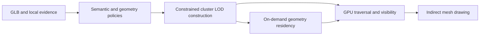

# Industrial Semantic LOD

Source code for semantic and structure-aware cluster LOD construction and GPU-driven rendering of industrial assemblies. Offline analysis combines supervised and open-vocabulary evidence with geometry; the Vulkan renderer performs hierarchy traversal, local LOD selection, visibility filtering and mesh-shader drawing.

[简体中文](README.zh-CN.md) · [Selected comparisons](docs/experiments/key-comparisons.md) · [Setup](docs/guides/end-to-end.md) · [Layout](docs/repository-layout.md)

## Selected comparisons

Only two rounded summaries from the 2026-11-04 version are published before the associated paper. These are internal evaluations, not external generalization claims.

| Comparison | Public summary |
| --- | --- |
| Supervised classification OA | PointNet++: approximately 94.6%; adapted PointNeXt branch: approximately 95.4% |
| On-demand vs. full geometry residency | Approximately 41–71% lower peak geometry-buffer allocation in the evaluated scenes |

Geometry allocation is not total GPU memory. These comparisons evaluate different modules and do not establish an equal-image-quality rendering speedup. Full tables, per-scene measurements, training records, figures, manuscript exports and weights are not distributed. See [scope and limitations](docs/experiments/key-comparisons.md).

## Implementation



The repository retains the renderer, shaders, neural inference wrappers, policy code and regression tests. The cluster DAG records cross-level geometry relationships; a spatial hierarchy accelerates runtime search. Experimental inputs and generated outputs stay outside the public tree.

## Build and view

Use Windows, Visual Studio 2022 C++ tools, CMake 3.22+, Git and a Vulkan SDK. Required GPU features are defined in [main.cpp](src/app/main.cpp). CUDA/PyTorch environments are separate requirements for neural inference.

```powershell
git clone https://github.com/13536309143/Industrial-Semantic-LOD.git t1
cd t1
cmake -S . -B build -G "Visual Studio 17 2022" -A x64
cmake --build build --config Release --parallel 3
.\scripts\windows\viewer.bat "path\to\scene.glb"
```

The build retrieves a pinned nvpro_core2 revision. In a checkout named `t1`, the renderer is `_bin/Release/t1.exe`. The viewer defaults to a 0.5 px error and semantic mode 6; prepare compatible policy CSV files beside the GLB. Set up local weights and environments using [the guide](docs/guides/end-to-end.md).

## Source layout

| Directory | Contents |
| --- | --- |
| `src/`, `shaders/` | Renderer, scene handling, cluster geometry, visibility and streaming |
| `cmake/`, `thirdparty/` | Build integration and vendor source |
| `tools/pointnext_lod/`, `tools/pointclipv2/` | Inference, fusion, policy tools and tests |
| `tools/feature_protection_tests/` | CPU geometry regression checks |
| `scripts/windows/` | Launchers and local data binding |
| `models/` | Inference interface metadata; weights stay local |
| `docs/` | Usage and the limited comparison summary |

## Checks

```powershell
python -s -m unittest discover -s tools\pointclipv2\tests -q
python -s -m unittest discover -s tools\pointnext_lod\tests -q
python -s tools\maintenance\check_publication.py --staged
```

Use the configured analysis environment for dependency tests. To enable the local publication checks for commits and pushes:

```powershell
git config core.hooksPath .githooks
```

[Publication boundaries](docs/publication-policy.md) describe what can be committed.

## Upstream foundations

[Vulkan Cluster LOD](https://github.com/nvpro-samples/vk_lod_clusters), [nvpro_core2](https://github.com/nvpro-samples/nvpro_core2), [meshoptimizer](https://github.com/zeux/meshoptimizer), [PointNeXt](https://github.com/guochengqian/PointNeXt) and [PointCLIP V2](https://github.com/yangyangyang127/PointCLIP_V2). Preserve upstream license notices in the corresponding source directories.
