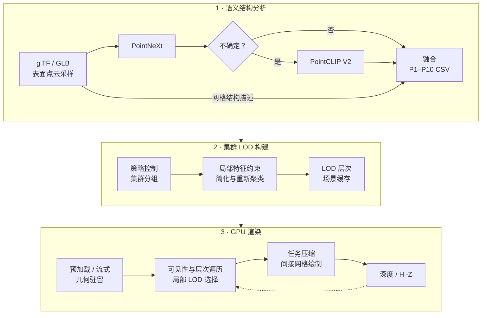

<div align="center">

# Industrial Semantic LOD

### 工业三维模型的语义结构感知集群 LOD 与 GPU 驱动渲染

**Semantic and Structure-Aware Cluster LOD for GPU-Driven Industrial Rendering**

[English](README.md) · [简体中文](README.zh-CN.md)


<sub>工业装配体图片来自提供的论文图片资料，为展示性示意图，并非本程序运行截图。</sub>

[项目概览](#项目概览) · [方法流程](#方法流程) · [已有实验](#已有实验) · [关键技术](#关键技术) · [完整流程](#完整使用流程) · [代码导航](#代码导航)

</div>

## 项目概览

工业装配场景中的重复紧固件、薄壁板件、传动零件、流体接口及精密细节具有不同的简化需求。本项目将**零部件级语义与几何分析**接入**局部集群 LOD 构建**，再通过 Vulkan 管线完成 GPU 层次遍历、可见性筛选与间接网格绘制。

离线分析融合 **14 类 PointNeXt 监督分类**、**不确定性门控的 PointCLIP V2 开放词汇推断**与**显式网格结构描述**，生成 P1–P10 策略，控制几何简化、局部特征保护、集群分组及运行时误差缩放。渲染端支持全量预加载和集群组级流式驻留；高精度数据暂不可用时，保留可访问的粗精度表示。

论文将语义结构分析框架称为 **ISPointNet**。当前实现的监督编码器为 `PointNextEncoder`，融合与策略映射通过确定性规则完成。项目将上述模块接入与 [NVIDIA Vulkan Cluster LOD 示例](https://github.com/nvpro-samples/vk_lod_clusters)及 [meshoptimizer](https://github.com/zeux/meshoptimizer) 相关的基础技术框架。

| 模块 | 当前实现 |
| :--- | :--- |
| 监督语义分析 | 工业零件分类及置信度、类别间隔提取 |
| 开放语义补充 | 对不确定零件进行 PointCLIP V2 多视图推断；对比配置另使用全量推断 |
| 结构感知策略 | 依据实际尺度、形态比例、紧致性与复杂度分配 P1–P10 |
| 局部几何约束 | 边界、锐边、近圆边界环、薄壁线索的重要度与顶点保护 |
| GPU 驱动渲染 | 层次遍历、局部 LOD 选择、子组压缩及间接网格绘制 |
| 可见性与驻留 | 装配预筛选、视锥/Hi-Z 判断、可选自适应双阶段剔除及流式加载 |

## 方法流程



默认门控在 PointNeXt 置信度低于 **0.70** 或 top1–top2 类别间隔低于 **0.08** 时触发开放分支。

**模型级策略与局部特征作用于不同尺度。** 前者规定零件整体的压缩与保护倾向，后者在集群组简化时引入加权属性与顶点保护。分组、简化和重新聚类逐层执行，并保留跨层生成关系，供运行时局部精度选择使用。

<p align="center">
  <br>
  <sub>结构保持图来自提供的图片资料，用于解释方法，并非定量实验的简化前后结果。</sub>
</p>

## 关键技术

论文主线由**离线语义结构感知集群 LOD 构建**与**在线 GPU 驱动光栅化及层次可见性**组成，以下模块将两部分衔接起来。

### 多源语义结构联合分析

ISPointNet 联合监督类别证据、门控开放词汇证据与显式网格描述。PointNeXt 给出工业已知类别及不确定性，PointCLIP V2 为歧义零件补充候选语义，几何分支描述尺度、形态比例与复杂度。融合角色进一步转为简化控制信息，而不是只用于显示分类标签。

### 多策略集群 LOD 构建

引擎支持六种证据配置，每种配置生成 **P1–P10 零件级策略**。较低保护倾向减少重复或微小几何，较高保护倾向为结构、运动及精密角色保留更多细节。策略共同控制目标保留率、层次衰减、集群组尺度、特征权重、硬保护预算及误差缩放。

在集群组内，特征属性加权与顶点保护指导简化；反复分组、简化和重新聚类产生粗集群，并保留生成组关系。模型级策略规定整体倾向，边界、锐边、近圆环和薄壁线索参与局部约束。[策略接入](src/scene/scene_semantic_lod.cpp) · [约束简化](src/meshlod/meshlod_simplify.h)

### GPU 层次搜索与局部精度选择

空间层次通过包围、可见性与投影误差缩小搜索范围，候选组再依据跨层生成关系和驻留状态选择集群。同一模型不同局部可采用不同精度；高精度生成组尚未加载时，可以保留可访问的粗候选。[遍历实现](shaders/traversal/traversal_run.comp.glsl)

### 多粒度可见性与自适应双阶段剔除

按**装配体 → 实例 → 空间节点 → 集群**筛选，结合真实导入的装配包围、视锥、屏幕尺寸和层次深度判断。具备适用层级的小投影装配可进入粗 LOD 路径。

第一阶段借助历史可见性筛选，用当前相机绘制。可选第二阶段由第一阶段深度构建中间 Hi-Z，重判候选并补绘新显露几何。自适应逻辑根据集群规模和视图投影矩阵变化决定是否执行额外阶段，但必须先启用双阶段开关。[装配筛选](shaders/traversal/assembly_visibility.comp.glsl) · [阶段调度](src/renderer/renderer_clusters_lod.cpp)

### 任务压缩与间接网格绘制

子组投票、局部前缀与批量原子申请把有效集群压缩成连续列表，GPU 生成间接参数决定网格工作组数量。网格着色器展开选中局部几何，经光栅化与片段着色生成图像，深度再反馈给 Hi-Z。[任务准备](shaders/build/build_setup.comp.glsl) · [网格着色器](shaders/render/clusters.mesh.glsl)

### 自动集群组流式传输与驻留管理

启用 `--streaming 1` 后，GPU 遍历识别缺失组并产生去重请求，CPU 在预算内调度准备与传输，再通过驻留更新发布地址。基础层次和最低细节保持可访问，等待细组时可以使用粗候选；动态组按访问年龄回收。

开启后，数据加载由运行时需求驱动，无需逐个零件手动上传。几何显存、每帧传输、驻留组容量及加载/卸载请求上限共同控制流程。可结合 Streaming memory 和 Profiler 观察场景工作集。[流式实现](src/streaming/streaming.cpp)

## 已有实验

当前监督编码器采用 `gpt` 中完成的双种子对比实验；默认部署 PointNeXt-S、seed=2027、第 98 轮权重，按验证集 Macro-F1 选择。[当前部署与复现说明](experiments/pointnext/encoder-compare-two-seeds-20261019/README.md) · [权重来源](models/pointnext/deployment.json)

下述五场景和六组策略统计属于旧模型的历史观察，原始输出已归档，不能作为新权重的场景结果。新场景推理、融合和 LOD 缓存需要重新生成。[历史数据来源与覆盖核验](docs/data/readme-evidence.json)

### 1. 工业零件分类

| 配置 | 测试 OA | 测试 mAcc | 测试 Macro-F1 |
| :--- | ---: | ---: | ---: |
| PointNet | 67.64±0.47 | 39.67±0.33 | 39.97±0.43 |
| PointNet++ | 94.63±0.23 | 91.04±0.58 | 91.26±0.46 |
| PointNeXt-S，stride=2 | **95.40±0.03** | **92.45±0.04** | **92.91±0.21** |
| PointNeXt，stride=4 | 94.80±0.13 | 91.52±0.21 | 91.70±0.48 |


**评估口径：** 单位为 %，训练 seed=2026、2027 的均值±样本标准差（n=2，ddof=1）。14 类、8,192 XYZ 点；训练/验证/测试为 53,654/11,517/11,542，使用相同分组划分，按验证 Macro-F1 选择各次最佳权重。两次重复共享测试集；这是已有数据来源上的内部留出评估，不是外部装配测试，也不宣称统计显著性。

默认部署选择 seed=2027：验证 Macro-F1 为 92.17%，高于 seed=2026 的 91.61%。该权重的单次测试 OA/mAcc/Macro-F1 为 95.43%/92.48%/93.06%；这些单次成绩与上表双种子均值应区分。旧 seed=3098、OA=96.19% 的开发评估仅作为[历史训练记录](experiments/pointnext/industrial-part-14class/README.md)保留。

### 2. 五个工业场景（旧模型历史统计）

| 场景 | Mesh 数 | 原始三角形数 | PointCLIP 候选记录数 | 候选占比 |
| :--- | ---: | ---: | ---: | ---: |
| `a` | 24,259 | 50,138,563 | 12,252 | 50.50% |
| `b` | 63,063 | 78,514,530 | 29,115 | 46.17% |
| `c` | 61,467 | 126,985,435 | 35,437 | 57.65% |
| `o1778` | 1,778 | 5,469,879 | 920 | 51.74% |
| `o3049` | 3,049 | 6,087,168 | 1,762 | 57.79% |
| **合计** | **153,616** | **267,195,575** | **79,486** | **51.74%** |

三角形数由 GLB 三角形 primitive 的 accessor 数量核验，表示输入文件几何规模，不是每帧实际提交量。这五个文件的 mesh 数与带 mesh 的 node 数相等。`a` 保留装配层级，另外四个场景节点结构平铺，其装配级筛选适用范围受限。[候选统计](analysis_reports/lod_pointnext_confidence_candidate_summary.csv)

### 3. 六组语义策略配置（旧模型历史统计）

**N** 表示 PointNeXt，**C** 表示 PointCLIP V2，**G** 表示显式几何结构证据。每种配置均覆盖五个场景的 153,616 条策略记录。

| 配置 | PointCLIP 覆盖 | P1–P3 | P8–P10 | `allow_cull` 输出占比 |
| :--- | ---: | ---: | ---: | ---: |
| N | 0.00% | 73.78% | 23.46% | 63.41% |
| C | 100.00% | 87.82% | <0.01% | 87.78% |
| N + G | 0.00% | 45.50% | 21.53% | 44.17% |
| C + G | 100.00% | 8.40% | 0.19% | 4.22% |
| N + C | 51.74% | 68.54% | 22.01% | 58.83% |
| **N + C + G · 默认** | **51.74%** | **46.27%** | **22.08%** | **42.59%** |


在 N 上加入 G，31.78% 的记录改变策略；加入候选开放分支 C，8.41% 的记录改变策略；从 N + C 到完整配置，30.82% 的记录改变策略。候选样本的平均 PointNeXt 置信度为 0.40–0.46，跳过开放分支的样本为 0.78–0.79。这些数据解释了策略变化及开放推理向不确定输入集中的现象。[汇总 CSV](analysis_reports/lod_ablation_aggregate_summary.csv) · [策略变化](analysis_reports/lod_pairwise_change_totals.csv) · [已有分析](analysis_reports/LOD_ALL_DATA_ANALYSIS_REPORT.md)

**结果解释：** P1–P3 表示较低保护，P8–P10 表示较高保护，P 编号不是实际几何 LOD 层号。保护分布更保守，不等于几何质量已经更好。六组配置使用不同融合规则与权重，全量和候选开放推断的提示词角色过滤也不同，因此更准确的表述是工程配置对比，而非严格控制变量的分支消融。`allow_cull` 当前属于策略输出元数据，GPU 可见性路径没有读取该位决定剔除，其占比不能当成实际剔除率。

### 实验覆盖情况

| 实验 | 当前可确认的证据 |
| :--- | :--- |
| 14 类监督编码器比较 | 四种配置×两个 seed；完整指标、历史、逐类结果与配置已导入 |
| 当前默认 PointNeXt-S 部署 | seed=2027、epoch=98；严格参数加载与 8,192 点 GPU 前向检查通过 |
| 新权重场景推理与融合 | 待重新运行批处理；旧场景输出已归档 |
| 历史五场景与六组策略比较 | 旧模型的 30 个策略 CSV、分布与策略变化汇总，不能标作新模型结果 |
| GPU 耗时、几何质量与流式权衡 | 已有实现与统计设施；本次未找到完整的受控基准结果集 |

详细代码分析、论文对应关系及实验边界见 [项目审查报告](analysis_reports/PROJECT_REVIEW_20261014.md)。

## 完整使用流程

按 **环境配置 → 标注数据与监督训练 → 多源场景分析 → LOD 预处理 → 渲染** 执行。工业分类器按类别体系训练一次，新场景复用最佳检查点；PointCLIP V2 使用预训练 CLIP。[完整中文教程](docs/guides/end-to-end.zh-CN.md) · [Detailed English guide](docs/guides/end-to-end.md)

### 1. 配置环境

| 部分 | 软件与硬件要求 |
| :--- | :--- |
| PointNeXt | Python 3.10、PyTorch 2.2.0 / torchvision 0.17.0、CUDA 12.1、NumPy 1.26.4、OpenPoints CUDA 扩展 |
| PointCLIP V2 | 独立 CUDA 环境、预训练 CLIP ViT-B/16 |
| 扩展编译 | 带 `nvcc` 的 CUDA Toolkit、Visual Studio C++ Build Tools |
| 渲染器 | C++20、Visual Studio 2022、CMake 3.22+、Git、Vulkan SDK 1.4.309.0+ |

GPU/驱动还需满足 [main.cpp](src/app/main.cpp) 请求的 EXT mesh shader、atomic、clock 和 shading-rate 等功能。离线推理用 CUDA，在线渲染用 Vulkan。

以下命令使用 **Anaconda Prompt / cmd.exe**，请按实际 checkout 修改路径：

```bat
set PROJECT_ROOT=E:\vk_lod_clusters1\t1
cd /d "%PROJECT_ROOT%"
conda env create -f tools\pointnext_lod\environment_pointnext.yml
conda env create -f tools\pointclipv2\environment_pointclipv2.yml
conda activate gpt-pointnext
python -c "import torch,numpy; print(torch.__version__,torch.version.cuda,numpy.__version__,torch.cuda.is_available())"
```

已有可用环境直接激活。在 Visual Studio Native Tools 命令行中准备 Conda，编译 PointNeXt 扩展：

```bat
conda activate gpt-pointnext
set CUDA_HOME=C:\Program Files\NVIDIA GPU Computing Toolkit\CUDA\v12.1
set PATH=%CUDA_HOME%\bin;%PATH%
cd /d "%PROJECT_ROOT%\tools\pointnext_lod\PointNeXt\openpoints\cpp\pointnet2_batch"
python -m pip install . --no-build-isolation
cd /d "%PROJECT_ROOT%"
python -c "import sys; sys.path.insert(0,r'tools/pointnext_lod/PointNeXt'); from openpoints.cpp.pointnet2_batch import pointnet2_cuda; print('CUDA extension OK')"
```

Conda CUDA runtime 不代替编译工具包。切换终端后需重新设置 `PROJECT_ROOT` 并激活环境。现有本地扩展保留，新机器应编译匹配自身环境的二进制。[详细环境与排错](docs/guides/end-to-end.zh-CN.md#1-环境准备)

### 2. 准备标注点云与场景模型

```text
datasets/industrial_part_14class/      # 带标签训练/评估数据
  classes.txt                        # 0–13，固定类别顺序，TAB 分隔
  train_list.txt
  val_list.txt
  test_list.txt
  screws_bolts_studs/part_0001.npy     # 归一化 XYZ 点云 [N,3]
_downloaded_resources/
  your_scene.glb                     # 待分析和渲染的无标签场景
```

对零件表面做面积加权采样，并按推理方式居中、缩放到单位球；配置使用 **8,192 XYZ 点**。列表行格式为 `相对路径.npy<TAB>类别编号<TAB>类别名`，使用真实制表符。类别编号与 [14 类目录](tools/pointnext_lod/industrial_part_14classes.txt) 一致，先按原始零件/家族划分，再生成采样和旋转副本。

仓库提供数据适配器，没有原始 CAD 数据转换器，训练 `.npy` 需单独准备。场景分析输入为 **GLB 2.0、可读取的 POSITION、三角形列表 primitive**，统一单位并保持 mesh/node ID 稳定。STEP/IGES 先导出三角网格 GLB；C++ 渲染器另接受 `.gltf` 和场景 `.cfg`，根目录批处理扫描 `.glb`。[详细输入约定](docs/guides/end-to-end.zh-CN.md#2-准备工业分类数据)

### 3. 训练 PointNeXt 并选择最佳检查点

**训练使用兼容的外部完整 PointNeXt 工程。** 本仓库含推理模块和工业配置，没有 `examples/classification/main.py`。先按 [训练工程配置](docs/guides/end-to-end.zh-CN.md#3-准备完整训练工程) 准备完整源码，复制工业适配器/配置并注册 `IndustrialPartPointCloud`。记录外部提交；历史训练入口未随本仓库提供。

准备好后在外部工程执行：

```bat
conda activate gpt-pointnext
set TRAINING_ROOT=D:\PointNeXt-training
cd /d "%TRAINING_ROOT%"
set CUDA_VISIBLE_DEVICES=0
python examples/classification/main.py --cfg cfgs/industrial_part/pointnext-s-14class-randomrot-8192-fast.yaml ^
  dataset.common.data_dir="%PROJECT_ROOT%\datasets\industrial_part_14class" ^
  dataset.val.list_file=val_list.txt dataset.test.list_file=test_list.txt ^
  root_dir="%PROJECT_ROOT%\.artifacts\training\pointnext" seed=3098
```

工业配置为 14 类、100 轮、AdamW、余弦调度、随机旋转、标签平滑及 AMP。显式列表覆盖可使用独立验证/测试集，历史运行仍是共享划分。这里说明外部入口的使用接口，不代表本次已重新训练。

从真实 run 目录选定 best，复制到：

```text
models/pointnext/industrial-part-14class-best.pth
```

检查点需匹配编码器、分类头与 14 类顺序，通用 ModelNet40 权重不能直接代替。可用 `POINTNEXT_CKPT` 指定其他兼容文件的绝对路径。best 放 `models/`，latest 和 TensorBoard 放 `.artifacts/`。已有兼容 best 时可直接复用，无需为每个 GLB 重训。

### 4. 多源语义结构分析

仓库根目录：

```bat
cd /d "%PROJECT_ROOT%"
set POINTNEXT_CONDA_ENV=gpt-pointnext
set POINTCLIP_CONDA_ENV=PointCLIPV2_LOD
run_all_glb_pointnext_pointclipv2_fused.bat
```

批处理自动切换环境，依次执行：

1. 全量 PointNeXt 分类与几何提取 → `<scene>_pointnext_analysis.csv`。
2. 不确定性门控 PointCLIP V2 → `<scene>_pointclipv2_candidates.csv`。
3. 语义结构融合 → `<scene>_lod_constraints_fused.csv` 与汇总 JSON。

产物放在 `lod_analysis_outputs/`。首次 CLIP ViT-B/16 加载可能下载权重。已有神经 CSV 会跳过，场景、检查点、类别或提示词变化后需归档并整套重做。

对已有五个命名场景生成六组配置比较：

```bat
conda activate PointCLIPV2_LOD
tools\pointclipv2\run_pointclipv2_full_5_glbs.bat
tools\pointclipv2\run_lod_ablation_5_glbs.bat
```

先生成 full，否则批处理会回退 candidate。full 供比较配置使用，默认融合仍使用候选开放分支。

### 5. 编译引擎并构建集群 LOD

```bat
cd /d "%PROJECT_ROOT%"
cmake -S . -B build -G "Visual Studio 17 2022" -A x64
cmake --build build --config Release
_bin\Release\t1.exe --scene "_downloaded_resources\your_scene.glb" ^
  --semanticlodmode 5 --processingonly 1 --autoloadcache 0 --processingpartial 1
```

将 `your_scene` 换成实际模型名。当前 `t1` 目录程序为 **`_bin/Release/t1.exe`**，target 名随源码目录变化。`nvpro_core2` 从本地查找或获取固定提交 `03297bee1f997208951cc104abb5ecc3e1f987ed`；只用本地依赖时设置 `-DNVPROCORE2_DOWNLOAD=OFF` 并提供可访问副本。

引擎预处理消费语义策略，构建约束集群 LOD，并保存 `.glb.zippp`。**语义分析生成策略 CSV，引擎预处理才生成可渲染 LOD 缓存。** `--processingpartial 1` 支持部分处理与续跑。

### 6. 打开场景并启用运行时技术

```bat
_bin\Release\t1.exe --scene "_downloaded_resources\your_scene.glb" --semanticlodmode 5

rem 自动集群组流式传输，使用示例预算
_bin\Release\t1.exe --scene "_downloaded_resources\your_scene.glb" ^
  --semanticlodmode 5 --streaming 1 --maxgeomegabytes 2048 --maxtransfermegabytes 64

rem 流式传输与自适应双阶段剔除
_bin\Release\t1.exe --scene "_downloaded_resources\your_scene.glb" ^
  --semanticlodmode 5 --streaming 1 --culling 1 ^
  --twopassculling 1 --adaptivetwopassculling 1
```

上述预算是示例起点，并非实测推荐。自适应开关需要双阶段与剔除开关同时启用；固定双阶段使用 `--twopassculling 1 --adaptivetwopassculling 0`。

| `--semanticlodmode` | 配置 |
| ---: | :--- |
| 0 | PointNeXt |
| 1 | PointCLIP V2 |
| 2 | PointNeXt + structure |
| 3 | PointCLIP V2 + structure |
| 4 | PointNeXt + PointCLIP V2 |
| **5** | **PointNeXt + PointCLIP V2 + structure** |

0 不是关闭语义。加载器先找所选配置，再回退 fused/普通 CSV，比较模式时需检查实际文件路径。策略哈希参与缓存兼容性，不同实验可使用不同 `--cachesuffix`。

UI 查看 Semantic LOD Policy Distribution、语义策略可视化、Statistics、Streaming memory 和 Profiler。`--loderror` 控制显示精度，特征与装配参数见下文及 [参数注册](src/app/lodclusters_config.cpp)。

## 代码导航

```text
src/
  app/           应用入口、参数、UI 与帧调度
  scene/         glTF 导入、语义策略、集群 LOD 与压缩
  meshlod/       分组、特征约束、简化与层次构建
  renderer/      Vulkan 资源、Hi-Z、预加载与集群渲染器
  streaming/     集群组驻留、请求处理与传输
  core/          序列化与缓存支持
shaders/
  traversal/     装配可见性、层次遍历与局部选择
  render/        网格与片段着色器
  streaming/     驻留更新与访问年龄筛选
  post/          Hi-Z 构建与背景绘制
  interface/     CPU/GPU 共享结构
tools/
  pointnext_lod/ PointNeXt 推断与语义结构策略映射
  pointclipv2/   开放词汇推断、融合与对比配置生成
analysis_reports/  已有实验汇总与技术分析
experiments/       精选训练日志与运行配置
models/            本地推理权重（忽略）与模型说明
docs/              教程、方法、README 图片与证据元数据
```

| 入口文件 | 阅读目的 |
| :--- | :--- |
| [main.cpp](src/app/main.cpp) | Vulkan 功能要求与应用启动 |
| [scene_semantic_lod.cpp](src/scene/scene_semantic_lod.cpp) | CSV 搜索、策略派生及参数映射 |
| [clusterlod.cpp](src/scene/clusterlod.cpp) | 策略注入与集群层次构建 |
| [meshlod_simplify.h](src/meshlod/meshlod_simplify.h) | 局部特征分析与约束简化 |
| [renderer_clusters_lod.cpp](src/renderer/renderer_clusters_lod.cpp) | GPU 阶段、同步与自适应双阶段判定 |
| [assembly_visibility.comp.glsl](shaders/traversal/assembly_visibility.comp.glsl) | 装配级屏幕空间与 Hi-Z 筛选 |
| [traversal_run.comp.glsl](shaders/traversal/traversal_run.comp.glsl) | GPU 层次任务处理 |
| [build_lod_constraints_from_analysis.py](tools/pointnext_lod/build_lod_constraints_from_analysis.py) | 结构角色融合及 P1–P10 生成 |

常用控制参数包括 `--loderror`、`--featureconstraints`、`--featureimportanceweight`、`--assemblymininstances`、`--assemblylodpixels`、`--maxgeomegabytes` 和 `--maxtransfermegabytes`。当前支持的名称以 [参数注册代码](src/app/lodclusters_config.cpp) 为准。

## 文档与基础工作

- [English README](README.md)
- [从训练到渲染的完整教程](docs/guides/end-to-end.zh-CN.md)
- [仓库目录与产物约定](docs/repository-layout.md)
- [代码与实验审查报告](analysis_reports/PROJECT_REVIEW_20261014.md)
- [语义分析完整流程](docs/guides/end-to-end.zh-CN.md)
- [语义 LOD 技术分析](docs/methods/semantic-lod-analysis.zh-CN.md)
- [六组策略实验设计](docs/experiments/policy-comparison-design.zh-CN.md)
- [五场景已有策略分析](analysis_reports/LOD_ALL_DATA_ANALYSIS_REPORT.md)
- [展示图片来源](docs/assets/README.md)

本项目使用并适配了既有图形学与点云分析组件。基础方法与上游许可参见 [Vulkan Cluster LOD](https://github.com/nvpro-samples/vk_lod_clusters)、[nvpro_core2](https://github.com/nvpro-samples/nvpro_core2)、[meshoptimizer](https://github.com/zeux/meshoptimizer)、[PointNeXt](https://github.com/guochengqian/PointNeXt) 和 [PointCLIP V2](https://github.com/yangyangyang127/PointCLIP_V2)。工业语义策略集成与运行时扩展的作用，应通过独立实验与基础能力区分。

**资料可用性：** 数据集、场景、权重、逐网格输出与训练运行产物保留在本地并由 Git 忽略；精选依据保留在 `experiments/`、`analysis_reports/` 和 `docs/data/`。推理前需要提供兼容训练权重，目录约定见 [仓库说明](docs/repository-layout.md)。本次未发现仓库级许可证文件，复用时应核对各组件许可证。
