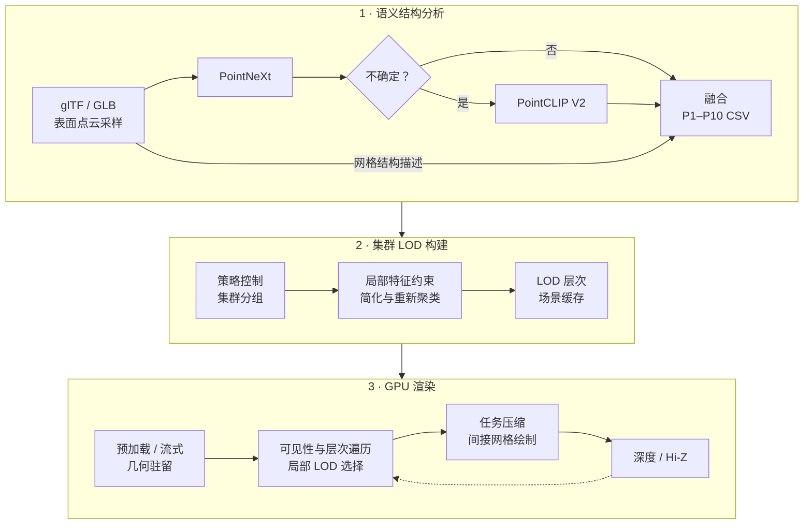

<div align="center">

# Industrial Semantic LOD

### 工业三维模型的语义结构感知集群 LOD 与 GPU 驱动渲染

**Semantic and Structure-Aware Cluster LOD for GPU-Driven Industrial Rendering**

[English](README.md) · [简体中文](README.zh-CN.md)


<sub>工业装配体图片来自提供的论文图片资料，为展示性示意图，并非本程序运行截图。</sub>

[项目概览](#项目概览) · [方法流程](#方法流程) · [已有实验](#已有实验) · [构建与运行](#构建与运行) · [语义分析流程](#语义分析流程) · [代码导航](#代码导航)

</div>

## 项目概览

工业装配场景中的重复紧固件、薄壁板件、传动零件、流体接口及精密细节具有不同的简化需求。本项目将**零部件级语义与几何分析**接入**局部集群 LOD 构建**，再通过 Vulkan 管线完成 GPU 层次遍历、可见性筛选与间接网格绘制。

离线分析融合 **14 类 PointNeXt 监督分类**、**不确定性门控的 PointCLIP V2 开放词汇推断**与**显式网格结构描述**，生成 P1–P10 策略，控制几何简化、局部特征保护、集群分组及运行时误差缩放。渲染端支持全量预加载和集群组级流式驻留；高精度数据暂不可用时，保留可访问的粗精度表示。

论文将语义结构分析框架称为 **ISPointNet**。当前实现的监督编码器为 `PointNextEncoder`，融合与策略映射通过确定性规则完成。项目将上述模块接入与 [NVIDIA Vulkan Cluster LOD 示例](https://github.com/nvpro-samples/vk_lod_clusters)及 [meshoptimizer](https://github.com/zeux/meshoptimizer) 相关的基础技术框架。

| 模块 | 当前实现 |
| :--- | :--- |
| 监督语义分析 | 工业零件分类及置信度、类别间隔提取 |
| 开放语义补充 | 对不确定零件进行 PointCLIP V2 多视图推断；对比配置另使用全量推断 |
| 结构感知策略 | 依据实际尺度、形态比例、紧致性与复杂度分配 P1–P10 |
| 局部几何约束 | 边界、锐边、近圆边界环、薄壁线索的重要度与顶点保护 |
| GPU 驱动渲染 | 层次遍历、局部 LOD 选择、子组压缩及间接网格绘制 |
| 可见性与驻留 | 装配预筛选、视锥/Hi-Z 判断、可选自适应双阶段剔除及流式加载 |

## 方法流程



默认门控在 PointNeXt 置信度低于 **0.70** 或 top1–top2 类别间隔低于 **0.08** 时触发开放分支。

**模型级策略与局部特征作用于不同尺度。** 前者规定零件整体的压缩与保护倾向，后者在集群组简化时引入加权属性与顶点保护。分组、简化和重新聚类逐层执行，并保留跨层生成关系，供运行时局部精度选择使用。

<p align="center">
  <br>
  <sub>结构保持图来自提供的图片资料，用于解释方法，并非定量实验的简化前后结果。</sub>
</p>

## 已有实验

以下内容来自已有训练日志和策略输出。本次文档整理逐份核验了 **30 个场景/配置策略 CSV** 与汇总统计，没有重新训练模型或新增渲染性能基准。[数据来源与覆盖核验](docs/data/readme-evidence.json)

### 1. 工业零件分类

| 配置 / 指标 | 已记录数值 |
| :--- | ---: |
| 类别数 / 每样本点数 | 14 / 8,192 |
| 训练 / 评估样本数 | 61,711 / 15,372 |
| 训练轮数 / 本次运行种子 | 100 / 3098 |
| 日志最佳评估 OA | **96.19%** |
| 重新加载最佳检查点后的 mAcc | **93.86%** |
| 最佳检查点轮次 | 85 |


**评估口径：** 当前验证与测试均使用 `test` 划分，数据集也将 `val` 映射到 `test`。因此这些数值是开发过程中已经记录的评估结果，不能当作独立留出测试成绩。OA 为总体准确率，mAcc 为类别平均准确率。曲线仅在每五轮实际评估的位置展示评估值。

重新加载最佳检查点后，螺钉/螺栓/螺柱类准确率为 98.99%，管件/阀门/喷嘴类为 76.21%，说明总体准确率之外仍需关注类别差异。[训练日志](tools/pointnext_lod/PointNeXt/log/industrial_part/industrial_part-train-pointnext-s-14class/log.txt) · [训练配置](tools/pointnext_lod/PointNeXt/cfgs/industrial_part/pointnext-s-14class-randomrot-8192-fast.yaml) · [数据集实现](tools/pointnext_lod/PointNeXt/openpoints/dataset/industrial_part.py)

### 2. 五个工业场景

| 场景 | Mesh 数 | 原始三角形数 | PointCLIP 候选记录数 | 候选占比 |
| :--- | ---: | ---: | ---: | ---: |
| `a` | 24,259 | 50,138,563 | 12,252 | 50.50% |
| `b` | 63,063 | 78,514,530 | 29,115 | 46.17% |
| `c` | 61,467 | 126,985,435 | 35,437 | 57.65% |
| `o1778` | 1,778 | 5,469,879 | 920 | 51.74% |
| `o3049` | 3,049 | 6,087,168 | 1,762 | 57.79% |
| **合计** | **153,616** | **267,195,575** | **79,486** | **51.74%** |

三角形数由 GLB 三角形 primitive 的 accessor 数量核验，表示输入文件几何规模，不是每帧实际提交量。这五个文件的 mesh 数与带 mesh 的 node 数相等。`a` 保留装配层级，另外四个场景节点结构平铺，其装配级筛选适用范围受限。[候选统计](analysis_reports/lod_pointnext_confidence_candidate_summary.csv)

### 3. 六组语义策略配置

**N** 表示 PointNeXt，**C** 表示 PointCLIP V2，**G** 表示显式几何结构证据。每种配置均覆盖五个场景的 153,616 条策略记录。

| 配置 | PointCLIP 覆盖 | P1–P3 | P8–P10 | `allow_cull` 输出占比 |
| :--- | ---: | ---: | ---: | ---: |
| N | 0.00% | 73.78% | 23.46% | 63.41% |
| C | 100.00% | 87.82% | <0.01% | 87.78% |
| N + G | 0.00% | 45.50% | 21.53% | 44.17% |
| C + G | 100.00% | 8.40% | 0.19% | 4.22% |
| N + C | 51.74% | 68.54% | 22.01% | 58.83% |
| **N + C + G · 默认** | **51.74%** | **46.27%** | **22.08%** | **42.59%** |


在 N 上加入 G，31.78% 的记录改变策略；加入候选开放分支 C，8.41% 的记录改变策略；从 N + C 到完整配置，30.82% 的记录改变策略。候选样本的平均 PointNeXt 置信度为 0.40–0.46，跳过开放分支的样本为 0.78–0.79。这些数据解释了策略变化及开放推理向不确定输入集中的现象。[汇总 CSV](analysis_reports/lod_ablation_aggregate_summary.csv) · [策略变化](analysis_reports/lod_pairwise_change_totals.csv) · [已有分析](analysis_reports/LOD_ALL_DATA_ANALYSIS_REPORT.md)

**结果解释：** P1–P3 表示较低保护，P8–P10 表示较高保护，P 编号不是实际几何 LOD 层号。保护分布更保守，不等于几何质量已经更好。六组配置使用不同融合规则与权重，全量和候选开放推断的提示词角色过滤也不同，因此更准确的表述是工程配置对比，而非严格控制变量的分支消融。`allow_cull` 当前属于策略输出元数据，GPU 可见性路径没有读取该位决定剔除，其占比不能当成实际剔除率。

### 实验覆盖情况

| 实验 | 当前可确认的证据 |
| :--- | :--- |
| 14 类 PointNeXt 训练 | 完整运行日志、逐类结果、配置与检查点 |
| 五场景 PointNeXt、候选及全量 PointCLIP 推断 | 五个场景均有输出 |
| 六组策略配置比较 | 30 个完整策略 CSV、分布与策略变化汇总 |
| GPU 耗时、几何质量与流式权衡 | 已有实现与统计设施；本次未找到完整的受控基准结果集 |
| PointNet / PointNet++ 分类对比 | 已有配置，未找到已完成的对比结果 |

详细代码分析、论文对应关系及实验边界见 [项目审查报告](analysis_reports/PROJECT_REVIEW_20261014.md)。

## 构建与运行

### 环境要求

- Windows 与 C++20 编译器；现有本地构建使用 Visual Studio 2022。
- CMake **3.22+**、Git、Vulkan SDK **1.4.309.0+**。
- GPU/驱动满足 [main.cpp](src/app/main.cpp) 注册的设备功能，包括 EXT mesh shader、shader clock、float atomic、fragment shading rate 和 64 位 image atomic。入口也请求了 NV 专属功能，设备兼容性以实际初始化为准。
- `nvpro_core2`、meshoptimizer、cgltf。找不到本地依赖时，默认获取 `nvpro_core2` 固定提交 `03297bee1f997208951cc104abb5ecc3e1f987ed`。

### 编译

在仓库根目录执行：

```powershell
cmake -S . -B build -G "Visual Studio 17 2022" -A x64
cmake --build build --config Release
```

CMake 使用源码目录名作为 target 名。当前 `t1` 工作区实际生成的 Release 程序位于 **`_bin/Release/t1.exe`**。若改名后重新配置源码目录，生成目标名也随之改变。

```powershell
# 打开模型
.\_bin\Release\t1.exe --scene "path\to\model.glb"

# 预处理并生成缓存
.\_bin\Release\t1.exe --scene "path\to\model.glb" --processingonly 1

# 启用集群组流式加载
.\_bin\Release\t1.exe --scene "path\to\model.glb" --streaming 1

# 启用自适应双阶段剔除
.\_bin\Release\t1.exe --scene "path\to\model.glb" --culling 1 --twopassculling 1 --adaptivetwopassculling 1
```

自适应逻辑必须在 `twopassculling` 已启用时才能生效。判定依据为场景集群规模与前后视图投影矩阵变化；仅启用 `adaptivetwopassculling` 不会激活第二阶段。

本地依赖可放在项目目录、上一级、上两级或 `build/_deps` 下的 `nvpro_core2`。`-DNVPROCORE2_DOWNLOAD=OFF` 关闭自动下载，但仍需要能找到本地依赖。

## 语义分析流程

渲染程序与离线神经推理使用独立依赖。执行语义脚本前，需要准备输入 GLB、兼容的 PointNeXt 检查点、OpenPoints CUDA 扩展，以及 PointCLIP V2/CLIP 环境。

在仓库根目录打开 **Anaconda Prompt / cmd.exe**：

```bat
rem 输入模型放在 _downloaded_resources\*.glb
rem 可按自己的环境名称覆盖以下默认值
set POINTNEXT_CONDA_ENV=gpt-pointnext
set POINTCLIP_CONDA_ENV=PointCLIPV2_LOD
run_all_glb_pointnext_pointclipv2_fused.bat
```

根目录批处理按顺序完成全量 PointNeXt 分析、门控 PointCLIP 推断及策略融合。默认检查点路径为：

```text
tools/pointnext_lod/PointNeXt/log/industrial_part/
  industrial_part-train-pointnext-s-14class/checkpoint/
    industrial_part-train-pointnext-s-14class_ckpt_best.pth
```

每个 `<scene>` 输出：

```text
lod_analysis_outputs/
  <scene>_pointnext_analysis.csv
  <scene>_pointclipv2_candidates.csv
  <scene>_pointnext_pointclip_merged.csv
  <scene>_lod_constraints_fused.csv
  <scene>_lod_constraints_fused_summary.json
```

根目录批处理会跳过已有神经推理输出。若输入模型、检查点或提示词变化，应先归档或重新生成对应结果，再解释新一轮实验。

已有五场景对比需要先完成候选推断，再执行：

```bat
conda activate PointCLIPV2_LOD
tools\pointclipv2\run_pointclipv2_full_5_glbs.bat
tools\pointclipv2\run_lod_ablation_5_glbs.bat
```

应先生成 full PointCLIP 文件：对比批处理在 full 文件缺失时会回退到候选文件。UI 中通过 **Semantic LOD Strategy** 切换，也可以使用 `--semanticlodmode`：

| 参数值 | 配置 |
| ---: | :--- |
| 0 | PointNeXt |
| 1 | PointCLIP V2 |
| 2 | PointNeXt + structure |
| 3 | PointCLIP V2 + structure |
| 4 | PointNeXt + PointCLIP V2 |
| **5** | **PointNeXt + PointCLIP V2 + structure** |

**0 表示 PointNeXt 策略，不是关闭语义。** 加载器先搜索所选配置的 CSV，再搜索 fused CSV，最后搜索普通 constraints CSV。对比实验必须检查日志中的实际 CSV 路径。语义策略哈希参与缓存兼容性检查；需要显式重建时，可用 `--processingonly 1 --autoloadcache 0`，不同实验可使用不同 `--cachesuffix` 保留各自缓存。

## 代码导航

```text
src/
  app/           应用入口、参数、UI 与帧调度
  scene/         glTF 导入、语义策略、集群 LOD 与压缩
  meshlod/       分组、特征约束、简化与层次构建
  renderer/      Vulkan 资源、Hi-Z、预加载与集群渲染器
  streaming/     集群组驻留、请求处理与传输
  core/          序列化与缓存支持
shaders/
  traversal/     装配可见性、层次遍历与局部选择
  render/        网格与片段着色器
  streaming/     驻留更新与访问年龄筛选
  post/          Hi-Z 构建与背景绘制
  interface/     CPU/GPU 共享结构
tools/
  pointnext_lod/ PointNeXt 推断与语义结构策略映射
  pointclipv2/   开放词汇推断、融合与对比配置生成
analysis_reports/  已有实验汇总与技术分析
docs/              README 图片与证据元数据
```

| 入口文件 | 阅读目的 |
| :--- | :--- |
| [main.cpp](src/app/main.cpp) | Vulkan 功能要求与应用启动 |
| [scene_semantic_lod.cpp](src/scene/scene_semantic_lod.cpp) | CSV 搜索、策略派生及参数映射 |
| [clusterlod.cpp](src/scene/clusterlod.cpp) | 策略注入与集群层次构建 |
| [meshlod_simplify.h](src/meshlod/meshlod_simplify.h) | 局部特征分析与约束简化 |
| [renderer_clusters_lod.cpp](src/renderer/renderer_clusters_lod.cpp) | GPU 阶段、同步与自适应双阶段判定 |
| [assembly_visibility.comp.glsl](shaders/traversal/assembly_visibility.comp.glsl) | 装配级屏幕空间与 Hi-Z 筛选 |
| [traversal_run.comp.glsl](shaders/traversal/traversal_run.comp.glsl) | GPU 层次任务处理 |
| [build_lod_constraints_from_analysis.py](tools/pointnext_lod/build_lod_constraints_from_analysis.py) | 结构角色融合及 P1–P10 生成 |

常用控制参数包括 `--loderror`、`--featureconstraints`、`--featureimportanceweight`、`--assemblymininstances`、`--assemblylodpixels`、`--maxgeomegabytes` 和 `--maxtransfermegabytes`。当前支持的名称以 [参数注册代码](src/app/lodclusters_config.cpp) 为准。

## 文档与基础工作

- [English README](README.md)
- [代码与实验审查报告](analysis_reports/PROJECT_REVIEW_20261014.md)
- [语义分析完整流程](POINTNEXT_POINTCLIPV2_SEMANTIC_LOD_FULL_WORKFLOW.md)
- [语义 LOD 技术分析](SEMANTIC_LOD_STRATEGY_TECHNICAL_ANALYSIS.md)
- [六组策略实验设计](LOD_ABLATION_EXPERIMENT_DESIGN.md)
- [五场景已有策略分析](analysis_reports/LOD_ALL_DATA_ANALYSIS_REPORT.md)
- [展示图片来源](docs/assets/README.md)

本项目使用并适配了既有图形学与点云分析组件。基础方法与上游许可参见 [Vulkan Cluster LOD](https://github.com/nvpro-samples/vk_lod_clusters)、[nvpro_core2](https://github.com/nvpro-samples/nvpro_core2)、[meshoptimizer](https://github.com/zeux/meshoptimizer)、[PointNeXt](https://github.com/guochengqian/PointNeXt) 和 [PointCLIP V2](https://github.com/yangyangyang127/PointCLIP_V2)。工业语义策略集成与运行时扩展的作用，应通过独立实验与基础能力区分。

**资料可用性：** `_downloaded_resources/` 和 `lod_analysis_outputs/` 被 Git 忽略，README 展示精简结果与来源，不代表本地完整场景数据及逐网格输出已公开。推理前请检查实际 checkout 中的检查点文件。本次未发现仓库级许可证文件，复用时应核对各组件许可证。
