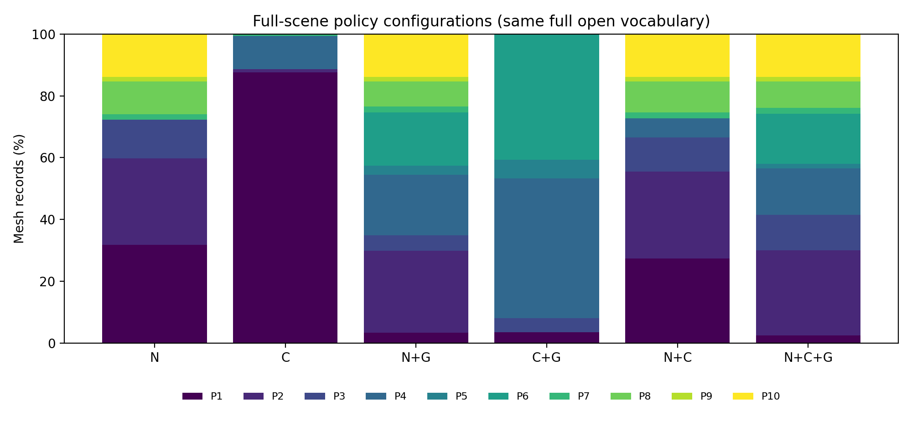
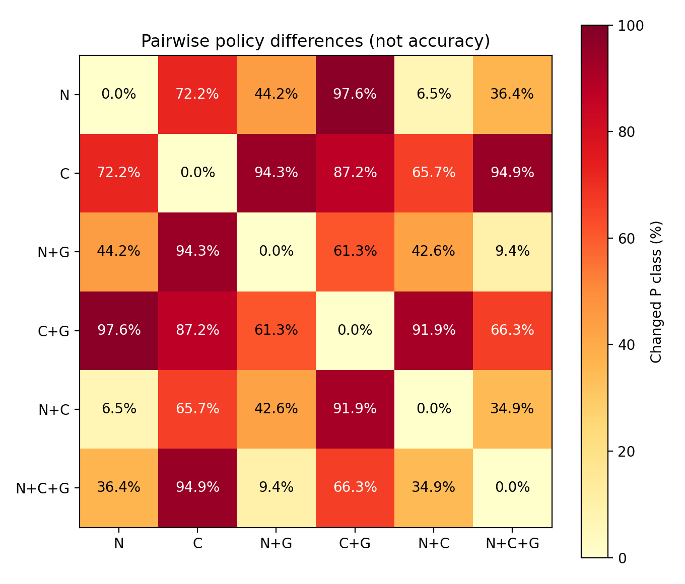

# a.glb 全量语义与结构分析、六种策略配置比较

日期：2026-10-19。当前文件哈希：`3fcbd0e5d17cf911fbb2ad3cfc82be37e819d2d4e9cda23fb4f1e826f37c2621`。监督权重为 PointNeXt-S、seed=2027、epoch=98，SHA256：`238ed37c8af354ea5bb6532f371ef6003d8fb43e0d6124f44363c55b66ea0493`。

核心观察：在当前规则下，结构组合显著改变策略分布，而开放证据的有效利用率有限；完整融合并未在所有保护分配指标上优于其他配置。本次结果支持流程覆盖与策略行为分析，尚不构成融合准确率或最终几何质量的优越性证明。

## 1. 完成范围与输入身份

本次已实际执行全量监督推理、全量 PointCLIP、门控 PointCLIP、结构规则分析、全量多源融合、门控多源融合，以及六种策略配置。没有把历史 CSV 当作本次结果。

当前 a.glb 为 149,487,228 字节、1,778 个带网格节点、1,778 个 mesh，源三角形约 5,469,879 个；含 children 的父节点数为 0。它不是旧汇报中 24,259 个 mesh 的 a。文件名不足以确定场景身份，应按哈希核对。

覆盖核验：监督 1778/1778、全量开放 1778/1778；门控开放 1136 条，恰好等于监督结果的候选集合。各 CSV 的 order/node_index/mesh_index 联合键唯一，六组输出与源记录一一对应，未发现漏行或重复覆盖。

完整原始记录位于 `E:\vk_lod_clusters1\t1\lod_analysis_outputs\a_seed2027_20261019`；本目录只保存汇总、配图和逐网格复核表。

## 2. 监督分支与真实场景门控

监督平均置信度 **57.73%**，中位数 **57.44%**。满足 confidence≥0.70 且 top1-top2≥0.08 的记录为 **642 条（36.11%）**；候选为 **1136 条（63.89%）**。

这些是置信度与覆盖率，没有人工真实类别，不能解释为场景准确率或错误率。当前阈值下，top1≥0.70 已蕴含间隔至少 0.40，因此 0.08 的间隔阈值不会额外排除这部分记录。不能凭本次统计证明两个门控条件各自都有贡献。

## 3. 开放语义与结构分析

PointCLIP 使用 ViT-B/16、8,192 个采样点、10 个投影视图、top-5。全量开放包含 110 个提示词标签；生产门控配置排除 micro_uncertain 角色，包含 106 个标签。开放 softmax 分数受词表竞争影响，不能与监督置信度当成同一尺度的准确率比较。

全量开放的首选角色分布如下，统计的是模型选择，不是真实角色：

| 首选角色 | 记录数 | 占比 |
|---|---:|---:|
| ordinary_low_detail | 609 | 34.25% |
| micro_uncertain | 603 | 33.91% |
| repeated_fastener | 527 | 29.64% |
| interface_fluid | 20 | 1.12% |
| large_static_bulk | 19 | 1.07% |

开放分支的 top1 平均分数为 0.0581，top1–top2 平均间隔为 0.0135。按当前已有质量规则，只有 **265 条（14.90%）**形成可用角色证据；其中排除 micro_uncertain 后可用于完整融合的为 **222 条（12.49%）**。其余 **1513 条**被规则拒绝或判为弱证据。纯 C 的 P1 很多，既受到原始角色预测影响，也受到“缺少可用证据时退回 micro_uncertain”的代码路径影响，不能全部解释成模型认为零件本身不重要。

因此当前开放分支的问题表现为“提示词/投影输出与现有证据质量规则的适配不足”，不能只凭全量运行成功就宣称开放语义有效纠错，也不能在没有真实标签时断言全部弱证据都是错误识别。需要结合人工角色标注检查提示词、投影可辨识度及阈值校准。

结构分支使用包围盒尺度、长宽厚比例、细长/薄片线索、紧致度、面数及密度等描述，经几何原型规则分配角色。它不是另一个训练得到的检测网络，也没有直接测量孔径、齿形或薄壁保持误差。原始结构与独立规则结果见原始输出目录中的 `a_structure_analysis.csv`。

## 4. 六种全量策略配置

N 为监督语义，C 为开放语义，G 为几何结构。以下六组全部使用同一份全量开放输出，使 N+C 与 N+C+G 也能接触所有记录的开放证据；这是全量配置比较。原生产门控版本另外保存在 `six_gated_production/`，未覆盖或改写现有部署公式。

P1–P3 为较低保护，P8–P10 为较高保护。均值只描述有序 P 编号的分布，不是质量分数。

| 配置 | 记录数 | P1–P3 | P8–P10 | allow_cull 元数据 | 平均 P 编号 |
|---|---:|---:|---:|---:|---:|
| N | 1778 | 72.22% | 25.98% | 59.73% | 3.75 |
| C | 1778 | 88.58% | 0.00% | 88.58% | 1.37 |
| N+G | 1778 | 34.87% | 23.51% | 29.92% | 4.98 |
| C+G | 1778 | 8.10% | 0.00% | 3.60% | 4.72 |
| N+C | 1778 | 66.54% | 25.37% | 55.46% | 3.87 |
| N+C+G | 1778 | 41.56% | 23.96% | 30.03% | 4.90 |

`allow_cull` 是策略输出元数据，不是实际剔除率；当前 GPU 可见性路径没有消费该标志来决定剔除。上表未测量真实删除三角形、简化误差或帧率。

## 5. 分支组合怎样改变了策略

| 比较 | P 等级改变数 | 改变占比 | 转向更高 P | 转向更低 P |
|---|---:|---:|---:|---:|
| N→N+G | 786 | 44.21% | 725 | 61 |
| C→C+G | 1551 | 87.23% | 1540 | 11 |
| N→N+C | 115 | 6.47% | 104 | 11 |
| N+C→N+C+G | 620 | 34.87% | 575 | 45 |
| N→N+C+G | 647 | 36.39% | 606 | 41 |

这些结果说明证据组合对策略输出有实际影响。保护增多可能有利于避免关键件过度简化，也可能增加不必要的几何保留；没有人工关键件参考与相同实际三角预算的几何质量测试，不能确定哪一种分配更正确。

完整融合的 P1–P3 占比为 41.56%，而 N+G 为 34.87%。因此不能表述为“加入更多证据后保护程度必然更高”。完整模式与 N+G 的融合函数/规则不同，两者差异不能全部归因于开放分支。

按源三角形加权，落在 P8–P10 网格中的三角形占比从 N 的 **54.69%** 变为完整融合的 **14.46%**。该量描述原始几何被分配到哪些等级，不是实际三角保留率。网格数量口径下，高保护占比变化较小，但少数大网格的降级对几何规模口径影响明显，应优先复核。

| order | 节点名 | 源三角形数 | 监督预测 | 监督置信度 | N→完整融合 |
|---|---|---:|---|---:|---|
| 1767 | Mesh.888 | 581,563 | handles_controls | 0.735 | P8→P6 |
| 412 | Mesh.1746 | 372,685 | handles_controls | 0.704 | P8→P6 |
| 414 | Mesh.1744 | 372,685 | handles_controls | 0.815 | P8→P6 |
| 546 | Mesh.1799 | 372,685 | handles_controls | 0.781 | P8→P6 |
| 548 | Mesh.1808 | 372,685 | handles_controls | 0.758 | P8→P6 |

这些高面数网格在开放分支中多被匹配为 small visual fragment、且分数较低，不能据此认定它们真实不重要。P6 仍表示高细节保护，而 P8 表示结构/控制类保护；应核实真实角色和关键边界后再判断分配是否合理。详见 [largest_mesh_policy_changes.csv](largest_mesh_policy_changes.csv)。

完整两两比较见 [lod_pairwise_change_summary.csv](lod_pairwise_change_summary.csv)，全部 1778 条逐网格证据和六组等级见 [per_mesh_policy_audit.csv](per_mesh_policy_audit.csv)，优先人工复核的 30 条见 [manual_review_top30.csv](manual_review_top30.csv)。复核清单按配置分歧和面数排序，不能作为随机抽样准确率估计。

## 6. 全量开放、门控与词表的影响

固定 110 标签词表，将全量开放限制为相同候选集合后，完整融合的 P 等级变化 **8 条（0.45%）**。这描述了开放证据只作用于候选记录时，当前融合规则的行为变化。

在同一候选集合上，再改为生产环境的 106 标签过滤词表，P 等级变化 **9 条（0.51%）**。因此不能把生产门控与全量结果的全部差异都归因于门控本身。

| 配置 | 全量版本：低保护 / 高保护 | 生产门控版本：低保护 / 高保护 |
|---|---:|---:|
| N+C | 66.54% / 25.37% | 65.80% / 24.63% |
| N+C+G | 41.56% / 23.96% | 42.01% / 23.96% |

固定词表后，门控与全量完整融合在 99.55% 的记录上保持相同 P 等级，同时少执行 642 条开放推理。这支持当前规则下减少开放计算的可能性，不等于已经证明不损失识别精度或几何质量。

全量融合中，归一化的基础证据权重均值约为 N=0.466、C=0.010、G=0.524。该统计尚未计入后续类别/结构规则加分，不是各分支的因果贡献或最终影响占比。开放分支有输出，也不等于该记录的开放证据通过了质量筛选并实际参与融合。

## 7. 独立结构与独立开放+结构补充对照

现有 C+G 仍利用监督 confidence/margin 派生的结构不确定性；纯 C 策略也携带监督 confidence 字段，下游 C++ 可据此调整保护。因此原来的六组不能全部视为严格独立分支消融。

为单独回答结构与开放+结构的行为，本次补充两份诊断基线：移除几何原型匹配中的监督 uncertainty_score，并在剩余几何维度重新归一权重；结构权重固定 0.70，开放权重沿用开放质量规则。其输出不含监督类别或 confidence；改变监督预测和置信度后输出保持一致的检查通过。它们属于明确注明方法差异的补充基线，不是悄悄修改生产算法，也不能与原组差值直接解释成单一因素收益。

| 补充基线 | P1–P3 | P8–P10 | allow_cull 元数据 |
|---|---:|---:|---:|
| structure_independent | 9.79% | 0.00% | 6.81% |
| pointclip_structure_independent | 9.79% | 0.00% | 6.81% |

独立 G 与独立 C+G 之间有 **79 条（4.44%）**改变等级，两组均没有产生 P8–P10。当前粗粒度几何与开放角色证据尚未在本场景恢复出高保护功能角色；不能将结构分支描述为已经识别全部关键功能件。

数据见原始目录的 `a_structure_independent.csv` 与 `a_pointclip_structure_independent.csv`。

## 8. 与旧场景观察的关系

与归档的 o1778 输出核对，1778 条记录的身份、名称、面数、表面积和包围盒对角线字段完全匹配。旧记录的平均置信度为 59.60%，候选 920 条；新记录为 57.73%，候选 1136 条，类别预测变化 587 条。历史 GLB 哈希未保存，不能据此证明历史输入的每一字节相同。该比较仅表示预测和门控变化，不是准确率升降；新模型的内部评估流程更严谨，也不保证场景置信度一定更高。

## 9. 本次效果应该怎样评价

本次验证了流程能够完整覆盖当前场景，并量化了监督、开放与结构证据如何改变 P1–P10 分配。监督分支的直接接受覆盖率为 36.11%，表明依照当前阈值仍有大量记录需要补充证据；这为融合提供了应用动机，但尚未验证补充证据能够纠错。

分类准确不等于功能角色正确，功能角色正确也不等于最终简化质量更好。本次没有人工类别/角色标签，没有实际执行网格简化、重建 LOD 或 GPU 渲染基准。因此不能报告场景 OA、融合准确率、关键结构保持率或 FPS 提升。

若用于论文，当前结果应命名为“真实场景全量推理与语义策略分配比较”。下一步优先人工核验关键件与高分歧记录，再在相同实际三角预算下比较几何偏差、关键结构保留与时间/显存。正式的单因素消融还需固定同一融合函数、证据质量规则和下游 confidence 处理。

## 10. 来源与复跑

[analysis_summary.json](analysis_summary.json) 保存完整计数与比较，[provenance.json](provenance.json) 保存场景、权重、推理 CSV 及分析代码哈希。失败的初始环境检查保存在日志目录；隔离 Conda DLL 搜索路径后重新完成开放推理，失败检查未被当作空预测参与统计。

项目根目录运行 `run_a_semantic_comparison.bat` 可复跑。已有神经结果仅在来源和输出哈希一致时复用；分析与策略表重新生成。原历史五场景汇总保持原样，本报告未将它们覆盖成单场景结果。

运行时间口径：开放全量阶段约 65.1 秒、门控阶段约 45.4 秒，包含进程启动、文本编码、采样与推理，仅为本次单次记录，不是重复 GPU 性能基准。监督阶段的时间可能仅包含对已完成输出的缓存核验，不能将缓存命中的调度时间当作全量监督推理耗时。
