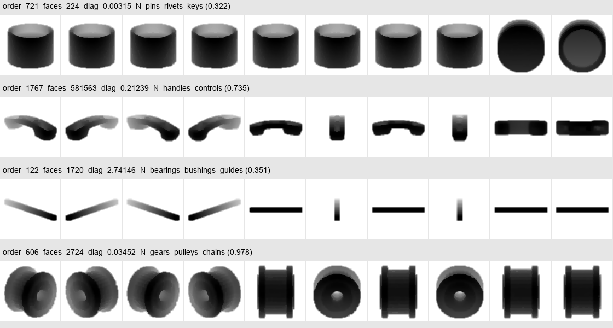

# a.glb 语义分支诊断与重构建议

日期：2026-10-19。对象为本次 seed2027 部署对应的 a.glb，1,778 个网格节点、5,469,879 个三角形。本文基于现有推断输出、几何统计和实际投影输入；场景尚无人工真值，以下置信度、规则通过率和策略变化率均不是识别准确率。

## 1. 核心判断

存在很多相对较小的节点，但现有证据不支持“小节点是语义效果弱的主要原因”。当前更明确的问题是：孤立零件输入丢失场景尺度和上下文；14 类监督分类必须在有限类别中选择；开放提示词与工业外观存在适配问题；语义不确定、几何微小、功能不重要和不可见被部分规则混用。

应把四个量分别输出：语义类别及其可靠性、功能重要性、几何复杂度、给定观察任务下的可见性。不能从其中一个量直接推导其余三个。

## 2. 小节点实际有多少

尺寸定义为节点包围盒对角线 / 全场景包围盒对角线。场景对角线约 4.38923；文件单位未确认，因此不换算成毫米或米。这是全局尺度诊断，不是可见性判据。

| 相对尺寸 | 节点数 | 节点占比 | 三角形占比 | 监督平均置信度 | 开放证据通过现有规则的比例 |
|---|---:|---:|---:|---:|---:|
| ≤0.5% | 101 | 5.68% | 0.86% | 55.91% | 29.70% |
| 0.5%～1% | 205 | 11.53% | 8.83% | 64.78% | 20.98% |
| 1%～2% | 501 | 28.18% | 11.20% | 62.83% | 21.16% |
| 2%～10% | 624 | 35.10% | 64.76% | 54.91% | 10.90% |
| >10% | 347 | 19.52% | 14.35% | 51.79% | 5.19% |

开放列包含 micro_uncertain 角色，仅用于核查现有质量规则。接受并不代表语义正确。

尺寸不超过 1% 的共 306 个，占 17.21%，其监督平均置信度约 61.85%，高于全场景的 57.73%。仅在统计中排除最小 101 个，监督直接接受覆盖率从 36.11% 变为 36.67%；排除全部 306 个反而降至 34.51%。这些统计不能证明准确率提高或降低，也不能支持通过删样本改善模型。

按已导出几何字段检查，面数、面积或对角线非正的节点为 0；这不等于已完成退化三角形、自交和遮挡检查。没有任何节点已被证实“无用”或“永远看不到”。

## 3. 规则中的直接问题

`tools/pointnext_lod/build_lod_constraints_from_analysis.py` 存在以下需要拆开的逻辑：

- `classify_size` 使用场景内分位数。底部 10%、25%、50% 的尺寸等级是相对排名，不能直接理解成工程意义上的微小或可删除。
- `infer_ablation_semantics` 在监督证据不可靠、缺少类别先验或纯开放证据不可用时，会增加或退回 `micro_uncertain`。该角色又对应 P1 和远距离剔除意图，因而把识别困难与低重要性联系起来。
- 结构特征含监督间隔生成的 `uncertainty_score`，使监督不确定性再次进入结构证据。所谓结构独立贡献需要另行隔离。
- 完整融合和其他组合采用不同融合路径、开放权重和后处理，当前六配置不能直接解释为严格控制变量的消融。

实例：监督单独策略中 565 个 P1 节点，有 511 个尺寸大于场景对角线的 1%；开放单独策略中 1,556 个 P1 节点，有 1,293 个超过该尺度。因此 P1 不能理解成“确实很小的无用零件”。

导出 `allow_cull` 目前是策略元数据，不等于渲染器实际执行的剔除，也不是已测得的不可见率。

## 4. 输入确实存在尺度和形状问题

图像从实际投影模块生成，不是人工示意图。四行依次是 order 721、1767、122、606；这是一件零件独立归一化后的多视图输入，不是场景相机截图。

- 最小节点 order 721 对角线约 0.00315，归一化后平均前景占比仍约 56.74%。模型看不到它相对装配体有多小。“tiny fragment”等文字标签不能代替场景尺度测量。
- 尺寸最大节点 order 122 对角线约 2.74146，但只有 1,720 面，外观细长，部分轴向投影视图前景仅约 4.17%。应处理视角信息量和局部结构，不能只增加统一采样点数。
- 面数最多节点 order 1767 为 581,563 面，对角线仅约 0.21239，投影呈把手状外观。它属于高几何复杂度对象，并不是尺寸最大对象；外观描述仍需人工类别确认。
- order 606 尺寸约 0.03452，监督预测为传动类、置信度约 97.84%。小件也可能有明确功能，不能按尺寸直接降低保护。

面数最多的 8 个网格，按对角线 1e-6 的位置焊接容差检查，均为单个面连通分量。简单拆连通分量不足以解决这些对象；连通也不等于具有单一完整语义。

本文件节点没有子节点，缺少可直接利用的装配层级。现有 `run_grid_grouped` 会按网格空间分组并把组预测复制给成员，邻近不同零件可能被误赋同类，不宜作为默认修复。

## 5. 建议的语义分支改造

### 5.1 输入分流与观察上下文

先保留全部节点。用尺度、长宽比、复杂度和可用证据决定分析方式，而不是决定删除。

- 小件：孤立形状 + 局部装配环境双输入；尺寸和邻接信息作为独立上下文，不混入类别名称。紧固、密封、连接、传动候选仍保留功能保护需求。
- 尺寸大、细长或高复杂度：全局输入 + 多个覆盖局部的采样/渲染输入，保留全局形状关系；比较各局部预测一致性，不把每个局部最高分直接当整件类别。
- 重复几何可缓存编码；先验证几何、归一化和变换等价条件。重复形状的出现位置和功能上下文仍分别保留。
- 场景渲染中记录节点 ID、深度、屏幕覆盖和观察轨迹，测量任务范围内的可见性。默认外观、近距离、剖切和拆解是不同任务，分别标注；暂时遮挡只支持延后处理，不能推出节点永久无用。

### 5.2 监督分支增加未知拒识

保留已有 14 类编码器作为已知工业零件专家。将“形状是否属于已知类别”与“属于哪一类”分开判断。以独立开发数据校准置信度、特征距离和拒识阈值，不以最大 softmax 作为唯一依据。

大框架、护罩、长杆及非常规零件若缺少训练类别，应输出粗类别或 unknown。强制在 14 类中选一个不构成识别成功，也不应因拒识而自动归入低保护。

### 5.3 开放分支采用粗到细、跨视角证据

先判断较稳定的粗类别，例如结构构件、外罩、连接件、传动件、流体接口、电气部件、未知；只对有粗类别支持的对象进入细粒度候选。类别层级需要用人工开发集确认。

移除将绝对尺寸、识别不确定性和类别混为一谈的提示词。给细粒度工业类别配置多个形状与功能描述，并按类别归一化聚合，避免描述条数多的类别自然占优。粗到细各级都允许拒识，避免首级错误硬锁定。

缓存逐视图图像特征和文本特征，比较均值聚合、开发集确定的视图权重、视图一致性及有信息量的局部视图。记录绝对相似度、候选间隔、视图一致性和词表版本；不能把 110 类 softmax 与 14 类监督概率按相同标尺混合。

官方 PointCLIP V2 使用数据集相关提示与视图权重；本项目自定义通用提示和视图平均并不能直接代表其最优工业适配。应在开发集上重新验证，不能套用 ModelNet 测试配置当工业最优参数。参考：[官方代码](https://github.com/yangyangyang127/PointCLIP_V2)、[原论文](https://openaccess.thecvf.com/content/ICCV2023/papers/Zhu_PointCLIP_V2_Prompting_CLIP_and_GPT_for_Powerful_3D_Open-world_ICCV_2023_paper.pdf)。

### 5.4 融合与 LOD 决策拆开

分别输出 `semantic_status`、`reliability`、`functional_importance`、`visibility_status` 和 `geometry_protection`。这些是建议字段，不是已部署接口。

缺少可靠语义时输出“功能尚未确定”，由几何误差预算和可见性保守控制，不能仅因未知直接 P1；具体保护下限要在有真值的开发集确定。对高可靠关键功能证据与弱开放猜测冲突的对象进入复核，不让弱证据任意覆盖。

六种语义配置应使用同一个融合函数，仅通过证据开关生成 N、C、N+G、C+G、N+C、N+C+G；补充 G-only。G 不读 N 的置信度或类别，C-only 不借用 N 的决策置信度；词表、后处理和输出字段口径固定。权重在独立开发集校准，另报告规则后处理的影响。

当前开放证据进入完整融合的平均基础归一权重约 1.02%（后处理前）。这解释了它为什么难以影响策略，但不说明应直接调大权重：先提升证据质量和校准，再验证权重。策略变化更多并不必然更好。

## 6. 怎么验证“优化有效”

先按尺寸、长宽比、面数、已知/未知和分支冲突分层，标注约 100～200 个节点作开发与规则诊断起点；标注类别、功能角色、关键细节、观察任务，不把模型自己的预测作为真值。小规模标注仅能提供初步证据，罕见类别仍可能缺乏统计把握。

在 a.glb 上反复观察并调整后，应把它视为开发场景；最终结论需要未参与调整、来源独立的装配场景。按几何家族或装配来源隔离，防止重复零件泄漏。

至少报告：全体节点类别/角色 Macro-F1，已知类与未知类拒识表现，覆盖率—错误率关系，关键功能漏保护率，分尺寸/复杂度结果；再在相同几何预算与观察轨迹下报告屏幕误差、关键细节保留和实际帧时间。延后、拒识和不可见节点单独列账，不能删掉难样本后把子集指标说成全量效果。

比较次序：现有流程 → 只拆开未知/重要性规则 → 加输入分流及局部上下文 → 加开放类别层级和视图证据 → 校准统一融合。这样才能区分规则收益、输入收益和编码收益。

## 7. 本次已经完成与尚未完成

已完成输入审计、4 个真实投影案例、8 个高面数对象的连通性诊断，以及不修改生产结果的分流原型。全部 1,778 个节点保留，`visibility_status=unmeasured`，`allow_geometry_drop=False`，没有因小或未知跳过全部语义。

分流预览：全局+局部多尺度 392 个，粗到细开放/拒识 762 个，已有可靠候选 523 个，小件上下文 99 个，小件关键功能候选 2 个。最后两组共 101 个极小节点；“候选”不等于真值。

预览阈值 0.5%、10%、10,000 面仅用于安排分析资源，不是标定后的删除或重要性阈值。原型为 `tools/pointclipv2/audit_semantic_routing.py`；相关 5 项测试通过（包含原有 2 项结构独立性测试）。生产推断、融合策略和模型权重尚未按本方案重构，也没有已验证的准确率提升。

配套证据：`routing_audit_summary.json`、`size_bin_statistics.csv`、`semantic_routing_v2_preview.csv`、`projection_diagnostics.json`，以及上级目录的 `large_mesh_topology_diagnostic.json`。当前结果和历史报告保持不变，可作为后续对照。
