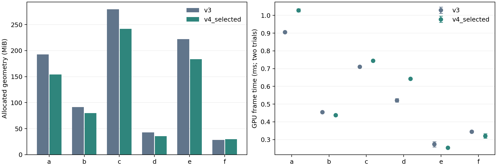

# P1–P10自适应几何保护策略：规则升级与六模型验证

当前策略版本：`adaptive_p10_v4.2`。本次不重训N/C，也不把名称弱参考当作准确率。优化对象是融合输出后的保护分配、层次构建约束和运行时细化选择。

## 十档定义与适用对象

P是有序的保护配置，不是物体类别；同类零件因功能上下文、几何敏感性和尺度不同可以进入不同档位。语义未知不意味着可删除，几何复杂也不自动意味着关键工艺件。

| 档位 | 定义 | 适用证据与边界 | 模板近/中/远 | 硬锁预算 | 相对增量QEM上限 |
|---|---|---|---|---:|---:|
| P1 | 微小重复件 | 普通标准件身份、极小相对尺寸、同网格重复且无功能冲突；不用于丢弃未知件 | 0.38/0.20/0.08 | 0.8% | 0.025 |
| P2 | 普通重复标准件 | 普通紧固、标准连接等；精密装配中的紧固件可升档 | 0.44/0.24/0.10 | 1.2% | 0.022 |
| P3 | 简洁静态体块 | 形状简单的大体块、机架实体；没有仅凭大尺寸假定安全 | 0.48/0.28/0.12 | 1.8% | 0.018 |
| P4 | 普通表面与支撑 | 普通安装板、支撑、外罩及简单表面；薄壁风险仍可提高保护 | 0.52/0.32/0.16 | 2.5% | 0.016 |
| P5 | 未决与均衡保护 | 身份不明确、证据冲突或几何无效时的保守起点 | 0.58/0.38/0.22 | 3.5% | 0.014 |
| P6 | 细长薄壁与轮廓 | 管、杆、薄板、异形轮廓和复杂几何；不凭形状编造对象身份 | 0.60/0.42/0.26 | 5.0% | 0.010 |
| P7 | 功能接口与局部安装 | 流体连接、检测安装、精密紧固及送料候选等 | 0.64/0.46/0.30 | 6.0% | 0.009 |
| P8 | 驱动控制与作业对象 | 执行、检测控制、工件候选等有功能依据的部件 | 0.66/0.50/0.34 | 7.5% | 0.008 |
| P9 | 精密运动与工艺定位 | 导向、传动、工装和工艺工具的功能保护 | 0.70/0.54/0.40 | 9.0% | 0.006 |
| P10 | 敏感关键工艺细节 | 精密/工艺功能假设与细长、薄壁或复杂几何共同成立；高置信度本身不够 | 0.76/0.60/0.48 | 12.0% | 0.004 |

模板比例是每次cluster合并简化的请求，不是最终三角形、内存或显存保留率。连续尺度与几何敏感性会小幅调整比例及屏幕误差权重；实测搜索还能修正远层请求。P档位不为填满直方图而分配。硬锁预算不覆盖不可松动的非流形点；表中比例不是精确锁定点数量。

## 从融合证据到实际执行

1. 保留v3对象身份、拒识与冲突；H只推断局部装配作用，不把父节点名称复制成子件类型。N/C消融继续显式遮蔽关闭的分支，H0不读取父组尺度，M单独开关。
2. 将功能意图与形状保护分开。大而简单的未知形状可进入P3/P4，但不会被宣称识别为机架；薄壁、细长、复杂形状形成保护下限；P10要求功能和几何共同支持。
3. 不再由旧P档位隐式追加10%–30%的硬锁，再叠加一套几何下限。schema=4显式指定锁预算、软权重与保护阈值，低语义置信度不降低几何安全约束。非流形保护仍保留。
4. 实际cluster简化使用有限增量QEM预算，并检查当前组AABB范围收缩和焊接连通分量是否完全消失。违反约束回退本组输入，禁止sloppy回退突破预算，也不再截小已测出的误差。
5. 全量单网格探针搜索可行请求；只改变简化配置，不修改对象身份或功能。相同实际面数时优先较温和的请求，无法满足时回退到原始/近乎无误差的几何。该探针与真实cluster递归不是同一评价尺度。
6. 同网格不同实例仍合并最严格构建约束；运行时误差权重保留各实例的作用差异。没有复制每实例几何，也没有根据小尺寸或名称自动删除节点。

## 实验范围与可复现边界

六场景a–f共11,000个节点。生成六组合×H0/H1的72组主策略，另有G对照和M辅助；模板90组加实测修正6组，共96个策略CSV。所有神经推断按内容哈希复用，保留旧报告与旧策略备份。单网格几何对比覆盖旧部署、v4模板、v4实测修正的全部33,000条节点结果。

真实程序重建与GPU测量只比较完整NCGHM配置的上述三版，不把它冒充72组渲染消融。使用RTX 3060；固定视角、1920×1080、supersample=1、关闭阴影/流式、屏幕误差2，每配置两次进程。明确等待异步加载与渲染就绪后再预热和计时；守卫加入前的诊断不进入最终结论。

## 单网格几何诊断

| 版本 | 实际三角形保留 | 平均归一化QEM | 面数加权QEM | 主轴收缩>10%的节点 | 显著分量丢失节点 |
|---|---:|---:|---:|---:|---:|
| v3_deployed | 53.55% | 0.038965 | 0.044036 | 52 | 11 |
| v4_profile | 33.11% | 0.007522 | 0.002757 | 2 | 0 |
| v4_selected | 28.18% | 0.009072 | 0.003625 | 0 | 0 |

QEM按两倍RMS半径归一化，非Hausdorff距离；主轴范围与分量存在性不能证明孔洞、厚度和全部拓扑保持。这里的结果不能直接换算为真实显存或帧率，因此另外测量实际程序。

## 真实程序：旧部署与最终候选

| 场景 | 几何GPU内存 MiB 旧→新 | 变化 | 渲染工作集 MiB 旧→新 | GPU帧耗时 ms 旧→新 | 新版两次范围 ms |
|---|---:|---:|---:|---:|---:|
| a | 192.64→154.13 | -19.99% | 528.42→492.54 | 0.905→1.029 | 1.021–1.037 |
| b | 91.76→80.04 | -12.78% | 298.20→286.56 | 0.455→0.438 | 0.432–0.443 |
| c | 279.72→241.66 | -13.61% | 742.68→705.28 | 0.711→0.745 | 0.743–0.746 |
| d | 42.80→35.46 | -17.16% | 246.89→239.51 | 0.521→0.642 | 0.640–0.645 |
| e | 222.34→183.71 | -17.37% | 657.76→657.96 | 0.274→0.254 | 0.254–0.254 |
| f | 28.56→29.86 | +4.57% | 260.84→260.94 | 0.345→0.321 | 0.308–0.333 |

几何GPU字节来自渲染器资源计数，不是整进程总显存；工作集按0.1秒轮询，受文件映射/系统缓存影响，不是几何有效载荷的同义词。GPU帧时间来自timestamp profiler；其倒数只代表GPU时间对应的吞吐，不是含窗口呈现、用户交互和CPU约束的实测FPS。两次进程只能作为工程诊断，不用于显著性结论。

## 固定视角图像核验

参考图使用相同渲染器、相同相机、屏幕误差0.0001；普通图为2。JPEG质量100，图像指标每隔一个像素取样。全图SSIM会被背景稀释，因此同时报告参考边缘区域SSIM及2像素容差边缘召回。空白参考会直接判为失败。该视角仍不能覆盖被遮挡内部或替代多视角/人工功能标注。

| 场景 | 版本 | PSNR dB | 全图SSIM | 边缘区域SSIM | 边缘召回 |
|---|---|---:|---:|---:|---:|
| a | v3 | 48.01 | 0.99889 | 0.99101 | 99.79% |
| a | v4_selected | 45.07 | 0.99831 | 0.98598 | 99.78% |
| b | v3 | 43.79 | 0.99835 | 0.99074 | 99.92% |
| b | v4_selected | 32.41 | 0.98909 | 0.93791 | 99.38% |
| c | v3 | 38.46 | 0.99571 | 0.96956 | 99.92% |
| c | v4_selected | 32.40 | 0.99109 | 0.92810 | 99.23% |
| d | v3 | 40.26 | 0.99743 | 0.99079 | 99.97% |
| d | v4_selected | 37.50 | 0.99616 | 0.98557 | 99.93% |
| e | v3 | 41.60 | 0.99667 | 0.95486 | 99.93% |
| e | v4_selected | 38.24 | 0.99505 | 0.93024 | 98.57% |
| f | v3 | 44.58 | 0.99826 | 0.99044 | 99.96% |
| f | v4_selected | 36.42 | 0.99370 | 0.96314 | 99.47% |

原图在[images](images/)；本表是质量与成本权衡，不能将PSNR降低解释为识别能力变差。若重要区域图像退步超过可接受范围，应调整屏幕误差权重/选择更细层，保留物体身份和P等级的独立性。

## 十档实际分布

| 场景 | P1 | P2 | P3 | P4 | P5 | P6 | P7 | P8 | P9 | P10 |
|---|---:|---:|---:|---:|---:|---:|---:|---:|---:|---:|
| a | 0.00% | 7.65% | 0.67% | 13.16% | 16.03% | 57.71% | 1.07% | 1.07% | 1.57% | 1.07% |
| b | 0.00% | 4.12% | 0.27% | 15.40% | 25.86% | 34.50% | 5.81% | 4.86% | 5.00% | 4.19% |
| c | 0.11% | 6.24% | 0.57% | 13.80% | 18.72% | 41.44% | 4.06% | 9.62% | 0.11% | 5.32% |
| d | 0.00% | 6.26% | 1.63% | 18.42% | 15.17% | 50.73% | 1.03% | 2.23% | 1.03% | 3.51% |
| e | 0.00% | 5.35% | 0.09% | 13.56% | 13.59% | 54.14% | 5.05% | 1.70% | 0.21% | 6.30% |
| f | 0.00% | 8.04% | 0.74% | 24.86% | 19.26% | 23.31% | 5.81% | 2.03% | 11.28% | 4.66% |
| 合并 | 0.02% | 6.15% | 0.54% | 15.82% | 17.38% | 45.55% | 4.03% | 3.38% | 2.64% | 4.50% |

完整节点/三角形占比以及六组合树开关结果见[all_profile_comparison.csv](all_profile_comparison.csv)。各P适用模型类型是证据示例，不是按类别强制查表；同一对象身份可以因局部功能和几何风险改变保护配置。

## 使用与局限

运行根目录`run_adaptive_p10_comparison.bat`重新生成并验证后导出。额外运行`run_adaptive_p10_runtime_validation.bat`完成真实离屏对比及图像核验。启动程序选择第七项（命令行索引6）并重建LOD使用NCGHM实测配置；第六项仍是关闭树/名称的NCG对照。已有旧CSV备份在`.artifacts/migrations`，旧实验目录不覆盖。

缓存需要随策略重建；CSV全行哈希参与缓存身份。继续采用已有共享网格去重与流式预算机制；本次没有改变全分辨率原始几何，因此无法保证所有场景、所有视角的内存、显存和FPS同时改善。六场景均参与开发，不能声称全局最优或独立测试泛化结论。
