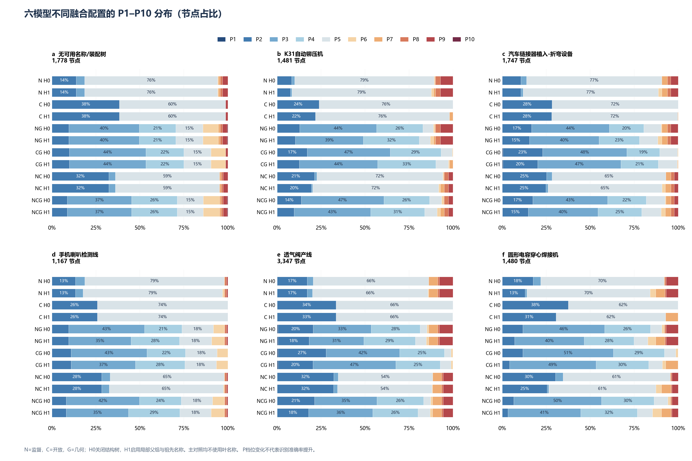
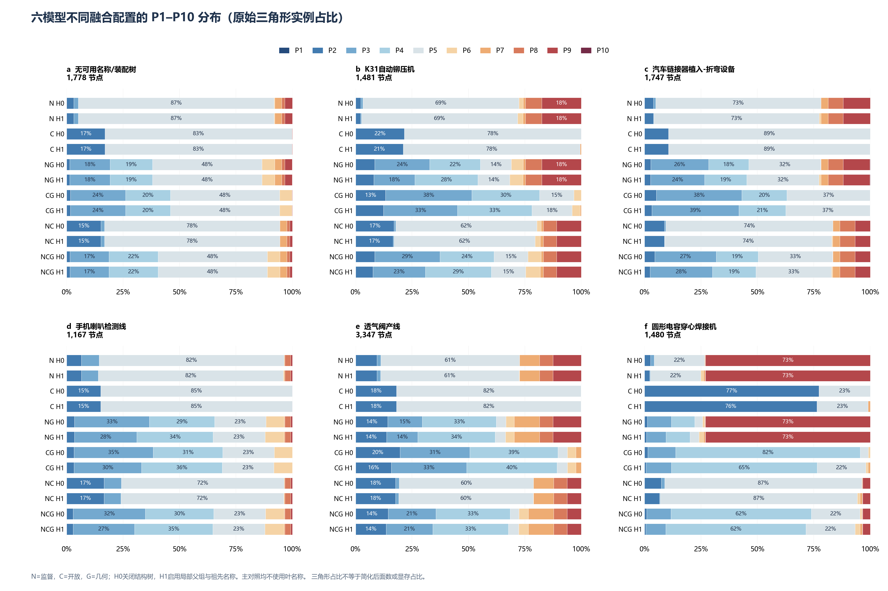
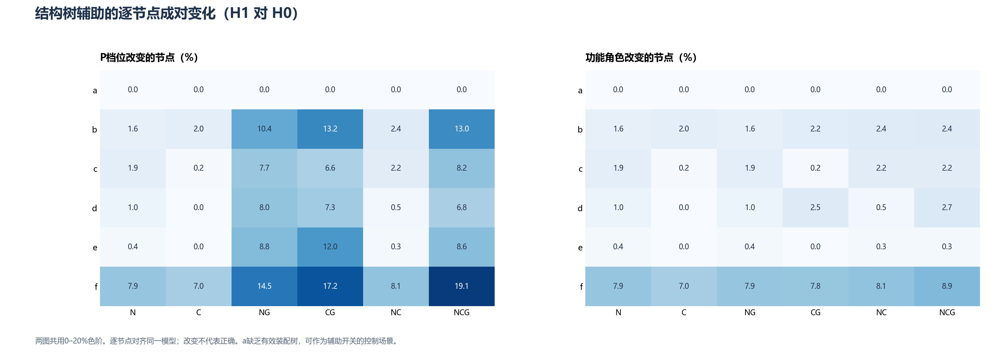
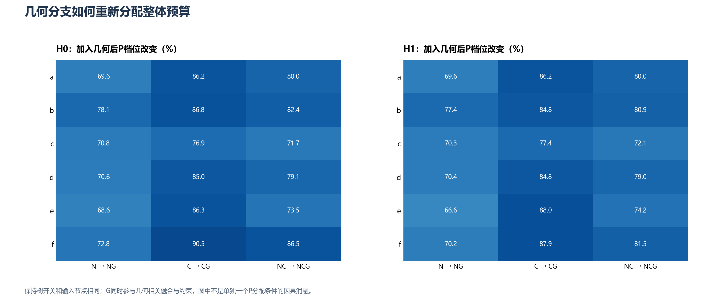
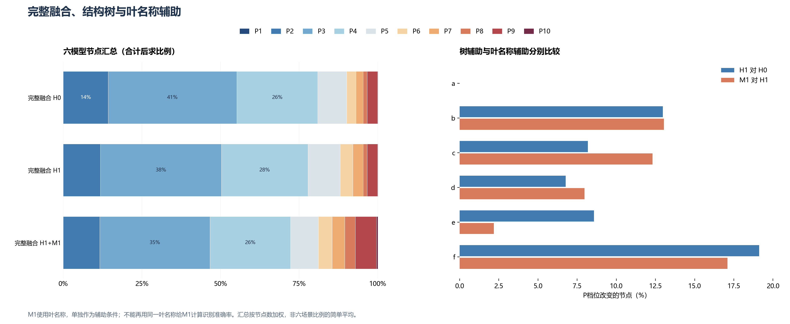
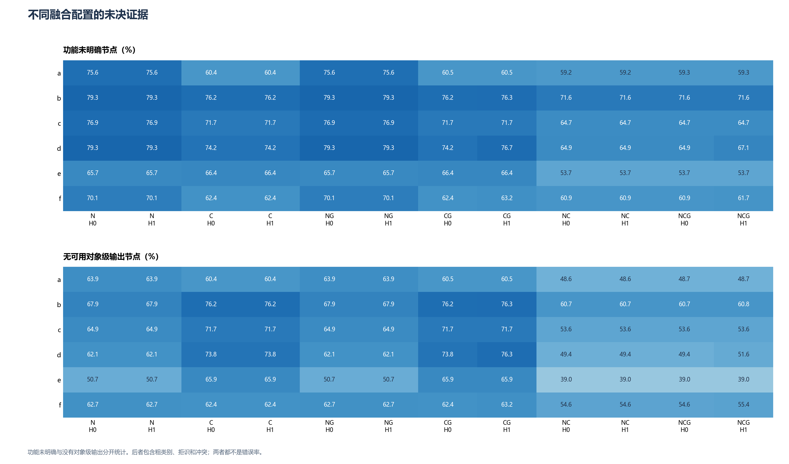
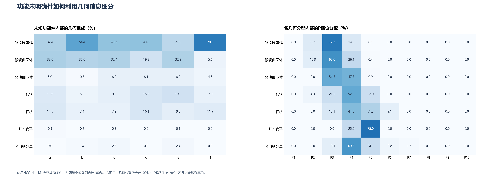
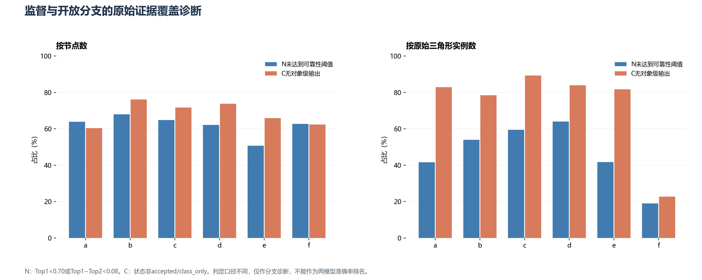
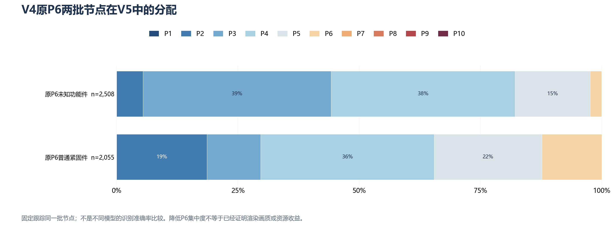

# 六模型不同融合配置图表分析（V5）

分析对象是V5策略回放，不是V4运行时性能测量。共6模型、11,000节点；主对照为六组合×H0/H1，共72组。纯G对照12组、M1辅助6组另列，总计90组，所有条件均覆盖场景全部节点。

N=监督语义，C=开放语义，G=几何结构。H0关闭树辅助；H1使用局部父组与祖先名称，不能称为纯拓扑消融。M1额外使用叶名称，不纳入主72组。

## 模型与分析规模

| 模型 | 场景 | 节点 | 原始三角形实例 |
|---|---|---:|---:|
| a | 无可用名称/装配树 | 1,778 | 5,469,879 |
| b | K31自动铆压机 | 1,481 | 3,433,060 |
| c | 汽车链接器植入-折弯设备 | 1,747 | 11,760,345 |
| d | 手机喇叭检测线 | 1,167 | 1,723,934 |
| e | 透气阀产线 | 3,347 | 15,496,224 |
| f | 圆形电容穿心焊接机 | 1,480 | 2,911,273 |

三角形按节点实例累计；共享网格可能重复计入，因此不能直接换算实际内存或显存。汇总一律先相加计数再求比例，避免场景规模不同造成平均比例失真。

## 六种融合组合的整体差异

| 配置 | 功能未明确 | 无对象级输出 | P1–P3 | P6 | P8–P10 | N/C冲突节点 |
|---|---:|---:|---:|---:|---:|---:|
| N_H0 | 72.93% | 60.22% | 17.71% | 0.12% | 6.90% | 0 |
| N_H1 | 72.93% | 60.22% | 15.89% | 1.20% | 6.90% | 0 |
| C_H0 | 67.87% | 67.65% | 31.90% | 0.00% | 0.21% | 0 |
| C_H1 | 67.87% | 67.65% | 30.64% | 0.00% | 0.21% | 0 |
| NG_H0 | 72.93% | 60.22% | 54.99% | 2.72% | 6.90% | 0 |
| NG_H1 | 72.93% | 60.22% | 49.40% | 3.82% | 6.90% | 0 |
| CG_H0 | 67.90% | 67.68% | 63.98% | 2.60% | 0.21% | 0 |
| CG_H1 | 68.29% | 68.07% | 59.80% | 2.75% | 0.21% | 0 |
| NC_H0 | 60.90% | 48.99% | 32.07% | 0.05% | 4.68% | 1,529 |
| NC_H1 | 60.90% | 48.99% | 30.15% | 1.00% | 4.68% | 1,529 |
| NCG_H0 | 60.93% | 49.02% | 55.16% | 2.94% | 4.68% | 1,529 |
| NCG_H1 | 61.28% | 49.37% | 50.29% | 4.02% | 4.68% | 1,529 |

- **N_H0 → NG_H0**：7,827节点改变P（71.15%）；功能未明确比例72.93%→72.93%，无对象级输出60.22%→60.22%。

- **C_H0 → CG_H0**：9,383节点改变P（85.30%）；功能未明确比例67.87%→67.90%，无对象级输出67.65%→67.68%。

- **NC_H0 → NCG_H0**：8,557节点改变P（77.79%）；功能未明确比例60.90%→60.93%，无对象级输出48.99%→49.02%。

监督与开放联合后（NC H0），无对象级输出比例为48.99%，低于仅监督的60.22%和仅开放的67.65%；同时显式保留1,529个N/C分歧节点（13.90%）。这表明候选覆盖有互补性，不能由此推导识别更准确。

G的直接用途是依据尺度、形态、细节和连接结构分配几何预算。仅语义配置中的未知功能件使用保守起点P5，启用G后可分散到多个档位；这属于预算分配能力，不能解释成分类准确率增加。N/C冲突数更多可能表示显式保留了分歧，不能单凭冲突数对方法排名。

节点占比突出大量小零件，三角形占比突出高面数节点。两图应并列使用；高P节点较少也可能覆盖大量源几何。

## 结构树与名称辅助的作用

| 分支组合 | H1改变P | 升档 | 降档 | 改变功能 | 改变对象身份 |
|---|---:|---:|---:|---:|---:|
| N | 200（1.82%） | 200 | 0 | 200 | 0 |
| C | 139（1.26%） | 139 | 0 | 139 | 0 |
| NG | 890（8.09%） | 890 | 0 | 200 | 0 |
| CG | 1,052（9.56%） | 1,052 | 0 | 182 | 43 |
| NC | 211（1.92%） | 211 | 0 | 211 | 0 |
| NCG | 984（8.95%） | 984 | 0 | 250 | 39 |

此次六组合的H辅助P变化全部为升档，没有降档。当前树分支的作用偏向增加保护，不能仅凭介入比例高就判定融合更优；后续应检查是否存在不必要的资源开销。

完整融合加入H1后，功能未知比例60.93%→61.28%，无对象级输出49.02%→49.37%，并未减少。树辅助的收益应优先从局部作用与几何约束是否合理来验证，不能自动解释成识别率提高。

a场景缺乏可用装配树：NCG的H开关改变P为0节点，功能改变为0节点。该控制有助于判断树分支是否在缺少信息时凭空生效。

在已经启用H1的基础上加入M1，另有827节点改变P（7.52%），1,212节点改变功能。名称辅助是额外证据，不能与不使用叶名称的主对照混为一组。纯G不承担对象识别，其全部功能未知只是输入分支的能力范围，不应解释成100%识别失败。

## 六个模型分别看什么

| 模型 | H1完整融合：功能未知 | 加M1后：功能未知 | H1改变P占比 | H1+M1中P8–P10 |
|---|---:|---:|---:|---:|
| a | 59.28% | 59.28% | 0.00% | 3.71% |
| b | 71.64% | 59.96% | 12.96% | 14.04% |
| c | 64.74% | 53.06% | 8.19% | 15.05% |
| d | 67.10% | 50.99% | 6.77% | 6.77% |
| e | 53.75% | 49.63% | 8.57% | 8.22% |
| f | 61.69% | 43.24% | 19.12% | 17.97% |

完整融合中，结构树对P分配改变比例最大的场景为f（19.12%）；名称辅助后功能未明确比例最高的场景为b（59.96%）。前者适合检查父组作用是否合理，后者适合优先核对未知功能件的形态预算。

不能仅凭设备名称断言每个子零件应处于哪一档；“焊接机”“检测线”等标题只说明场景用途。精密/作业保护比例的差异，应继续追溯到局部部件与装配角色。

## 未知功能、分支不确定性与V4原P6

未知功能件的几何分型与P档位分开呈现，避免“不同形状全部一个兜底档位”。N未达到可靠性阈值与C没有对象级输出采用不同定义，不能据此给两模型的准确率排名。V4原P6去向是同一批节点的策略变更诊断，属于补充图，不是不同融合方式的识别结果。

## 结论与边界

现有数据可以支持：比较不同分支的策略分配、结构树/名称的实际介入范围、未决与冲突证据，以及节点统计和源几何工作量的差异。尚无独立人工真值、V5多视角画质或GPU测量，因此不报告OA/Macro-F1、显著性、显存降低率或帧率提升。

交互入口：[六模型融合交互图表.html](六模型融合交互图表.html)。图像同时提供PNG与可编辑文字的SVG版本，单模型图以`scene_a_fusion`等命名。
