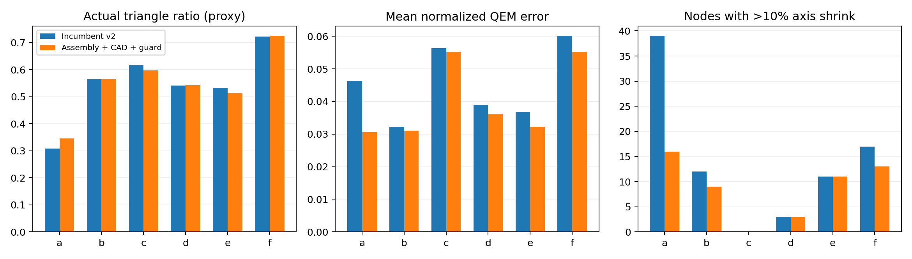

# 六模型装配上下文与几何反馈策略实验

六个GLB共 **11,000 个网格节点**，已完成全量监督/开放推断、表面几何描述、策略消融和单网格简化诊断。没有人工类别或功能真值，名称只能作为弱参考；没有执行Vulkan固定轨迹或完整cluster LOD质量/FPS基准。

## 结论

本轮优化的重点是把“物体类型、装配作用、几何保真要求”分开决策。结构树补充关系与工位上下文，不把父类别复制给子零件；几何分支可以在类别未知时提出截面、轮廓和分离部件保护要求。

在可保守映射到监督类别的 655 个名称弱参考节点中，盲推断最终身份与名称一致数为旧版 171、新版加树 171。这不是全部节点的OA，也不是CLIP候选Top-1统计；元数据辅助身份没有计入。**此次改造不能宣称视觉分类准确率显著提高。**

按照名称提供的功能弱参考，关键类别却落入P1–P3的节点数由 96 降为盲配置 13、名称辅助配置 0。这是策略一致性检查，依赖既定功能重要性假设，不能当作分类准确率或真实功能保护率。

## 数据与验证范围

| 文件 | 场景 | 网格节点 | 装配节点 | 名称参考节点/名称组 |
|---|---|---:|---:|---:|
| a.glb | 无可用名称/装配树 | 1778 | 0 | 0 / 0 |
| b.glb | K31自动铆压机 | 1481 | 62 | 167 / 26 |
| c.glb | 汽车链接器植入-折弯设备 | 1747 | 198 | 125 / 8 |
| d.glb | 手机喇叭检测线 | 1167 | 118 | 60 / 11 |
| e.glb | 透气阀产线 | 3347 | 211 | 107 / 7 |
| f.glb | 圆形电容穿心焊接机 | 1480 | 157 | 196 / 43 |

b、c、d、e与此前四场景文件逐字节相同，不能算四个新独立测试集。a没有可用装配树或名称映射，采用几何与视觉回退；不虚构父结构。b–e用于前期开发；第三轮冻结后对f确认，发现“折弯头”名称规则缺口，第四轮补齐并全量回放。因此六场景均属于开发/诊断数据，本轮没有保留严格独立的最终测试集。重复零件不独立，另给出名称组宏平均；不能以重复实例放大统计显著性。

## 反复实验如何改变算法

1. **R0：现有v2。** 保留各证据配置，作为迁移参照。
2. **R1：几何与工位上下文初版。** 在b–e运行，发现大工位向普通紧固件扩散“精密装配”作用；测试还检出了轴对齐包围盒归一化的旋转依赖。历史输入、源代码和结果已保存。
3. **R2：局部装配约束。** 改用旋转不变的RMS半径归一化，排除覆盖整个设备的父节点；精密紧固关系限定局部装配数量和相对尺寸。但全量QEM诊断发现部分场景实际误差/分离部件丢失变差，说明“保护下限达标”不能证明简化变好。
4. **R3＋实测反馈：冻结部署候选。** 边缘复杂度触发从14收紧到24；有名称与平面几何共同支持的场景参考件单列。对NCG/NCGH/NCGHM额外执行迁移检查，若QEM误差超过旧NCG的1.05倍加0.002、明显增加轴向收缩或增加显著部件丢失，则提高该节点的保留比例，必要时检查更高比例。身份与功能角色保持独立，不通过篡改类型来解释几何风险。
5. **R4：名称覆盖修正后全量复跑。** f中的“折弯头”仍被分到普通紧固件，补充通用工艺头名称。若功能名称与紧固件身份冲突，输出身份待核验、功能候选及保护策略，不凭名字虚构精确工具型号；所有数值阈值保持第三轮一致。

这些数值是冻结的工程规则，不是概率校准。迁移检查把现有NCG当几何参照，并不把旧类别当真值，也不保证绝对几何质量合格。该附加阶段只用于含N/C/G的完整配置；纯C/G消融保持独立，不能把完整系统收益解释成G的单因素因果贡献。

## 结构树的实际作用

相对于“同样使用叶名称、但关闭父结构”的配置，父结构改变了 **320 个节点的功能角色**。记录上下文不一定改变P级；薄壁/细长等几何下限仍可能主导最终动作。

| 场景 | 名称参考节点 | 旧盲身份一致/覆盖 | 新盲身份一致/覆盖 | 父结构额外改变功能数 | 实测反馈调整数 |
|---|---:|---:|---:|---:|---:|
| a | 0 | 0/0 | 0/0 | 0 | 188 |
| b | 167 | 40/67 | 40/67 | 89 | 129 |
| c | 125 | 4/6 | 4/6 | 38 | 90 |
| d | 60 | 26/34 | 26/30 | 31 | 78 |
| e | 107 | 65/65 | 65/65 | 11 | 236 |
| f | 196 | 36/66 | 36/66 | 151 | 102 |

分子为与名称弱参考一致，分母为该参考集合中输出可映射对象身份的节点数；参考节点总数另列。不能只看已覆盖子集的一致比例。名称辅助配置直接使用名称，因此不参加这张盲身份评分。

| 场景 | 零件名称 | 仅叶名称的作用 | 加父结构的作用 | 父结构 |
|---|---|---|---|---|
| b | K31-02A（H）螺母-1 | standard_fastener | feeding_material_candidate | A0100-ZD20018螺母送料组 |
| b | C010-ZD20018-1.002 | mounting_support | motion_mount | C0200-ZD20018-转运轨道 |
| b | I008-ZD20018-2 | standard_fastener | precision_fastener | I0100-ZD20018- 焊脚装配组 |
| c | JX22-018-A102-1 | mounting_support | motion_mount | 018-B冲切 |
| c | 切废料^018金属B冲切-1/SDA100x10SB_0_+_CMSG-2_-1/_CMSG_GN-1 | standard_fastener | precision_fastener | 切废料^018金属B冲切 |
| c | 018螺母上料机构-1/镜向SDAJ25x10-10SB_10x0_+_CMSG-2_-1/镜向_SDAJ-25- M8x1.25-1 | standard_fastener | feeding_material_candidate | 018螺母上料机构 |
| d | NG移栽装配体-1/WD-SB8-4040-3 | mounting_support | motion_mount | NG移栽装配体 |
| d | 下CCD装配体-1/246下CCD光源安装板-1 | mounting_support | inspection_mount | 下CCD装配体 |
| e | JX028-A005-7 | mounting_support | motion_mount | A极耳胶七孔冲裁 |
| e | JX028-I003-1 | standard_fastener | precision_fastener | CCD产品外观检测 |
| f | ~零件1-1 | standard_fastener | precision_fastener | 夹具 |
| f | U形座-1 | mounting_support | motion_mount | 夹具 |
| f | 滑动痤-1 | mounting_support | inspection_mount | 锡线检测部件 |

送料工位里的螺母只有在物料名称、对象类型和局部尺度有共同支持时才标作候选工件；不会把送料机构所有螺钉都当产品。CCD安装板等复合名称先认安装件，再根据检测装配赋予安装作用。没有接触/运动/可见性测量，仍不能自动证明某个零件就是工艺关键件。

## 全量单网格简化诊断

| 场景 | 旧实际三角形比例 | 新实际三角形比例 | 旧平均QEM误差 | 新平均QEM误差 | 旧/新显著部件丢失节点 | 残余回归复核 |
|---|---:|---:|---:|---:|---:|---:|
| a | 30.86% | 34.51% | 0.04632 | 0.03053 | 0 / 0 | 0 |
| b | 56.55% | 56.62% | 0.03229 | 0.03110 | 0 / 0 | 0 |
| c | 61.76% | 59.67% | 0.05630 | 0.05529 | 0 / 0 | 0 |
| d | 54.06% | 54.20% | 0.03889 | 0.03604 | 0 / 0 | 0 |
| e | 53.25% | 51.32% | 0.03682 | 0.03221 | 0 / 0 | 0 |
| f | 72.28% | 72.45% | 0.06011 | 0.05521 | 11 / 11 | 0 |

QEM误差以两倍RMS半径归一化，是meshoptimizer报告的误差代理，并非Hausdorff距离或人工可见质量。部件丢失指焊接后表面积占比至少0.1%的分离表面分量消失；不代表孔洞保持率。轴向收缩按源几何主轴包围范围检查。所有节点参与，重复网格/相同比例复用数值结果。

各策略实际达到的三角形预算不同，上表不是同预算优越性证明。R2/R3还保存了相同请求预算的对照，但实际达成预算不同，不能据此声称公平预算下全面领先。最终反馈阶段优先避免相对旧策略退步，保真改善需要与增加的几何成本一起评估。独立探针没有应用前端的特征软约束/硬锁、cluster层次或运行时剔除；新增特征下限已接入前端，但必须重建LOD后另做实际测试。

f中旧策略已有的11个显著表面分量丢失节点在最终策略中仍存在；迁移检查未增加这项丢失，不等于已消除绝对几何质量问题。名称及层次也不足以证明实际运动、装配接触或运行时可见性。

## 接入与复现

运行项目根目录 `run_assembly_context_comparison.bat`，使用gpt-pointnext与PointCLIPV2_LOD。支持 `--policies-only` 复用已核验推断，`--no-export` 仅分析。每个场景失败会记录并继续，存在失败时不发布完整策略。原始输出在 `lod_analysis_outputs/assembly_context_v3_20261020`。

六个既有配置继续使用各自证据；第七项加载装配树＋叶名称＋几何反馈的完整策略。第六项保持无名称/无父结构。导出前核验来源和完整节点集合，旧CSV先备份。需重新打开场景、选择第七项并重建LOD。对于共用网格，节点作用可不同，但网格几何仍按最严格实例合并，不能声称已生成独立的每实例几何。

[逐场景总表](overall_comparison.csv)、[结构树作用变化](tree_function_changes.csv)、[最终几何诊断](geometry_final_comparison.csv)、[盲名称核验与名称辅助标记](final_guarded/name_weak_reference.csv)、[节点级反馈原因](final_guarded/geometry_feedback.csv)。

论文中可表述为“装配上下文与实测几何反馈驱动的策略优化”；目前不能表述为“已验证开放识别准确率、工艺关键件识别准确率或FPS显著提升”。
