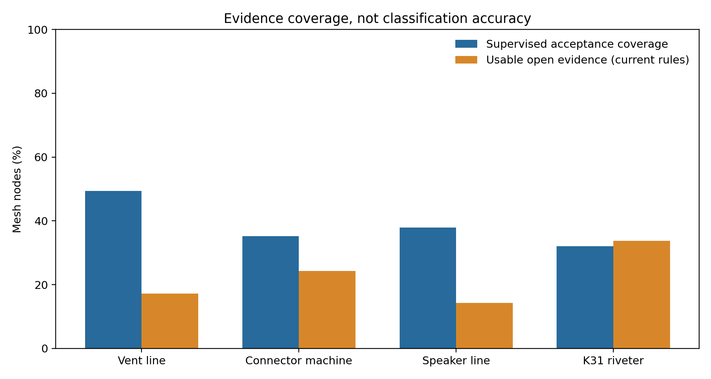
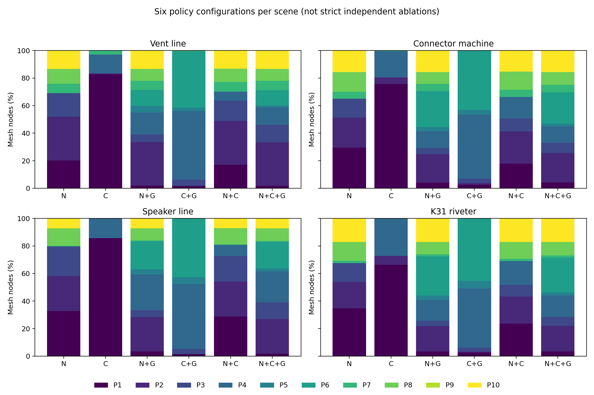

# 四模型全量语义测试与整体评价

日期：2026-10-19。**当前结果支持完整流程覆盖与策略行为分析，但还不足以证明融合识别精度或最终 LOD 质量优于各单分支。** 最需要改进的是工业类别覆盖、未知拒识、开放证据质量，以及物体类别到工艺角色的映射。

## 1. 本轮实际完成什么

四模型共 **7,742 个网格节点**，全部覆盖监督 N、全量开放 C、门控开放、结构 G、六配置及完整/门控融合；另提供移除监督不确定性的独立 G、独立 C+G 诊断基线。所有 CSV 逐节点联合键与源网格一一对应。监督模型固定为 PointNeXt-S seed2027 epoch98，验证集 Macro-F1 选择的部署权重，8,192 点；开放固定 ViT-B/16、10视图、8,192点，全量110标签，门控106标签。未改变生产融合公式或训练模型。

| 场景 | 网格节点 | 装配组 | 监督直接接受覆盖率 | 可用于完整融合的开放证据比例 |
|---|---:|---:|---:|---:|
| 透气阀产线 | 3,347 | 211 | 49.33% | 17.21% |
| 汽车链接器植入-折弯设备 | 1,747 | 198 | 35.15% | 24.27% |
| 手机喇叭检测线 | 1,167 | 118 | 37.87% | 14.31% |
| K31自动铆压机 | 1,481 | 62 | 32.07% | 33.76% |

接受为置信度≥0.70且间隔≥0.08；可用开放证据按现有质量规则且排除micro_uncertain计算。**二者都不是准确率。** 按节点合并，监督接受 3,182/7,742＝41.10%，开放可用 1,667/7,742＝21.53%；按四场景等权平均，分别为 38.61% 和 22.39%。二者并列报告，避免较大产线支配总体比例。

## 2. 输入更新与复用

| 场景 | 当前字节数 | 本轮处理 | 当前SHA256 |
|---|---:|---|---|
| 透气阀产线 | 546,993,236 | 经核验复用 | `c27eb7aa2a3066621f9bf9a681cdc568d25f9a104e73e9a8c922ea449ec59d72` |
| 汽车链接器植入-折弯设备 | 385,601,804 | 本轮新推断 | `dde06a4a6c8d67374c3a8574b60f4815ef724451b3c62df36bae6417b1212dff` |
| 手机喇叭检测线 | 58,071,788 | 经核验复用 | `0b9a5597b267f63edde781b2dfad3019fb20b4ee75d0ebf3ff708c4b2fc24d7b` |
| K31自动铆压机 | 109,519,656 | 本轮新推断 | `97f8f13e427ca5f368ddaf515fea0117aa9cc85b266711fef61c3ac48547886b` |

手机喇叭检测线、透气阀产线经输入、权重、代码和输出哈希核验后复制独立推断快照，策略与报告重新生成。汽车设备已重新导出，大小从481,674,560变为385,601,804字节，节点顺序/名称实例后缀也变化，必须重跑；不能拿上一轮node_index直接对应本轮。K31为首次全量推断。原三模型报告保留为历史记录。复用快照的耗时属于原始运行，不作为本轮GPU耗时或加速结果。

## 3. 结合模型名和装配名称判断功能是否合理

设备名称只提供设备级任务先验，不能为所有零件提供类别真值。这里再用文件中真实的装配名称确认功能上下文，避免仅凭文件名猜测。

- **透气阀产线**：设备名提示透气阀生产及相关搬运、检测、排气流程。优先核查检测/排气/冲裁工位的局部尺度和功能接口；名称只能说明工位上下文。
- **汽车链接器植入-折弯设备**：设备名提示连接器植入、冲切与折弯。优先区分端子/产品、工具、夹具和普通装配件，不能把待加工产品按通用紧固件处理。
- **手机喇叭检测线**：设备名提示喇叭检测及输送、定位、视觉/真空相关作业。优先核查视觉、气动与真空零件，当前14类没有完整覆盖这些功能对象。
- **K31自动铆压机**：设备名提示铆压及相关送料、锁螺丝、装胶帽作业。重点保护经核验的铆压接触部位、定位导向和工件特征；不同送料螺母的功能角色不能只由形状类别决定。

与工艺名称匹配的装配组如下。组内低保护不等于错误：紧固件等可能合理降级，关键接触件则可能需要保护；必须进一步区分成员角色，不能整组统一提到最高等级。

| 设备 | 装配node_index | 装配名称 | 后代网格数 | 完整融合P1–P3 | 完整融合P8–P10 |
|---|---:|---|---:|---:|---:|
| 透气阀产线 | 54 | A极耳胶七孔冲裁 | 187 | 45 | 37 |
| 透气阀产线 | 2051 | Q 排气工位 | 77 | 38 | 16 |
| 透气阀产线 | 2631 | Q 排气工位 | 77 | 39 | 14 |
| 透气阀产线 | 2133 | Q 排气工位 | 76 | 39 | 14 |
| 透气阀产线 | 2287 | Q 排气工位 | 76 | 38 | 14 |
| 透气阀产线 | 244 | CCD产品外观检测 | 11 | 5 | 1 |
| 透气阀产线 | 256 | CCD产品外观检测 | 11 | 6 | 2 |
| 汽车链接器植入-折弯设备 | 271 | 018-B冲切 | 246 | 83 | 57 |
| 汽车链接器植入-折弯设备 | 533 | 018-A冲切 | 245 | 82 | 68 |
| 汽车链接器植入-折弯设备 | 1919 | 018摸具上夹爪总成 | 116 | 36 | 17 |
| 汽车链接器植入-折弯设备 | 171 | 摸具 | 87 | 44 | 26 |
| 汽车链接器植入-折弯设备 | 529 | 摸具总装1 | 63 | 25 | 21 |
| 汽车链接器植入-折弯设备 | 1446 | 一次折弯结构长端子 | 52 | 23 | 12 |
| 汽车链接器植入-折弯设备 | 1505 | 一次折弯结构长端子.001 | 52 | 22 | 10 |
| 汽车链接器植入-折弯设备 | 1914 | 018-摸具上夹爪 | 43 | 5 | 9 |
| 汽车链接器植入-折弯设备 | 270 | 送料^018金属B冲切 | 37 | 15 | 2 |
| 汽车链接器植入-折弯设备 | 206 | 料架^018金属B冲切 | 34 | 7 | 16 |
| 汽车链接器植入-折弯设备 | 228 | 移载^018金属B冲切 | 19 | 4 | 5 |
| 汽车链接器植入-折弯设备 | 75 | 切废料^018金属B冲切 | 16 | 3 | 0 |
| 汽车链接器植入-折弯设备 | 158 | 等高螺丝^摸具 | 3 | 2 | 1 |
| 汽车链接器植入-折弯设备 | 162 | 等高螺丝^摸具.001 | 3 | 2 | 1 |
| 汽车链接器植入-折弯设备 | 166 | 等高螺丝^摸具.002 | 3 | 2 | 1 |
| 汽车链接器植入-折弯设备 | 170 | 等高螺丝^摸具.003 | 3 | 2 | 1 |
| 手机喇叭检测线 | 597 | 下CCD装配体 | 7 | 1 | 2 |
| 手机喇叭检测线 | 14 | 真空盒装配体 | 6 | 1 | 3 |
| 手机喇叭检测线 | 603 | 侧CCD装配体 | 4 | 0 | 3 |
| 手机喇叭检测线 | 17 | CCD装配体1-1 | 2 | 0 | 1 |
| 手机喇叭检测线 | 591 | CCD装配体 | 2 | 0 | 1 |
| 手机喇叭检测线 | 600 | CCD装配体.001 | 2 | 0 | 1 |
| K31自动铆压机 | 1438 | K31-13A自动装胶帽-ZD20018 | 223 | 73 | 57 |
| K31自动铆压机 | 987 | H0100-ZG20018铆压组 | 44 | 18 | 4 |
| K31自动铆压机 | 1140 | J000-锁螺丝-ZD20018 | 38 | 10 | 7 |
| K31自动铆压机 | 1181 | J0100-锁螺丝-ZD20018 | 38 | 8 | 11 |
| K31自动铆压机 | 942 | G0400-ZD20018-锁螺丝轨道 | 33 | 8 | 1 |
| K31自动铆压机 | 875 | G0200-ZD20018-锁螺丝轨道 | 32 | 4 | 9 |
| K31自动铆压机 | 908 | G0200-ZD20018-锁螺丝轨道.001 | 32 | 4 | 8 |
| K31自动铆压机 | 842 | G0100-ZD20018-锁螺丝轨道 | 27 | 5 | 4 |

这些装配组可能嵌套，计数不能跨组相加。逐成员证据与人工角色填写列见 [functional_context_review.csv](functional_context_review.csv)。

## 4. 名称与预测给出的具体线索

| 场景 | node_index | 零件名称 | 监督预测 | 监督置信度 | 开放标签 | 完整融合 |
|---|---:|---|---|---:|---|---|
| 透气阀产线 | 313 | 极耳胶裁切-1/弹簧-4 | springs | 98.67% | spacer sleeve | P10 |
| 透气阀产线 | 265 | 光源110X112-1 | plates_discs_shapes | 87.40% | plain rectangular block | P3 |
| 透气阀产线 | 32 | 温控表-2 | pins_rivets_keys | 48.65% | plain rectangular block | P2 |
| 汽车链接器植入-折弯设备 | 1123 | 018分割盘-1/产品01-18 | rotating_fluid_machinery | 96.44% | tiny cap or plug | P10 |
| 汽车链接器植入-折弯设备 | 1728 | 018摆盘机构_-1/光电感应器FQ31-T02N-P31P2-D-2 | motors_gearmotors | 95.44% | tiny cap or plug | P10 |
| 手机喇叭检测线 | 142 | 旋转气缸-1-1.001 | motors_gearmotors | 99.11% | small visual fragment | P10 |
| 手机喇叭检测线 | 93 | 轴承-2-1 | washers_rings_spacers | 71.57% | plain disc | P2 |
| 手机喇叭检测线 | 29 | 装配体21-1-1/光源1-1-1 | washers_rings_spacers | 76.46% | plain disc | P2 |
| K31自动铆压机 | 66 | K31-02A（H）螺母-17 | bearings_bushings_guides | 84.64% | cap nut | P10 |
| K31自动铆压机 | 1281 | S0200-ZD20018胶帽送料组-1/R000-ZD20018-1/ZD20018-SDA20x85SB_2_+_CS1-G-2气缸-1 | motors_gearmotors | 98.77% | plain rectangular block | P10 |
| K31自动铆压机 | 1268 | Q0100-ZD20018-移位组-1/台达400W伺服电机-1 | motors_gearmotors | 97.91% | plain rectangular block | P10 |

案例按每种名称线索中最高监督置信度选取，既包含一致也包含分歧，不是随机误差样本。螺母、气缸、产品、感知器件等名称与预测分歧需要人工核验。伺服电机等一致案例说明监督分支有可用能力；它不支持把全部零件都判为正确。气缸和视觉/温控类别在当前14类中缺乏直接对应，强制闭集预测仍可能很高分。

K31中，保守名称规则识别出54个明确“螺母”名称实例，监督分支有54个预测为轴承/导向类，开放分支有52个给出螺母家族标签。这表明开放分支存在有价值的互补线索，不能笼统判断为无效；这些重复实例也不能视作同样数量的独立准确率样本。当前融合主要输出功能角色与LOD策略，不会把监督predicted_class重写成开放类别。因此“开放识别提供线索”和“最终完成类别纠错”必须分开评价。

尤其要区分“是什么”与“在这里做什么”：送料轨道中的螺母可能是工件，铆压接触件可能是定制工具；外观相似不能证明功能相同。只用置信度阈值触发开放分支，会遗漏这类高分的类别覆盖缺口。名称也不能无条件覆盖模型，例如螺母送料盘不是一颗螺母，CCD安装板不是相机。

风险是双向的：名称为光源或轴承却进入P2，存在欠保护的复核需求；名称为螺母、因监督轴承类而进入P10，也存在过度保留的复核需求。真正是否错误取决于该设备中的功能和使用任务，不能把高保护比例当作正确率。两类风险最终都需要在同一几何预算下验证。

## 5. 六种配置的总体行为

N=监督，C=开放，G=结构。下面全部使用相同全量开放输出。P1–P3表示低保护、P8–P10表示高保护；P编号不是几何LOD层级或质量得分。

| 配置 | 合并节点：P1–P3 | 合并节点：P8–P10 | 四场景等权：P1–P3 | 四场景等权：P8–P10 |
|---|---:|---:|---:|---:|
| N | 69.44% | 26.07% | 70.30% | 26.19% |
| C | 81.05% | 0.01% | 80.60% | 0.01% |
| N+G | 33.42% | 22.36% | 31.83% | 22.08% |
| C+G | 6.20% | 0.03% | 6.13% | 0.02% |
| N+C | 59.83% | 24.76% | 59.71% | 24.89% |
| N+C+G | 38.70% | 22.77% | 36.66% | 22.57% |

| 配置变化 | P等级变化节点 | 合并节点占比 | 四场景等权变化率 |
|---|---:|---:|---:|
| N→N+G | 3,195 | 41.27% | 44.20% |
| N→N+C | 884 | 11.42% | 12.46% |
| N→N+C+G | 2,755 | 35.59% | 38.91% |
| N+C→N+C+G | 2,528 | 32.65% | 35.71% |

这些结果量化了规则输出的变化，不能当作精度提升。当前完整模式与其他组合的融合权重/后处理不完全一致，原G也读取监督不确定性，原C输出还携带监督置信度。六配置不是严格独立分支消融；独立G/CG补充基线仅用于明确诊断这一差异。

整体判断：监督在部分已知类上出现与名称一致的预测，但真实设备角色超出14类；开放证据只有部分通过质量规则，现有弱开放输出经常停留在通用形状描述，同时也存在螺母家族等互补线索；结构规则对分配有较大影响，但它不是已经学会功能角色的结构网络。完整融合改变分配并不意味着已经纠正类别或保留了真正关键细节。

## 6. 目前不能据此宣称的结果

没有人工类别/功能角色真值，所以没有场景OA、Macro-F1、融合准确率或关键件漏检率；没有实际执行本轮几何简化、重建LOD、相机轨迹和GPU渲染基准，所以没有几何误差、孔洞保持率、实际剔除率或FPS提升。allow_cull是策略元数据，不能当已执行剔除。

全局小节点也不能直接删掉：长产线会把大量正常零件划成相对微小，局部工位尺度、可见性和功能需要分别测量。当前所有节点保留，未把识别未知当成无用，也未证明任意节点永久不可见。

## 7. 对论文和下一步优化的判断

当前适合写作“不同真实工业设备的全量语义推断与策略分配比较”，可以论证流程覆盖、跨设备输入差异和现有瓶颈。要证明多源融合有效，应先修正未知→低重要性的映射，并补齐气动/感知/工艺工具的粗类别；再加入局部装配上下文、全局+局部输入和开放质量校准。不要单纯调大开放权重使策略看起来变化更明显。

名称和层级可以作为明确的元数据M辅助拒识、候选和功能判断，但需另做 N+C+G+M、去名称、去层级等对照。不能同时用名称辅助推断、再把同一名称自动生成的标签当独立真值。对关键工艺组人工核验后，再在相同实际几何预算与轨迹下比较关键细节误差和帧时间，才能支持整体方法优越性的结论。

## 8. 明细、来源与复现

- [透气阀产线：完整六配置报告](透气阀产线/semantic_comparison/analysis_report.md)；[装配树](透气阀产线/assembly_tree.txt)。
- [汽车链接器植入-折弯设备：完整六配置报告](汽车链接器植入-折弯设备/semantic_comparison/analysis_report.md)；[装配树](汽车链接器植入-折弯设备/assembly_tree.txt)。
- [手机喇叭检测线：完整六配置报告](手机喇叭检测线/semantic_comparison/analysis_report.md)；[装配树](手机喇叭检测线/assembly_tree.txt)。
- [K31自动铆压机：完整六配置报告](K31自动铆压机/semantic_comparison/analysis_report.md)；[装配树](K31自动铆压机/assembly_tree.txt)。

[名称层级与逐场景配置明细](四模型名称层级与语义明细.md)、[四场景总表](four_scene_summary.csv)、[名称分歧复核表](name_semantic_review.csv)、[总体计算结果](overall_assessment.json)、[输入版本](input_versions.json)。

所有原始结果保存在 `E:\vk_lod_clusters1\t1\lod_analysis_outputs\four_scenes_seed2027_20261019`，报告保存在 `E:\vk_lod_clusters1\t1\analysis_reports\four_scenes_20261019`。本报告及表图的输入/输出哈希见 overall_provenance.json；各场景神经阶段来源与状态另见原始目录的provenance和inference_status。完整测试覆盖语义推断与策略配置，未执行训练或实际LOD渲染测评。
