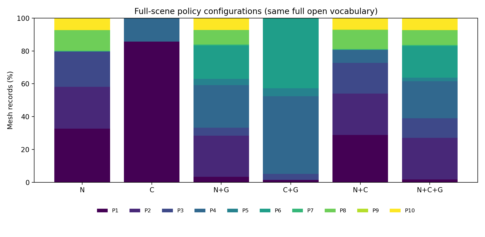
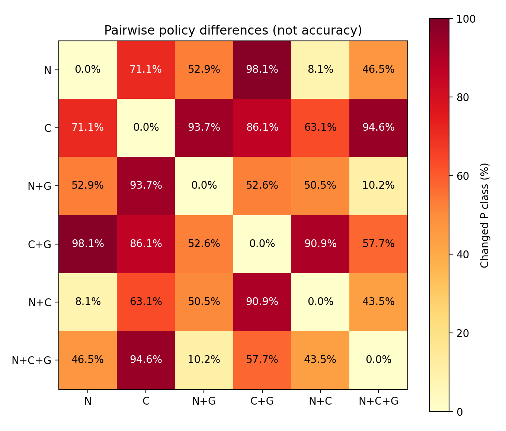

# 手机喇叭检测线.glb 全量语义与结构分析、六种策略配置比较

日期：2026-10-19。当前文件哈希：`0b9a5597b267f63edde781b2dfad3019fb20b4ee75d0ebf3ff708c4b2fc24d7b`。监督权重为 PointNeXt-S、seed=2027、epoch=98，SHA256：`238ed37c8af354ea5bb6532f371ef6003d8fb43e0d6124f44363c55b66ea0493`。

核心观察：在当前规则下，结构组合显著改变策略分布，而开放证据的有效利用率有限；完整融合并未在所有保护分配指标上优于其他配置。本次结果支持流程覆盖与策略行为分析，尚不构成融合准确率或最终几何质量的优越性证明。

## 1. 完成范围与输入身份

本次已实际执行全量监督推理、全量 PointCLIP、门控 PointCLIP、结构规则分析、全量多源融合、门控多源融合，以及六种策略配置。没有把历史 CSV 当作本次结果。

当前 手机喇叭检测线.glb 为 58,071,788 字节、1,167 个带网格节点、1,072 个 mesh；唯一 mesh 三角形 1,609,544 个，按节点实例展开的源三角形 1,723,934 个；含 children 的父节点数为 118。几何与分类逐实例统计，累计父节点世界变换。文件名不足以确定场景身份，应按哈希核对。

覆盖核验：监督 1167/1167、全量开放 1167/1167；门控开放 725 条，恰好等于监督结果的候选集合。各 CSV 的 order/node_index/mesh_index 联合键唯一，六组输出与源记录一一对应，未发现漏行或重复覆盖。

完整原始记录位于 `E:\vk_lod_clusters1\t1\lod_analysis_outputs\four_scenes_seed2027_20261019\手机喇叭检测线`；本目录只保存汇总、配图和逐网格复核表。

## 2. 监督分支与真实场景门控

监督平均置信度 **57.45%**，中位数 **57.21%**。满足 confidence≥0.70 且 top1-top2≥0.08 的记录为 **442 条（37.87%）**；候选为 **725 条（62.13%）**。

这些是置信度与覆盖率，没有人工真实类别，不能解释为场景准确率或错误率。当前阈值下，top1≥0.70 已蕴含间隔至少 0.40，因此 0.08 的间隔阈值不会额外排除这部分记录。不能凭本次统计证明两个门控条件各自都有贡献。

## 3. 开放语义与结构分析

PointCLIP 使用 ViT-B/16、8,192 个采样点、10 个投影视图、top-5。全量开放包含 110 个提示词标签；生产门控配置排除 micro_uncertain 角色，包含 106 个标签。开放 softmax 分数受词表竞争影响，不能与监督置信度当成同一尺度的准确率比较。

全量开放的首选角色分布如下，统计的是模型选择，不是真实角色：

| 首选角色 | 记录数 | 占比 |
|---|---:|---:|
| ordinary_low_detail | 488 | 41.82% |
| micro_uncertain | 412 | 35.30% |
| repeated_fastener | 222 | 19.02% |
| interface_fluid | 35 | 3.00% |
| large_static_bulk | 10 | 0.86% |

开放分支的 top1 平均分数为 0.0580，top1–top2 平均间隔为 0.0144。按当前已有质量规则，只有 **204 条（17.48%）**形成可用角色证据；其中排除 micro_uncertain 后可用于完整融合的为 **167 条（14.31%）**。其余 **963 条**被规则拒绝或判为弱证据。纯 C 的 P1 很多，既受到原始角色预测影响，也受到“缺少可用证据时退回 micro_uncertain”的代码路径影响，不能全部解释成模型认为零件本身不重要。

因此当前开放分支的问题表现为“提示词/投影输出与现有证据质量规则的适配不足”，不能只凭全量运行成功就宣称开放语义有效纠错，也不能在没有真实标签时断言全部弱证据都是错误识别。需要结合人工角色标注检查提示词、投影可辨识度及阈值校准。

结构分支使用包围盒尺度、长宽厚比例、细长/薄片线索、紧致度、面数及密度等描述，经几何原型规则分配角色。它不是另一个训练得到的检测网络，也没有直接测量孔径、齿形或薄壁保持误差。原始结构结果见 `手机喇叭检测线_structure_analysis.csv`。本轮推断没有使用零件名称或装配树语义，名称/层级审计是另行输出的辅助证据。

## 4. 六种全量策略配置

N 为监督语义，C 为开放语义，G 为几何结构。以下六组全部使用同一份全量开放输出，使 N+C 与 N+C+G 也能接触所有记录的开放证据；这是全量配置比较。原生产门控版本另外保存在 `six_gated_production/`，未覆盖或改写现有部署公式。

P1–P3 为较低保护，P8–P10 为较高保护。均值只描述有序 P 编号的分布，不是质量分数。

| 配置 | 记录数 | P1–P3 | P8–P10 | allow_cull 元数据 | 平均 P 编号 |
|---|---:|---:|---:|---:|---:|
| N | 1167 | 79.69% | 19.88% | 58.10% | 3.25 |
| C | 1167 | 85.69% | 0.00% | 85.69% | 1.43 |
| N+G | 1167 | 33.33% | 16.02% | 28.36% | 4.60 |
| C+G | 1167 | 5.23% | 0.00% | 1.46% | 4.82 |
| N+C | 1167 | 72.66% | 18.85% | 54.07% | 3.35 |
| N+C+G | 1167 | 39.07% | 16.37% | 27.08% | 4.55 |

`allow_cull` 是策略输出元数据，不是实际剔除率；当前 GPU 可见性路径没有消费该标志来决定剔除。上表未测量真实删除三角形、简化误差或帧率。

## 5. 分支组合怎样改变了策略

| 比较 | P 等级改变数 | 改变占比 | 转向更高 P | 转向更低 P |
|---|---:|---:|---:|---:|
| N→N+G | 617 | 52.87% | 568 | 49 |
| C→C+G | 1005 | 86.12% | 1005 | 0 |
| N→N+C | 94 | 8.05% | 82 | 12 |
| N+C→N+C+G | 508 | 43.53% | 468 | 40 |
| N→N+C+G | 543 | 46.53% | 501 | 42 |

这些结果说明证据组合对策略输出有实际影响。保护增多可能有利于避免关键件过度简化，也可能增加不必要的几何保留；没有人工关键件参考与相同实际三角预算的几何质量测试，不能确定哪一种分配更正确。

完整融合的 P1–P3 占比为 39.07%，而 N+G 为 33.33%。因此不能表述为“加入更多证据后保护程度必然更高”。完整模式与 N+G 的融合函数/规则不同，两者差异不能全部归因于开放分支。

按源三角形加权，落在 P8–P10 网格中的三角形占比从 N 的 **25.14%** 变为完整融合的 **20.83%**。该量描述原始几何被分配到哪些等级，不是实际三角保留率。网格数量口径下，高保护占比变化较小，但少数大网格的降级对几何规模口径影响明显，应优先复核。

| order | 节点名 | 源三角形数 | 监督预测 | 监督置信度 | N→完整融合 |
|---|---|---:|---|---:|---|
| 288 | NG装配体-1/41PS235B0107_TRAY-1 | 21,102 | plates_discs_shapes | 0.598 | P3→P5 |
| 289 | NG装配体-1/41PS235B0107_TRAY-5 | 21,102 | plates_discs_shapes | 0.659 | P3→P5 |
| 6 | J4 C4-1 | 14,148 | handles_controls | 0.531 | P8→P6 |
| 3 | J1 C4-1 | 12,108 | handles_controls | 0.579 | P8→P6 |
| 38 | 1-1-1 | 11,604 | motors_gearmotors | 0.334 | P1→P6 |

上述高面数网格需要结合零件名称、真实角色和关键边界复核。开放标签和分数不是功能重要性的真值。P6 表示高细节保护，P8 表示结构/控制类保护；不能只凭编号升降断定结果改善。详见 [largest_mesh_policy_changes.csv](largest_mesh_policy_changes.csv)。

完整两两比较见 [lod_pairwise_change_summary.csv](lod_pairwise_change_summary.csv)，全部 1167 条逐网格证据和六组等级见 [per_mesh_policy_audit.csv](per_mesh_policy_audit.csv)，优先人工复核的 30 条见 [manual_review_top30.csv](manual_review_top30.csv)。复核清单按配置分歧和面数排序，不能作为随机抽样准确率估计。

## 6. 全量开放、门控与词表的影响

固定 110 标签词表，将全量开放限制为相同候选集合后，完整融合的 P 等级变化 **13 条（1.11%）**。这描述了开放证据只作用于候选记录时，当前融合规则的行为变化。

在同一候选集合上，再改为生产环境的 106 标签过滤词表，P 等级变化 **3 条（0.26%）**。因此不能把生产门控与全量结果的全部差异都归因于门控本身。

| 配置 | 全量版本：低保护 / 高保护 | 生产门控版本：低保护 / 高保护 |
|---|---:|---:|
| N+C | 72.66% / 18.85% | 71.98% / 17.82% |
| N+C+G | 39.07% / 16.37% | 40.10% / 16.37% |

固定词表后，门控与全量完整融合在 98.89% 的记录上保持相同 P 等级，同时少执行 442 条开放推理。这支持当前规则下减少开放计算的可能性，不等于已经证明不损失识别精度或几何质量。

全量融合中，归一化的基础证据权重均值约为 N=0.468、C=0.011、G=0.520。该统计尚未计入后续类别/结构规则加分，不是各分支的因果贡献或最终影响占比。开放分支有输出，也不等于该记录的开放证据通过了质量筛选并实际参与融合。

## 7. 独立结构与独立开放+结构补充对照

现有 C+G 仍利用监督 confidence/margin 派生的结构不确定性；纯 C 策略也携带监督 confidence 字段，下游 C++ 可据此调整保护。因此原来的六组不能全部视为严格独立分支消融。

为单独回答结构与开放+结构的行为，本次补充两份诊断基线：移除几何原型匹配中的监督 uncertainty_score，并在剩余几何维度重新归一权重；结构权重固定 0.70，开放权重沿用开放质量规则。其输出不含监督类别或 confidence；改变监督预测和置信度后输出保持一致的检查通过。它们属于明确注明方法差异的补充基线，不是悄悄修改生产算法，也不能与原组差值直接解释成单一因素收益。

| 补充基线 | P1–P3 | P8–P10 | allow_cull 元数据 |
|---|---:|---:|---:|
| structure_independent | 12.77% | 0.00% | 9.77% |
| pointclip_structure_independent | 12.51% | 0.00% | 9.51% |

独立 G 与独立 C+G 之间有 **102 条（8.74%）**改变等级。高保护比例见上表；未与人工功能标注核对，不能将结构分支描述为已经识别全部关键功能件。

数据见原始目录的 `手机喇叭检测线_structure_independent.csv` 与 `手机喇叭检测线_pointclip_structure_independent.csv`。

## 8. 与旧场景观察的关系

没有可完整配对的旧场景输出，不进行新旧准确率比较。

## 9. 本次效果应该怎样评价

本次验证了流程能够完整覆盖当前场景，并量化了监督、开放与结构证据如何改变 P1–P10 分配。监督分支的直接接受覆盖率为 37.87%，表明依照当前阈值仍有大量记录需要补充证据；这为融合提供了应用动机，但尚未验证补充证据能够纠错。

分类准确不等于功能角色正确，功能角色正确也不等于最终简化质量更好。本次没有人工类别/角色标签，没有实际执行网格简化、重建 LOD 或 GPU 渲染基准。因此不能报告场景 OA、融合准确率、关键结构保持率或 FPS 提升。

若用于论文，当前结果应命名为“真实场景全量推理与语义策略分配比较”。下一步优先人工核验关键件与高分歧记录，再在相同实际三角预算下比较几何偏差、关键结构保留与时间/显存。正式的单因素消融还需固定同一融合函数、证据质量规则和下游 confidence 处理。

## 10. 来源与复跑

[analysis_summary.json](analysis_summary.json) 保存完整计数与比较，[provenance.json](provenance.json) 保存场景、权重、推理 CSV 及分析代码哈希。各阶段进程状态与耗时保存在原始输出目录的 inference_status.json；失败阶段不会当成空预测参与统计。

使用 `tools/pointclipv2/run_scene_semantic_comparison.py` 指定本场景路径与输出目录，再调用 `analyze_scene_semantics.py` 可复跑。已有神经结果仅在来源和输出哈希一致时复用；分析与策略表重新生成。历史汇总保持原样。

本轮使用经输入、代码、权重及输出哈希核验的推断快照。以下时间属于快照的原始运行，不是本轮复用耗时。运行时间口径：开放全量阶段约 46.9 秒、门控阶段约 33.0 秒，包含进程启动、文本编码、采样与推理，仅为本次单次记录，不是重复 GPU 性能基准。监督阶段的时间可能仅包含对已完成输出的缓存核验，不能将缓存命中的调度时间当作全量监督推理耗时。
