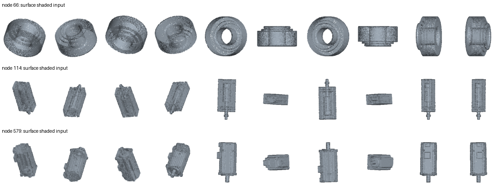

# 开放语义分支升级与对照分析

本轮完成了词库、几何输入、视觉汇总、拒识、语义身份输出、统一融合和渲染CSV导出接口的改造；四场景共7,742个节点。**这是一套已运行的工程升级，尚未证明真实识别准确率提高。** 原版结果保留在four_scenes_seed2027_20261019，不重写历史对照。

## 改了什么

- 原110标签词库换为66物体类别、12上层类别，包含气动、视觉、工艺工具和送料机构等；中文别名只供单独的CAD弱证据使用。每类平衡的名词、外观和CAD描述替代大量同义词重复竞争。未知、微小和不重要不再混为类别。
- 深度输入使用原姿态与确定性PCA主轴姿态，按信息量选择视图；复杂/细长对象增加有限局部视图，局部证据只能在与全局类别一致时补充。
- 增加16,384表面点的法线着色正交视图，补充原低层深度投影难表达的曲面、孔和台阶线索。它是表面点渲染，不是具有完整材质/光照的照片，也不是完整三角形光栅化。
- 按“上层类别—对象大类—精确类型”判别；例如两路都支持螺母、但不能区分盖形/六角时，输出class_only的螺母大类，不假装精确类型已确认。粗文本只能提供有界辅助，不能压过具体视觉证据。绝对相似度、间隔、跨视图一致性及空背景参照共同参与拒识，排名softmax不是正确率。
- 深度与法线着色分别判别：同类才形成共识；细类别分歧只输出上层类别；上层冲突明确拒识；仅一路有支持时限制为粗类别。证据利用率不作为精度提升的替代指标。
- 新融合N/C/G共享同一个函数，G不读监督不确定性，C-only不借监督置信度；额外提供G-only和NCGM。输出resolved_object_class、resolved_source、resolved_status和冲突原因，原监督类别另行保留。高分冲突不再静默覆盖。
- 未知默认中性保护；结构复杂度、冲突与工件上下文可以设置保护下限。未知不直接P1，暂时看不到不表示可以删掉。

实现参考了[PointCLIP V2官方逐视图投影与加权接口](https://github.com/yangyangyang127/PointCLIP_V2/blob/main/zeroshot_cls/trainers/zeroshot.py)以及[CLIP图像预处理](https://github.com/openai/CLIP/blob/main/clip/clip.py)。新增几何着色、多视图汇总和拒识规则属于本项目工程方法，未声称复现官方最优权重或论文精度。原版PointCLIP深度分支本身没有采用标准RGB归一化，新版RGB处理属于方法变化，不能把原版简单说成遗漏预处理的bug。

## 本轮全量结果

| 场景 | 节点 | 旧规则可用开放证据 | 新双渲染非拒识 | 新细类别候选数 | 新拒识数 | N/C上层冲突数 | +M明确名称候选数 |
|---|---:|---:|---:|---:|---:|---:|---:|---:|
| 透气阀产线 | 3347 | 17.21% | 44.49% | 112 | 1858 | 396 | 242 |
| 汽车链接器植入-折弯设备 | 1747 | 24.27% | 35.03% | 146 | 1135 | 265 | 254 |
| 手机喇叭检测线 | 1167 | 14.31% | 38.30% | 38 | 720 | 94 | 352 |
| K31自动铆压机 | 1481 | 33.76% | 34.10% | 42 | 976 | 135 | 269 |

旧规则可用与新非拒识采用不同质量定义，只用于说明行为和工作量，不能把差值叫准确率提升。拒识的节点仍完整保留，未知或冲突明确进入后续保守处理。

新版NCG的基础归一C权重均值为：透气阀产线 22.92%、汽车链接器植入-折弯设备 19.06%、手机喇叭检测线 21.24%、K31自动铆压机 19.10%。这与原固定0.18系数不同，尚未经人工开发集校准；不等于因果贡献。是否真正更合理需要看功能标注和同预算几何误差，不能以权重变大作为成功标准。

## 名称辅助核验：有覆盖率才有解释

名称只产生弱参考，不等于类别真值。下表只取保守词典能映射到已知类别的叶名称；重复实例不独立，支架/安装件与机构本体已做基本区分。候选一致统计含被拒识的视觉候选，避免仅留下容易样本。+M不参加这项评价，因为用名称推断再对照同一名称会循环自证。

| 场景 | 弱名称参考节点 | 旧候选与名称一致数 | 新候选与名称一致数 | 新对象类别覆盖数 / 其中名称一致数 |
|---|---:|---:|---:|---:|
| 透气阀产线 | 107 | 74 | 87 | 4 / 1 |
| 汽车链接器植入-折弯设备 | 125 | 0 | 13 | 4 / 0 |
| 手机喇叭检测线 | 60 | 20 | 20 | 32 / 20 |
| K31自动铆压机 | 167 | 52 | 53 | 56 / 52 |

词表与输入均有改变，因此这不是单因素词库消融，更不是正式OA。缓存中的cached_feature_controls.csv另提供相同新词库下的原姿态均值、原姿态层次、主轴/局部、单独着色与双渲染决策，供后续人工对照。

合并这459个名称弱参考实例，旧候选一致146个，新候选一致173个；新版输出对象类别的覆盖为96/459，其中与名称一致73个。候选与最终输出要分开看，不能把被拒识的好候选当成已经正确采用，也不能只保留容易样本。该参考主要覆盖词典能明确映射的标准零件，并未验证全部66类，更没有验证气动、感知和工艺工具的真实准确率。

## 可核验案例

| 场景 | node_index | 名称 | 监督类别 | 旧开放 | 新视觉候选/状态 | NCG语义身份 | NCGM弱名称身份 |
|---|---:|---|---|---|---|---|---|
| 透气阀产线 | 131 | 弹簧-2 | springs | spacer sleeve | coil_spring（family_only） | family:transmission | known:springs |
| 透气阀产线 | 132 | 弹簧-4 | springs | spacer sleeve | coil_spring（family_only） | family:transmission | known:springs |
| 透气阀产线 | 140 | 弹簧-1 | springs | spacer sleeve | coil_spring（family_only） | family:transmission | known:springs |
| 透气阀产线 | 141 | 弹簧-3 | springs | spacer sleeve | coil_spring（family_only） | family:transmission | known:springs |
| 透气阀产线 | 311 | 极耳胶裁切-1/弹簧-3 | springs | slotted castle nut | coil_spring（family_only） | family:transmission | known:springs |
| 汽车链接器植入-折弯设备 | 151 | 摸具-1/弹簧10X35-1 | springs | spacer sleeve | coil_spring（family_only） | family:transmission | known:springs |
| 汽车链接器植入-折弯设备 | 152 | 摸具-1/弹簧10X35-2 | springs | spacer sleeve | coil_spring（family_only） | family:transmission | known:springs |
| 汽车链接器植入-折弯设备 | 153 | 摸具-1/弹簧10X35-3 | springs | spacer sleeve | coil_spring（family_only） | family:transmission | known:springs |
| 汽车链接器植入-折弯设备 | 154 | 摸具-1/弹簧10X35-4 | springs | spacer sleeve | coil_spring（family_only） | family:transmission | known:springs |
| 汽车链接器植入-折弯设备 | 507 | 018-A冲切-1/摸具总装1-1/弹簧-1 | springs | spacer sleeve | coil_spring（family_only） | family:transmission | known:springs |
| 手机喇叭检测线 | 93 | 轴承-2-1 | washers_rings_spacers | plain disc | flat_washer（family_only） | family:fastening | known:bearings_bushings_guides |
| 手机喇叭检测线 | 94 | 轴承-3-1 | washers_rings_spacers | plain disc | flat_washer（family_only） | family:fastening | known:bearings_bushings_guides |
| 手机喇叭检测线 | 95 | 轴承块2-2-1 | handles_controls | cylindrical pin | shaft_key（class_only） |  | known:bearings_bushings_guides |
| 手机喇叭检测线 | 96 | 轴承块2-3-1 | handles_controls | cylindrical pin | shaft_key（class_only） |  | known:bearings_bushings_guides |
| 手机喇叭检测线 | 150 | 轴承-2-1.001 | washers_rings_spacers | plain disc | flat_washer（family_only） | family:fastening | known:bearings_bushings_guides |
| K31自动铆压机 | 58 | K31-02A（H）螺母-1 | bearings_bushings_guides | cap nut | cap_nut（class_only） |  | known:nuts |
| K31自动铆压机 | 59 | K31-02A（H）螺母-10 | bearings_bushings_guides | cap nut | cap_nut（class_only） |  | known:nuts |
| K31自动铆压机 | 60 | K31-02A（H）螺母-11 | bearings_bushings_guides | cap nut | cap_nut（class_only） |  | known:nuts |
| K31自动铆压机 | 61 | K31-02A（H）螺母-12 | bearings_bushings_guides | cap nut | cap_nut（class_only） |  | known:nuts |
| K31自动铆压机 | 62 | K31-02A（H）螺母-13 | bearings_bushings_guides | cap nut | cap_nut（class_only） |  | known:nuts |

这些是定向复核案例，不是随机精度样本。含“产品”、送料工件、气动/检测对象可能超出现有监督14类。新版可以表达开放身份、粗类别和冲突，但不会把任何一个高分猜测自动变成真值。

## 统一配置与CAD辅助版本

| 场景 | 配置 | P1–P3 | P8–P10 | N/C冲突 |
|---|---|---:|---:|---:|
| 透气阀产线 | N | 48.88% | 24.08% | 0 |
| 透气阀产线 | C | 33.52% | 0.57% | 0 |
| 透气阀产线 | G | 0.00% | 0.00% | 0 |
| 透气阀产线 | NG | 42.28% | 21.15% | 0 |
| 透气阀产线 | CG | 32.24% | 0.00% | 0 |
| 透气阀产线 | NC | 58.08% | 18.05% | 396 |
| 透气阀产线 | NCG | 48.85% | 16.43% | 396 |
| 透气阀产线 | NCGM | 46.79% | 16.25% | 396 |
| 汽车链接器植入-折弯设备 | N | 35.49% | 29.94% | 0 |
| 汽车链接器植入-折弯设备 | C | 28.33% | 0.00% | 0 |
| 汽车链接器植入-折弯设备 | G | 0.00% | 0.00% | 0 |
| 汽车链接器植入-折弯设备 | NG | 30.97% | 24.38% | 0 |
| 汽车链接器植入-折弯设备 | CG | 27.30% | 0.00% | 0 |
| 汽车链接器植入-折弯设备 | NC | 43.73% | 22.32% | 265 |
| 汽车链接器植入-折弯设备 | NCG | 38.24% | 19.75% | 265 |
| 汽车链接器植入-折弯设备 | NCGM | 38.07% | 14.20% | 265 |
| 手机喇叭检测线 | N | 47.04% | 19.88% | 0 |
| 手机喇叭检测线 | C | 25.79% | 0.43% | 0 |
| 手机喇叭检测线 | G | 0.00% | 0.00% | 0 |
| 手机喇叭检测线 | NG | 36.93% | 16.11% | 0 |
| 手机喇叭检测线 | CG | 23.48% | 0.00% | 0 |
| 手机喇叭检测线 | NC | 55.44% | 15.94% | 94 |
| 手机喇叭检测线 | NCG | 42.84% | 13.02% | 94 |
| 手机喇叭检测线 | NCGM | 34.02% | 16.88% | 94 |
| K31自动铆压机 | N | 32.82% | 30.86% | 0 |
| K31自动铆压机 | C | 23.84% | 0.00% | 0 |
| K31自动铆压机 | G | 0.00% | 0.00% | 0 |
| K31自动铆压机 | NG | 27.62% | 24.78% | 0 |
| K31自动铆压机 | CG | 23.57% | 0.00% | 0 |
| K31自动铆压机 | NC | 43.21% | 23.16% | 135 |
| K31自动铆压机 | NCG | 35.72% | 18.03% | 135 |
| K31自动铆压机 | NCGM | 32.55% | 25.25% | 135 |

NCG为纯视觉开放+监督+几何，NCGM额外使用可审计的叶名称与工艺上下文。CAD名称不会进入纯视觉特征或词库排名。父组只能给上下文，不能给所有子零件复制同一个类别；螺母送料盘、CCD安装板等复合名称有单独防误判规则。M输出标为metadata_candidate，仍需要人工确认。

相比旧版，词库、输入、可靠性定义与融合规则均变化，因此旧/新最终P分配不是某一个模块的因果收益。新版各证据开关共享公式；G-only只能支持几何形状保护，不能声称仅凭包围盒识别全部功能。

## 如何使用

项目根目录运行run_open_semantic_v2.bat。它激活gpt-pointnext，自动找到PointCLIPV2_LOD，使用隔离的DLL路径；模型失败会记录并继续后续场景，最后返回失败状态，避免把部分结果汇总成完整结果。成功阶段按输入/输出哈希复用。词库或判别规则变更可用缓存重新评分，无需全部重做视觉编码。

默认导出渲染器既有六配置文件名，模式6对应纯NCG。NCGM另存为显式metadata CSV，不暗中混入六配置。已有不同内容的导出会先备份。需重新打开场景并重建LOD后才会消费新策略；本轮没有重建LOD或测量FPS。可用--no-export仅生成分析结果。

编译后的应用另有第七项“PointNeXt + open semantics + structure + CAD context”，读取NCGM专用文件；该项缺少文件时不会悄悄回退成普通融合。第六项仍保持纯视觉NCG。带可信CAD名称的模型可选择第七项，人工确认名称冲突后再判断功能保护是否合理。

上图分别取K31的三个节点，展示的是孤立零件输入，不是场景可见性测试。孔洞、轮廓、台阶等可作为视觉线索，仍不能仅凭投影认定装配功能。

原始输出：E:\vk_lod_clusters1\t1\lod_analysis_outputs\open_semantic_v2_20261019。新词库：tools/pointclipv2/industrial_open_vocab_v2.json；固定参数：open_semantic_v2_config.json。候选与证据分数没有人工校准，当前四场景应视为开发诊断场景；最终论文需人工类别/功能标签和独立设备评估。

[逐场景对照](scene_comparison.csv)、[名称弱参考](name_proxy_checks.csv)、[冲突复核清单](semantic_conflict_review.csv)、[统一策略分布](unified_policy_comparison.csv)。细节与复现说明见项目中的OPEN_SEMANTIC_V2.md。未删除节点，未宣称真实准确率、关键细节保持或FPS提升。
