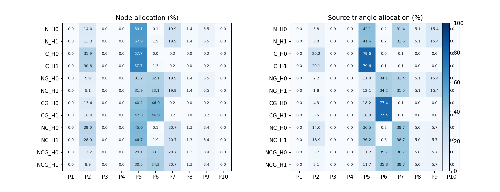

# 六模型六组合与结构树开关全量消融

本次固定神经网络权重、词库和策略阈值，复用逐文件哈希一致的全量推断；对11,000个节点重新执行融合与策略分配。主实验为六模型×六组合×树开关，共72组、132,000条节点策略记录。另有纯G、仅拓扑和叶名称辅助对照，共138组、253,000条记录。没有重训网络或改写已部署CSV。

## 实验定义与可比性

| 符号 | 含义 |
|---|---|
| N | 工业监督编码器候选及置信度 |
| C | 开放视觉语义候选、对象级输出/粗类别/拒识 |
| G | 表面几何风险、形状兼容性和保真约束 |
| H0 | 不使用装配关系、父组尺度或祖先名称；世界变换和输入几何保持不变 |
| H1 | 使用局部装配尺度与受范围限制的祖先名称上下文 |
| HT | 使用拓扑及父组尺度，不读取祖先名称，作为分解H效应的附加对照 |
| M | 直接使用叶名称，仅放附表，不进入主实验 |

六种主组合沿用现有配置：N、C、NG、CG、NC、NCG。纯G是补充参照。H1包含祖先名称，因此不能把H1的全部效果归因于纯拓扑；HT附表用于区分这两个因素。所有主配置M=0、旧NCG几何回退=0，防止回退机制把N/C证据带入单分支消融。

原生产函数中部分上下文检查会读取原始N/C字段。本次在实验边界显式遮蔽被关闭的分支；H0也关闭先前可能隐含使用的父组相对尺寸。因此本表与上一轮“局部关闭功能上下文”的结果并非同一实验口径，不应直接混表比较。

## P1–P10总分布

下表按11,000个网格节点合并统计，分母是节点总数，不是六个场景占比的简单平均。每个P等级均保留，0表示确实没有分到该档。各等级的计数、三角形数和面积占比见Excel与[长表](priority_distribution_long.csv)；场景等权均值另见[宏平均](scene_macro_comparison.csv)。

| 配置 | P1 | P2 | P3 | P4 | P5 | P6 | P7 | P8 | P9 | P10 |
|---|---:|---:|---:|---:|---:|---:|---:|---:|---:|---:|
| N_H0 | 0.00% | 14.02% | 0.00% | 0.00% | 59.06% | 0.12% | 19.90% | 1.40% | 5.50% | 0.00% |
| N_H1 | 0.00% | 13.32% | 0.00% | 0.00% | 57.95% | 1.90% | 19.94% | 1.40% | 5.50% | 0.00% |
| C_H0 | 0.00% | 31.90% | 0.00% | 0.00% | 67.65% | 0.00% | 0.24% | 0.00% | 0.21% | 0.00% |
| C_H1 | 0.00% | 30.64% | 0.00% | 0.00% | 67.65% | 1.26% | 0.24% | 0.00% | 0.21% | 0.00% |
| NG_H0 | 0.00% | 9.90% | 0.00% | 0.00% | 31.15% | 32.15% | 19.90% | 1.40% | 5.50% | 0.00% |
| NG_H1 | 0.00% | 8.08% | 0.00% | 0.00% | 31.94% | 33.15% | 19.94% | 1.40% | 5.50% | 0.00% |
| CG_H0 | 0.00% | 13.39% | 0.00% | 0.00% | 40.16% | 46.00% | 0.24% | 0.00% | 0.21% | 0.00% |
| CG_H1 | 0.00% | 10.35% | 0.00% | 0.00% | 42.28% | 46.92% | 0.24% | 0.00% | 0.21% | 0.00% |
| NC_H0 | 0.00% | 28.96% | 0.00% | 0.00% | 45.63% | 0.05% | 20.67% | 1.28% | 3.40% | 0.00% |
| NC_H1 | 0.00% | 28.02% | 0.00% | 0.00% | 44.65% | 1.93% | 20.72% | 1.28% | 3.40% | 0.00% |
| NCG_H0 | 0.00% | 12.22% | 0.00% | 0.00% | 29.08% | 33.35% | 20.67% | 1.28% | 3.40% | 0.00% |
| NCG_H1 | 0.00% | 9.88% | 0.00% | 0.00% | 30.53% | 34.19% | 20.72% | 1.28% | 3.40% | 0.00% |

主实验P1/P3/P4/P10均为0。这反映当前规则实际只激活部分档位：未知默认至少P5，大体量部件没有单凭尺寸进入P3，主实验关闭叶名称使场景参考件P4不激活，功能优先级表最高为P9。不能为填满十档而人工分配；论文应说明保留档位，或在后续独立版本重新定义分级。

## 节点占比与三角形占比

以下分母是原始节点实例引用的三角形总数，同一网格的多次实例会重复计入。它衡量几何工作量分布，不等于实际显存、屏幕贡献或运行时可见性。

| 配置 | P1 | P2 | P3 | P4 | P5 | P6 | P7 | P8 | P9 | P10 |
|---|---:|---:|---:|---:|---:|---:|---:|---:|---:|---:|
| N_H0 | 0.00% | 5.80% | 0.00% | 0.00% | 42.06% | 0.20% | 31.45% | 5.13% | 15.36% | 0.00% |
| N_H1 | 0.00% | 5.76% | 0.00% | 0.00% | 41.63% | 0.65% | 31.46% | 5.13% | 15.36% | 0.00% |
| C_H0 | 0.00% | 20.22% | 0.00% | 0.00% | 79.65% | 0.00% | 0.11% | 0.00% | 0.02% | 0.00% |
| C_H1 | 0.00% | 20.10% | 0.00% | 0.00% | 79.65% | 0.12% | 0.11% | 0.00% | 0.02% | 0.00% |
| NG_H0 | 0.00% | 2.18% | 0.00% | 0.00% | 11.80% | 34.07% | 31.45% | 5.13% | 15.36% | 0.00% |
| NG_H1 | 0.00% | 1.81% | 0.00% | 0.00% | 12.08% | 34.16% | 31.46% | 5.13% | 15.36% | 0.00% |
| CG_H0 | 0.00% | 4.31% | 0.00% | 0.00% | 18.19% | 77.37% | 0.11% | 0.00% | 0.02% | 0.00% |
| CG_H1 | 0.00% | 3.55% | 0.00% | 0.00% | 18.88% | 77.44% | 0.11% | 0.00% | 0.02% | 0.00% |
| NC_H0 | 0.00% | 13.97% | 0.00% | 0.00% | 36.53% | 0.16% | 38.65% | 4.99% | 5.69% | 0.00% |
| NC_H1 | 0.00% | 13.85% | 0.00% | 0.00% | 36.24% | 0.56% | 38.66% | 4.99% | 5.69% | 0.00% |
| NCG_H0 | 0.00% | 3.73% | 0.00% | 0.00% | 11.19% | 35.73% | 38.65% | 4.99% | 5.69% | 0.00% |
| NCG_H1 | 0.00% | 3.12% | 0.00% | 0.00% | 11.70% | 35.83% | 38.66% | 4.99% | 5.69% | 0.00% |

例如NCG_H1的P2占节点9.88%，占原始三角形3.12%；两种口径应同时看，不能以小零件数量多就认定它们支配几何预算。P5/P6仍可能是未知类型的保守保护，并不代表识别出了具体器件。

## 结构树成对变化

| 组合 | P级改变 | 升级 | 降级 | 功能候选改变 | 对象身份改变 | 平均P变化 |
|---|---:|---:|---:|---:|---:|---:|
| N | 200 | 200 | 0 | 200 | 0 | +0.0395 |
| C | 139 | 139 | 0 | 139 | 0 | +0.0505 |
| NG | 243 | 243 | 0 | 200 | 0 | +0.0653 |
| CG | 334 | 334 | 0 | 182 | 43 | +0.1003 |
| NC | 211 | 211 | 0 | 211 | 0 | +0.0480 |
| NCG | 285 | 285 | 0 | 250 | 39 | +0.0795 |

a没有可用装配树，H0/H1各组合的决策应完全一致，是负对照。其他场景里，H可把安装件区分为检测/运动支撑，把局部精密装配的紧固件提高保护。含G时，父组尺度也可能触发形状与“标准紧固件”身份不兼容，撤回身份并增加未知；这属于保守回退，不是新增识别正确数。

| 场景（NCG） | P级改变 | 功能候选改变 | 身份撤回/改变 |
|---|---:|---:|---:|
| a | 0 | 0 | 0 |
| b | 17 | 36 | 1 |
| c | 57 | 39 | 0 |
| d | 14 | 32 | 26 |
| e | 79 | 11 | 0 |
| f | 118 | 132 | 12 |

f的局部装配作用变化最多；e的P级变化多于功能变化，说明父组几何尺度也参与了动作。d有26个身份变化，主要是含G后的兼容性回退，不能算识别出了26个新类型。

| 组合 | H0→HT的P级改变 | HT→H1的P级改变 | H0→HT功能改变 | HT→H1功能改变 |
|---|---:|---:|---:|---:|
| N | 0 | 200 | 0 | 200 |
| C | 0 | 139 | 0 | 139 |
| NG | 128 | 115 | 0 | 200 |
| CG | 233 | 101 | 43 | 139 |
| NC | 0 | 211 | 0 | 211 |
| NCG | 187 | 98 | 39 | 211 |

上表将父组尺度与祖先语义分开对照；改变节点集合可能重叠，计数不能直接相加当成可加的因果贡献。

[完整成对表](tree_pairs_with_total.csv)、[10×10迁移矩阵](priority_transitions.csv)、[改变节点与原因](changed_nodes.csv)保留了不变、升级和降级，不能只展示升级案例。

## 置信度与未解决类型

N可靠条件为概率≥0.70且第一、二候选差值≥0.08；“非常低”另指概率<0.40，间隔不足可能与概率分组重叠。C不按同一概率阈值判定：accepted/class_only为对象级，family_only仅粗类别，abstain为拒识。C质量分数未校准，不能与N概率直接比较。对象级输出也不等于判断正确。

| 场景 | 节点 | N未达可靠条件 | C对象级输出 | C仅粗类别 | C拒识 |
|---|---:|---:|---:|---:|---:|
| a | 1778 | 1136（63.89%） | 704（39.60%） | 205 | 869 |
| b | 1481 | 1006（67.93%） | 353（23.84%） | 152 | 976 |
| c | 1747 | 1133（64.85%） | 495（28.33%） | 117 | 1135 |
| d | 1167 | 725（62.13%） | 306（26.22%） | 141 | 720 |
| e | 3347 | 1696（50.67%） | 1143（34.15%） | 346 | 1858 |
| f | 1480 | 928（62.70%） | 557（37.64%） | 225 | 698 |
| ALL | 11000 | 6624（60.22%） | 3558（32.35%） | 1186 | 6256 |

按原始三角形加权，N未可靠节点占47.14%，C没有对象级输出的节点占79.65%。因此开放分支的不足并非仅由微小零件数量多造成，大量几何工作量也处在粗类别/拒识状态。

| 配置 | 无对象级输出 | 功能未知 | N/C冲突 | 几何/类型冲突 | 需复核 |
|---|---:|---:|---:|---:|---:|
| N_H0 | 6624（60.22%） | 8022 | 0 | 0 | 6624 |
| N_H1 | 6624（60.22%） | 8022 | 0 | 0 | 7259 |
| C_H0 | 7442（67.65%） | 7466 | 0 | 0 | 6256 |
| C_H1 | 7442（67.65%） | 7466 | 0 | 0 | 6396 |
| NG_H0 | 6624（60.22%） | 8022 | 0 | 0 | 6624 |
| NG_H1 | 6624（60.22%） | 8022 | 0 | 0 | 7259 |
| CG_H0 | 7445（67.68%） | 7469 | 0 | 3 | 6259 |
| CG_H1 | 7488（68.07%） | 7512 | 0 | 46 | 6442 |
| NC_H0 | 5389（48.99%） | 6699 | 1529 | 0 | 5156 |
| NC_H1 | 5389（48.99%） | 6699 | 1529 | 0 | 5591 |
| NCG_H0 | 5392（49.02%） | 6702 | 1529 | 3 | 5158 |
| NCG_H1 | 5431（49.37%） | 6741 | 1529 | 42 | 5628 |

“需复核”还包括上下文候选，不等于低置信度数量；功能未知与没有对象级身份也是不同指标。G不承担类别识别，不应把它没有分类概率解释成100%识别失败。原始候选、置信度和名称弱提示保存在[source_uncertainty_nodes.csv](source_uncertainty_nodes.csv)。

### 低置信候选类别

以下按低置信候选数量排序。“类别”来自预测候选，不是真实标签；一类数量多，可能因为原本就常被预测到，必须同时看类内低置信比例。C表包含被拒识的候选，不能把这些候选当已采用的识别结果。

**N分支，低置信候选最多的前10类**

| 候选类型 | 候选总数 | 低置信数 | 类内比例 | 占该分支低置信池 |
|---|---:|---:|---:|---:|
| pins_rivets_keys | 1758 | 1371 | 77.99% | 20.70% |
| bearings_bushings_guides | 1473 | 1026 | 69.65% | 15.49% |
| handles_controls | 1124 | 1003 | 89.23% | 15.14% |
| joints_clamps_structural_connectors | 1122 | 716 | 63.81% | 10.81% |
| plates_discs_shapes | 1889 | 612 | 32.40% | 9.24% |
| pipe_fittings_valves_nozzles | 644 | 386 | 59.94% | 5.83% |
| washers_rings_spacers | 894 | 379 | 42.39% | 5.72% |
| screws_bolts_studs | 751 | 335 | 44.61% | 5.06% |
| rotating_fluid_machinery | 307 | 259 | 84.36% | 3.91% |
| motors_gearmotors | 248 | 142 | 57.26% | 2.14% |

**C分支，低置信候选最多的前10类**

| 候选类型 | 候选总数 | 低置信数 | 类内比例 | 占该分支低置信池 |
|---|---:|---:|---:|---:|
| plain_block | 2542 | 2542 | 100.00% | 34.16% |
| shaft_key | 1906 | 1131 | 59.34% | 15.20% |
| flat_washer | 819 | 738 | 90.11% | 9.92% |
| dowel_pin | 2410 | 364 | 15.10% | 4.89% |
| cap_nut | 474 | 321 | 67.72% | 4.31% |
| threaded_stud | 361 | 307 | 85.04% | 4.13% |
| die_block | 294 | 294 | 100.00% | 3.95% |
| mounting_plate | 256 | 232 | 90.62% | 3.12% |
| nozzle | 228 | 226 | 99.12% | 3.04% |
| hex_nut | 456 | 220 | 48.25% | 2.96% |

[全部类别、全部场景](low_confidence_candidate_types.csv)同时提供计数、类内比例、低置信池占比和关联三角形数。

## 几何简化诊断与成本

主72组都对所有节点做了单网格QEM诊断，按相同源几何、相同简化器，分别执行各策略的远景请求比例。相同网格/比例复用结果；没有应用前端特征锁、cluster层次或剔除。

| 组合 | H0实际保留比例 | H1实际保留比例 | H0平均QEM误差 | H1平均QEM误差 | H0/H1轴向收缩>10% | H0/H1显著分量丢失节点 |
|---|---:|---:|---:|---:|---:|---:|
| N | 52.0718% | 52.0723% | 0.04502 | 0.04478 | 108 / 108 | 21 / 21 |
| C | 49.5795% | 49.5801% | 0.05107 | 0.05092 | 143 / 143 | 21 / 21 |
| NG | 52.3650% | 52.3654% | 0.04383 | 0.04362 | 80 / 80 | 21 / 21 |
| CG | 50.5000% | 50.5029% | 0.04863 | 0.04846 | 105 / 105 | 21 / 21 |
| NC | 51.3353% | 51.3359% | 0.04556 | 0.04542 | 83 / 83 | 21 / 21 |
| NCG | 51.6809% | 51.6839% | 0.04372 | 0.04357 | 68 / 68 | 21 / 21 |

NCG加H后，实际简化结果只增加1,208个三角形，占源三角形的0.002961个百分点；平均QEM误差相对降低0.36%。这是较小的全局变化。

NCG_H1请求保留32.1244%，实际保留51.6839%，说明请求比例没有等量转化为实际简化。可能受到网格拓扑、边界及简化器约束限制；需要在实际LOD链路中定位，不能只继续调语义权重。所有主组合在该探针下均有21个显著分量丢失节点，H没有解决这项风险。

QEM误差相对两倍RMS半径归一化，非Hausdorff距离；分量丢失检查的是源表面积至少0.1%的分离表面分量，非孔洞保持率。不同策略实际预算不同，误差降低时必须同时看增加的三角形。这里没有真实LOD、图像质量或FPS结论。

## 名称弱参考与分析结论

| 配置 | 名称参考节点 | 对象身份覆盖 | 与名称一致 | 所有参考中一致率 | 名称组宏平均 |
|---|---:|---:|---:|---:|---:|
| N_H0 | 655 | 349 | 232 | 35.42% | 31.15% |
| N_H1 | 655 | 349 | 232 | 35.42% | 31.15% |
| C_H0 | 655 | 178 | 98 | 14.96% | 6.22% |
| C_H1 | 655 | 178 | 98 | 14.96% | 6.22% |
| NG_H0 | 655 | 349 | 232 | 35.42% | 31.15% |
| NG_H1 | 655 | 349 | 232 | 35.42% | 31.15% |
| CG_H0 | 655 | 178 | 98 | 14.96% | 6.22% |
| CG_H1 | 655 | 174 | 98 | 14.96% | 6.22% |
| NC_H0 | 655 | 238 | 171 | 26.11% | 19.74% |
| NC_H1 | 655 | 238 | 171 | 26.11% | 19.74% |
| NCG_H0 | 655 | 238 | 171 | 26.11% | 19.74% |
| NCG_H1 | 655 | 234 | 171 | 26.11% | 19.74% |

仅评分能保守映射到14类的名称，655个实例包含重复件，不等于655个独立样本；a没有这类参考。M辅助输出排除在该评价之外。b–e与此前模型相同，六场景都参与过方法开发，本轮不是独立测试集，也没有计算真实OA/Macro-F1或统计显著性。

NCG中N/C冲突为1529个节点（13.90%）。加入G/H的价值应首先看形状风险是否被保护、冲突是否被显式保留，不能把更高P等级或更少剔除解释成更高语义准确率。

从N→NG、C→CG、NC→NCG的对比看，G主要重新分配P5/P6及几何保护要求；它不会凭几何证明装配功能。H主要改变局部装配作用与约束，未重算视觉候选。N与C的融合既可补充对象证据，也会保留高分分歧；是否有收益需要覆盖、弱参考一致性、几何预算与误差一起判断。

**融合尚未显示盲识别优势。** N_H0在名称弱参考中覆盖349、一致232；NCG_H1覆盖234、一致171。融合撤回了部分冲突身份，覆盖下降，不能只报已覆盖子集的一致比例来宣称改善。

**结构树的全局几何影响较小。** NCG中P级改变285个节点，占2.59%，作用候选改变250个。它主要影响局部关系；不能从这些计数推断全场景显著收益。

**开放分支仍偏向标准件与通用形状。** C_H0的P2与P5合计超过99%，对象级输出覆盖有限；大量块状、模具、安装板等候选未能采用。C+G将很多节点转入P6，说明几何保护补充了作用，但不能证明开放语义已经识别了这些非标件。

论文可将本实验定位为“固定编码器下的分支与装配上下文策略消融”。当前结果不支持将P1–P10当成已全部充分使用的十类，也不支持声称结构树显著提高了盲分类准确率。

## 各模型P1–P10节点占比完整表

### a.glb：无可用名称/装配树

| 配置 | P1 | P2 | P3 | P4 | P5 | P6 | P7 | P8 | P9 | P10 |
|---|---:|---:|---:|---:|---:|---:|---:|---:|---:|---:|
| N_H0 | 0.00% | 13.84% | 0.00% | 0.00% | 63.10% | 0.39% | 18.34% | 1.29% | 3.04% | 0.00% |
| N_H1 | 0.00% | 13.84% | 0.00% | 0.00% | 63.10% | 0.39% | 18.34% | 1.29% | 3.04% | 0.00% |
| C_H0 | 0.00% | 38.36% | 0.00% | 0.00% | 60.40% | 0.00% | 0.00% | 0.00% | 1.24% | 0.00% |
| C_H1 | 0.00% | 38.36% | 0.00% | 0.00% | 60.40% | 0.00% | 0.00% | 0.00% | 1.24% | 0.00% |
| NG_H0 | 0.00% | 10.57% | 0.00% | 0.00% | 30.65% | 36.11% | 18.34% | 1.29% | 3.04% | 0.00% |
| NG_H1 | 0.00% | 10.57% | 0.00% | 0.00% | 30.65% | 36.11% | 18.34% | 1.29% | 3.04% | 0.00% |
| CG_H0 | 0.00% | 13.78% | 0.00% | 0.00% | 38.47% | 46.51% | 0.00% | 0.00% | 1.24% | 0.00% |
| CG_H1 | 0.00% | 13.78% | 0.00% | 0.00% | 38.47% | 46.51% | 0.00% | 0.00% | 1.24% | 0.00% |
| NC_H0 | 0.00% | 32.34% | 0.00% | 0.00% | 44.94% | 0.00% | 19.01% | 1.07% | 2.64% | 0.00% |
| NC_H1 | 0.00% | 32.34% | 0.00% | 0.00% | 44.94% | 0.00% | 19.01% | 1.07% | 2.64% | 0.00% |
| NCG_H0 | 0.00% | 10.57% | 0.00% | 0.00% | 30.20% | 36.50% | 19.01% | 1.07% | 2.64% | 0.00% |
| NCG_H1 | 0.00% | 10.57% | 0.00% | 0.00% | 30.20% | 36.50% | 19.01% | 1.07% | 2.64% | 0.00% |

### b.glb：K31自动铆压机

| 配置 | P1 | P2 | P3 | P4 | P5 | P6 | P7 | P8 | P9 | P10 |
|---|---:|---:|---:|---:|---:|---:|---:|---:|---:|---:|
| N_H0 | 0.00% | 8.31% | 0.00% | 0.00% | 60.90% | 0.41% | 20.46% | 2.77% | 7.16% | 0.00% |
| N_H1 | 0.00% | 7.63% | 0.00% | 0.00% | 59.96% | 2.03% | 20.46% | 2.77% | 7.16% | 0.00% |
| C_H0 | 0.00% | 23.84% | 0.00% | 0.00% | 76.16% | 0.00% | 0.00% | 0.00% | 0.00% | 0.00% |
| C_H1 | 0.00% | 21.81% | 0.00% | 0.00% | 76.16% | 2.03% | 0.00% | 0.00% | 0.00% | 0.00% |
| NG_H0 | 0.00% | 5.06% | 0.00% | 0.00% | 36.73% | 27.82% | 20.46% | 2.77% | 7.16% | 0.00% |
| NG_H1 | 0.00% | 4.59% | 0.00% | 0.00% | 36.19% | 28.83% | 20.46% | 2.77% | 7.16% | 0.00% |
| CG_H0 | 0.00% | 12.42% | 0.00% | 0.00% | 44.90% | 42.67% | 0.00% | 0.00% | 0.00% | 0.00% |
| CG_H1 | 0.00% | 11.28% | 0.00% | 0.00% | 45.24% | 43.48% | 0.00% | 0.00% | 0.00% | 0.00% |
| NC_H0 | 0.00% | 21.27% | 0.00% | 0.00% | 49.97% | 0.41% | 23.36% | 2.36% | 2.63% | 0.00% |
| NC_H1 | 0.00% | 19.51% | 0.00% | 0.00% | 49.36% | 2.77% | 23.36% | 2.36% | 2.63% | 0.00% |
| NCG_H0 | 0.00% | 10.87% | 0.00% | 0.00% | 32.48% | 28.29% | 23.36% | 2.36% | 2.63% | 0.00% |
| NCG_H1 | 0.00% | 9.93% | 0.00% | 0.00% | 32.48% | 29.24% | 23.36% | 2.36% | 2.63% | 0.00% |

### c.glb：汽车链接器植入-折弯设备

| 配置 | P1 | P2 | P3 | P4 | P5 | P6 | P7 | P8 | P9 | P10 |
|---|---:|---:|---:|---:|---:|---:|---:|---:|---:|---:|
| N_H0 | 0.00% | 10.59% | 0.00% | 0.00% | 57.53% | 0.00% | 25.70% | 1.89% | 4.29% | 0.00% |
| N_H1 | 0.00% | 10.59% | 0.00% | 0.00% | 55.58% | 1.95% | 25.70% | 1.89% | 4.29% | 0.00% |
| C_H0 | 0.00% | 28.33% | 0.00% | 0.00% | 71.67% | 0.00% | 0.00% | 0.00% | 0.00% | 0.00% |
| C_H1 | 0.00% | 28.11% | 0.00% | 0.00% | 71.67% | 0.23% | 0.00% | 0.00% | 0.00% | 0.00% |
| NG_H0 | 0.00% | 7.21% | 0.00% | 0.00% | 30.28% | 30.62% | 25.70% | 1.89% | 4.29% | 0.00% |
| NG_H1 | 0.00% | 6.12% | 0.00% | 0.00% | 30.39% | 31.60% | 25.70% | 1.89% | 4.29% | 0.00% |
| CG_H0 | 0.00% | 13.28% | 0.00% | 0.00% | 35.43% | 51.29% | 0.00% | 0.00% | 0.00% | 0.00% |
| CG_H1 | 0.00% | 10.65% | 0.00% | 0.00% | 38.01% | 51.35% | 0.00% | 0.00% | 0.00% | 0.00% |
| NC_H0 | 0.00% | 25.19% | 0.00% | 0.00% | 46.08% | 0.00% | 24.56% | 1.89% | 2.29% | 0.00% |
| NC_H1 | 0.00% | 24.84% | 0.00% | 0.00% | 44.19% | 2.12% | 24.67% | 1.89% | 2.29% | 0.00% |
| NCG_H0 | 0.00% | 11.96% | 0.00% | 0.00% | 26.22% | 33.09% | 24.56% | 1.89% | 2.29% | 0.00% |
| NCG_H1 | 0.00% | 9.67% | 0.00% | 0.00% | 27.36% | 34.12% | 24.67% | 1.89% | 2.29% | 0.00% |

### d.glb：手机喇叭检测线

| 配置 | P1 | P2 | P3 | P4 | P5 | P6 | P7 | P8 | P9 | P10 |
|---|---:|---:|---:|---:|---:|---:|---:|---:|---:|---:|
| N_H0 | 0.00% | 13.37% | 0.00% | 0.00% | 71.64% | 0.00% | 13.28% | 1.03% | 0.69% | 0.00% |
| N_H1 | 0.00% | 13.37% | 0.00% | 0.00% | 70.61% | 0.94% | 13.37% | 1.03% | 0.69% | 0.00% |
| C_H0 | 0.00% | 25.79% | 0.00% | 0.00% | 73.78% | 0.00% | 0.43% | 0.00% | 0.00% | 0.00% |
| C_H1 | 0.00% | 25.79% | 0.00% | 0.00% | 73.78% | 0.00% | 0.43% | 0.00% | 0.00% | 0.00% |
| NG_H0 | 0.00% | 12.68% | 0.00% | 0.00% | 35.99% | 36.33% | 13.28% | 1.03% | 0.69% | 0.00% |
| NG_H1 | 0.00% | 12.68% | 0.00% | 0.00% | 34.96% | 37.28% | 13.37% | 1.03% | 0.69% | 0.00% |
| CG_H0 | 0.00% | 11.83% | 0.00% | 0.00% | 44.73% | 43.02% | 0.43% | 0.00% | 0.00% | 0.00% |
| CG_H1 | 0.00% | 11.14% | 0.00% | 0.00% | 45.42% | 43.02% | 0.43% | 0.00% | 0.00% | 0.00% |
| NC_H0 | 0.00% | 28.28% | 0.00% | 0.00% | 56.38% | 0.00% | 13.62% | 1.03% | 0.69% | 0.00% |
| NC_H1 | 0.00% | 28.28% | 0.00% | 0.00% | 55.87% | 0.43% | 13.71% | 1.03% | 0.69% | 0.00% |
| NCG_H0 | 0.00% | 14.22% | 0.00% | 0.00% | 32.48% | 37.96% | 13.62% | 1.03% | 0.69% | 0.00% |
| NCG_H1 | 0.00% | 13.54% | 0.00% | 0.00% | 32.65% | 38.39% | 13.71% | 1.03% | 0.69% | 0.00% |

### e.glb：透气阀产线

| 配置 | P1 | P2 | P3 | P4 | P5 | P6 | P7 | P8 | P9 | P10 |
|---|---:|---:|---:|---:|---:|---:|---:|---:|---:|---:|
| N_H0 | 0.00% | 17.09% | 0.00% | 0.00% | 55.42% | 0.00% | 18.70% | 0.99% | 7.80% | 0.00% |
| N_H1 | 0.00% | 17.09% | 0.00% | 0.00% | 55.03% | 0.39% | 18.70% | 0.99% | 7.80% | 0.00% |
| C_H0 | 0.00% | 33.52% | 0.00% | 0.00% | 65.85% | 0.00% | 0.63% | 0.00% | 0.00% | 0.00% |
| C_H1 | 0.00% | 33.49% | 0.00% | 0.00% | 65.85% | 0.03% | 0.63% | 0.00% | 0.00% | 0.00% |
| NG_H0 | 0.00% | 9.80% | 0.00% | 0.00% | 28.32% | 34.39% | 18.70% | 0.99% | 7.80% | 0.00% |
| NG_H1 | 0.00% | 7.59% | 0.00% | 0.00% | 30.45% | 34.48% | 18.70% | 0.99% | 7.80% | 0.00% |
| CG_H0 | 0.00% | 10.61% | 0.00% | 0.00% | 38.75% | 50.01% | 0.63% | 0.00% | 0.00% | 0.00% |
| CG_H1 | 0.00% | 7.53% | 0.00% | 0.00% | 41.80% | 50.04% | 0.63% | 0.00% | 0.00% | 0.00% |
| NC_H0 | 0.00% | 32.21% | 0.00% | 0.00% | 40.69% | 0.00% | 20.53% | 0.96% | 5.62% | 0.00% |
| NC_H1 | 0.00% | 32.18% | 0.00% | 0.00% | 40.39% | 0.33% | 20.53% | 0.96% | 5.62% | 0.00% |
| NCG_H0 | 0.00% | 10.55% | 0.00% | 0.00% | 26.47% | 35.88% | 20.53% | 0.96% | 5.62% | 0.00% |
| NCG_H1 | 0.00% | 8.19% | 0.00% | 0.00% | 28.80% | 35.91% | 20.53% | 0.96% | 5.62% | 0.00% |

### f.glb：圆形电容穿心焊接机

| 配置 | P1 | P2 | P3 | P4 | P5 | P6 | P7 | P8 | P9 | P10 |
|---|---:|---:|---:|---:|---:|---:|---:|---:|---:|---:|
| N_H0 | 0.00% | 17.57% | 0.00% | 0.00% | 52.50% | 0.00% | 22.30% | 0.81% | 6.82% | 0.00% |
| N_H1 | 0.00% | 13.04% | 0.00% | 0.00% | 49.12% | 7.70% | 22.50% | 0.81% | 6.82% | 0.00% |
| C_H0 | 0.00% | 37.57% | 0.00% | 0.00% | 62.36% | 0.00% | 0.00% | 0.00% | 0.07% | 0.00% |
| C_H1 | 0.00% | 30.54% | 0.00% | 0.00% | 62.36% | 7.03% | 0.00% | 0.00% | 0.07% | 0.00% |
| NG_H0 | 0.00% | 15.14% | 0.00% | 0.00% | 29.80% | 25.14% | 22.30% | 0.81% | 6.82% | 0.00% |
| NG_H1 | 0.00% | 8.38% | 0.00% | 0.00% | 32.03% | 29.46% | 22.50% | 0.81% | 6.82% | 0.00% |
| CG_H0 | 0.00% | 21.55% | 0.00% | 0.00% | 42.64% | 35.74% | 0.00% | 0.00% | 0.07% | 0.00% |
| CG_H1 | 0.00% | 10.74% | 0.00% | 0.00% | 47.57% | 41.62% | 0.00% | 0.00% | 0.07% | 0.00% |
| NC_H0 | 0.00% | 30.27% | 0.00% | 0.00% | 44.26% | 0.00% | 21.28% | 0.68% | 3.51% | 0.00% |
| NC_H1 | 0.00% | 25.47% | 0.00% | 0.00% | 40.95% | 7.97% | 21.42% | 0.68% | 3.51% | 0.00% |
| NCG_H0 | 0.00% | 18.04% | 0.00% | 0.00% | 30.95% | 25.54% | 21.28% | 0.68% | 3.51% | 0.00% |
| NCG_H1 | 0.00% | 10.20% | 0.00% | 0.00% | 34.93% | 29.26% | 21.42% | 0.68% | 3.51% | 0.00% |

## 文件

- `六模型六组合与结构树消融完整对比.xlsx`：可筛选的汇总、各P节点/三角形比例、树开关差异、低置信类型、几何诊断和原始统计计数。
- [主72组原始统计（另含12行总计）](main_72_comparison.csv)、[主配置置信度与冲突](main_confidence_and_conflicts.csv)、[名称弱参考](blind_name_reference_comparison.csv)。
- [HT、纯G、M辅助附表](supplementary_controls.csv)；M辅助不做名称一致率评分。
- `provenance.json`记录源文件和策略结果哈希；节点策略和几何明细在`lod_analysis_outputs/six_scene_factorial_ablation_20261020`。

主实验固定M=0与迁移回退=0，与当前第七项部署策略不是同一配置。此次只生成分析结果，没有替换渲染器策略。
