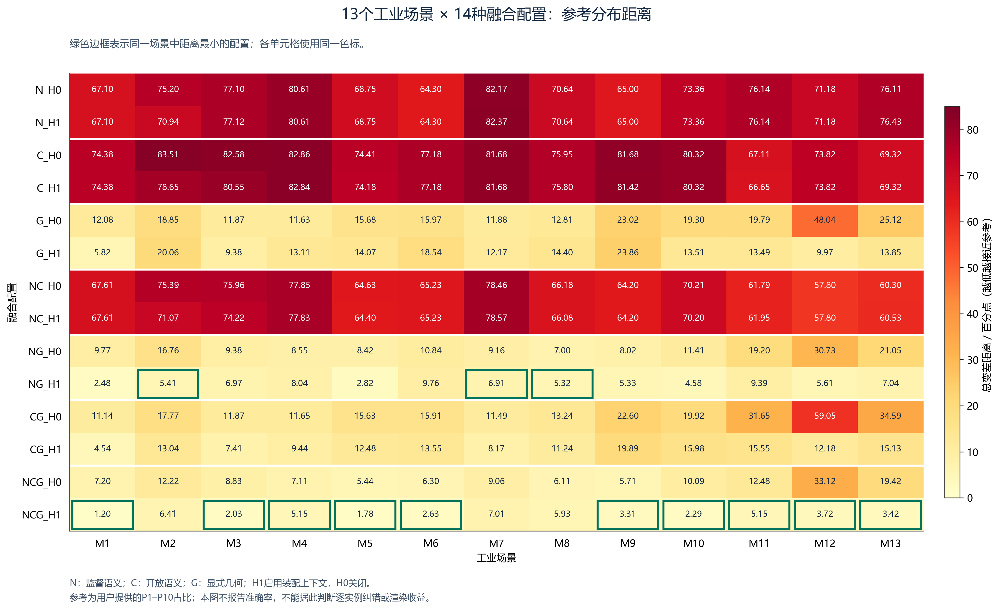
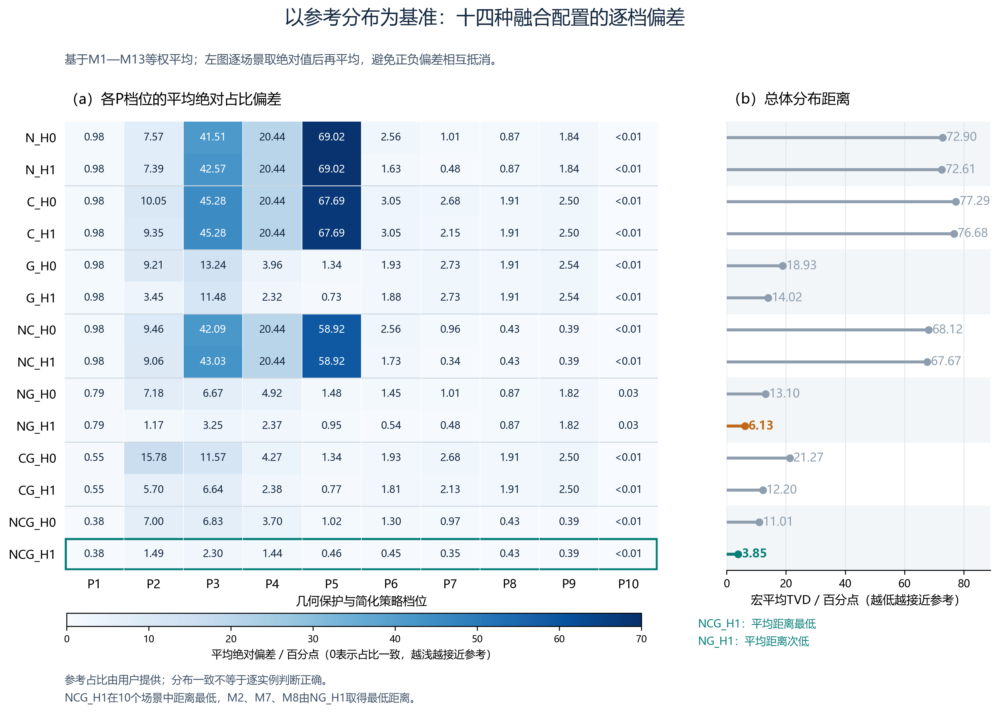

### 5.3.2 多源分支消融结果与分析

表5-5汇总十四种配置的对象输出、功能未明确比例、监督与开放候选分歧及宏平均策略分布距离。图5-1进一步比较各场景与参考分布的差异，图5-2以参考占比为基准展示各P档位的平均绝对偏差，分别从总体指标、场景差异与档位偏差三个层面分析融合结果。

**表5-5 十四种融合配置的输出状态与策略分布距离**

| 配置 | 无对象级输出／% | 功能未明确／% | N/C分歧／% | 宏平均分布距离／百分点↓ |
|---|---:|---:|---:|---:|
| N_H0 | 60.33 | 75.07 | — | 72.90 |
| N_H1 | 60.33 | 75.07 | — | 72.61 |
| C_H0 | 73.75 | 73.79 | — | 77.29 |
| C_H1 | 73.75 | 73.79 | — | 76.68 |
| G_H0 | 100.00 | 100.00 | — | 18.93 |
| G_H1 | 100.00 | 100.00 | — | 14.02 |
| NC_H0 | 51.32 | 64.67 | 13.30 | 68.12 |
| NC_H1 | 51.32 | 64.67 | 13.30 | 67.67 |
| NG_H0 | 60.33 | 75.07 | — | 13.10 |
| NG_H1 | 60.33 | 75.07 | — | 6.13 |
| CG_H0 | 73.75 | 73.79 | — | 21.27 |
| CG_H1 | 73.87 | 73.91 | — | 12.20 |
| NCG_H0 | 51.33 | 64.67 | 13.30 | 11.01 |
| NCG_H1 | 51.44 | 64.78 | 13.30 | **3.85** |

注：前三项按68,972个有效实例合并统计，分布距离对13个场景等权平均。N/C分歧仅在同时启用两分支时统计，其余记为“—”。纯G不承担对象与功能识别，其前两项100%表示未产生对应语义输出。上述比例均不代表识别错误率。

完整融合在H0和H1条件下均取得最低宏平均分布距离，NCG_H1为3.85个百分点。与其相比，删除监督、开放和几何分支后，距离分别增加8.35、2.28和63.82个百分点；H0切换至H1后，完整融合的平均距离减少7.16个百分点。上述差值反映固定融合与回退规则下的条件消融结果，各分支存在交互，不能相加为独立贡献。

监督与开放分支首先表现为候选覆盖的互补。关闭上下文时，N的无对象级输出比例为60.33%，联合C后降至51.32%，但仍有13.30%的实例存在两分支候选分歧。新增对象候选不一定正确，功能未明确比例也不能直接换算为错误率，仍需通过后续参考对照评价分配是否得当。

**图5-1 十三个工业场景在十四种融合配置下的策略分布距离**

注：颜色越浅表示与参考分布越接近；绿色边框表示同一场景的最低距离，各单元格使用统一色标。

图5-1显示，NCG_H1在10个场景上取得最低分布距离，M2、M7和M8则由NG_H1取得更低距离。加入开放分支使这三个场景的距离分别增加约1.00、0.10和0.61个百分点，说明开放证据的作用具有场景差异，需要通过置信度与冲突处理控制其介入。完整融合在13个场景中均因启用上下文而更接近参考，但M8的距离仅减少0.18个百分点，不能将平均改善理解为各场景具有相同收益。

**图5-2 不同融合配置相对参考分布的逐档偏差与总体距离**

注：（a）为十三个场景等权计算的各档平均绝对占比偏差，颜色越浅越接近参考；（b）为相同配置的宏平均分布距离。绿色边框标出总体距离最低的NCG_H1，不表示其在每个档位或场景均为最优。占比归一化及精度处理与图5-1和表5-5保持一致。

图5-2显示，N、C及NC配置的主要偏差集中于P3、P4和P5。结合原始占比可见，这些配置中大量实例集中于P5；该档位同时承担缺少几何证据时的保守回退用途，并不意味着这些实例均属于同一曲面或复杂零件类型。加入G后，系统能够依据相对尺度、形态、细节与分量结构，将功能未明确的实例进一步分配至不同保护预算，P2—P4的构成由此发生变化。例如，NC_H0切换为NCG_H0后，有52,521个实例改变P档位，占76.15%，而功能未知比例基本不变。这支持几何分支对策略细化的作用，不能解释为相同比例的对象识别被纠正。

完整融合由H0切换为H1后，P2、P3和P4的平均绝对占比偏差分别由7.00、6.83和3.70降至1.49、2.30和1.44个百分点，表明其总体分布改善主要体现在这些档位。NCG_H1的总体距离最低，但并非每档偏差均最低，例如NG_H1在P2的偏差为1.17个百分点，低于NCG_H1的1.49个百分点。因此，应结合整体距离与逐档偏差评价配置，而不能仅选择局部最有利的档位作为结论。

仅使用G时，策略主要依据几何需求分配；加入语义信息后，部分实例获得作业、传动或精密功能保护预算。相应地，NG_H1较G_H1的距离减少7.89个百分点，进一步加入C后由6.13降至3.85个百分点。几何与语义证据分别提供形态需求与功能依据，其结合有助于避免仅凭类型或仅凭几何复杂度进行统一分配，但具体实例的正确性仍需人工对照确认。

完整配置NCG_H1的P2、P3和P4实例占比分别为23.66%、46.06%和15.17%，P10仅有1个实例。档位分布不要求均匀，不能以所有档位均被频繁触发作为合理性的依据。此外，P6仅占2.28%的实例，却对应13.64%的原始三角形实例，说明分配频度与几何负担需要分别理解。完整融合由H0切换至H1后，原始三角形加权远档请求面数比例由22.60%升至22.99%，提示保护修正也伴随预算增加；该请求值不是实际面数保留率，其质量与资源取舍由后续实验评价。
