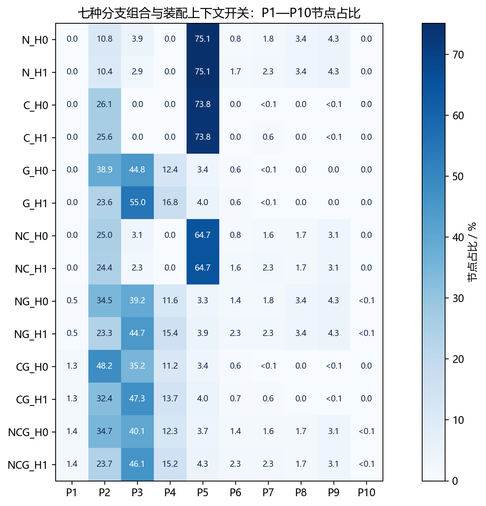
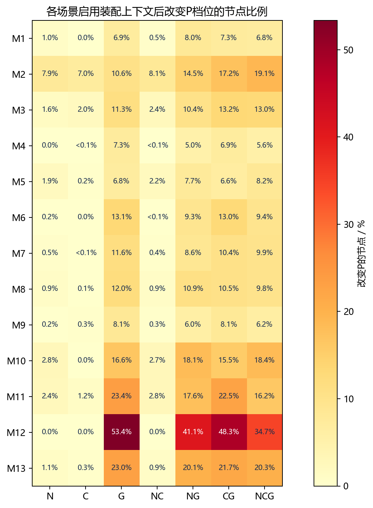
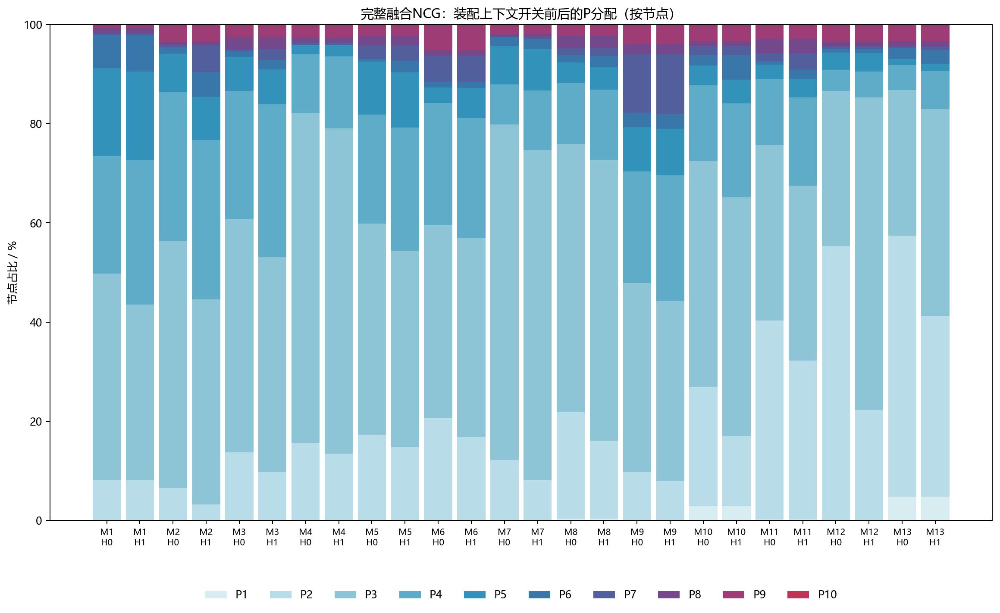
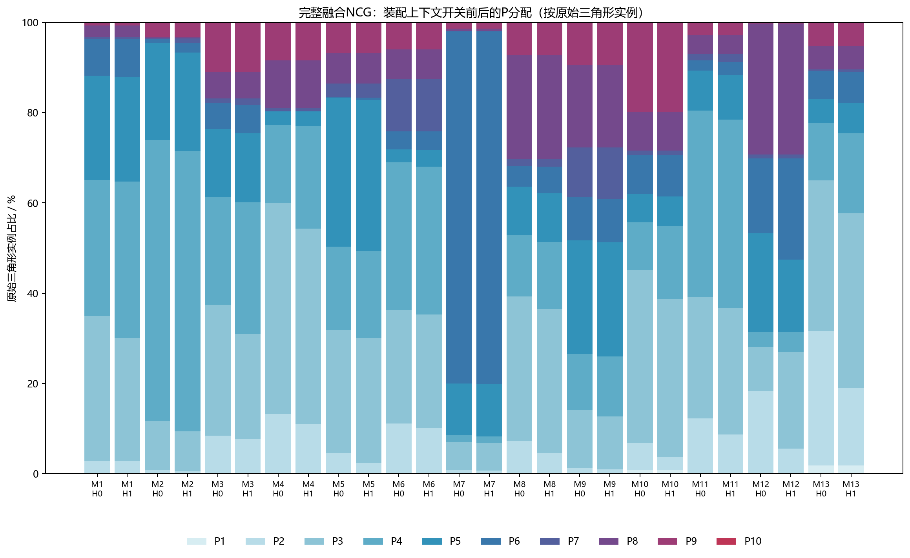
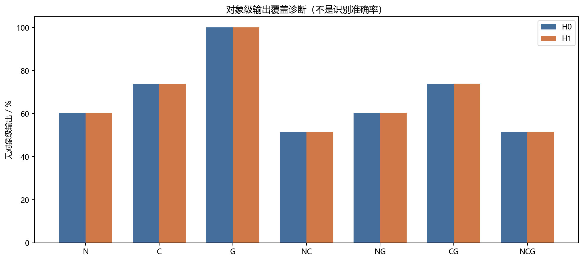
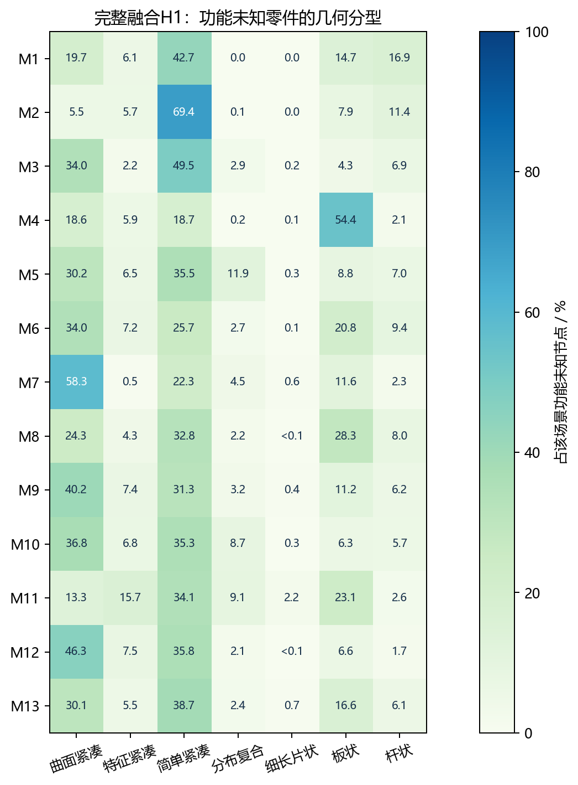

# 十三个工业场景全量融合与装配上下文消融分析

固定V5策略、监督权重、开放词库及阈值；共13个场景、68,972个网格实例。主实验为7种非空分支组合×H0/H1；HT仅保留拓扑与局部尺度，M额外使用叶名称。没有重训、调参或替换当前渲染策略；本报告不将输出覆盖或P变化解释为识别准确率、画质、显存或帧率提升。

N=监督语义；C=开放视觉语义；G=显式几何；H1=局部装配尺度与受范围限制的祖先名称。H0保留相同世界变换及输入几何，屏蔽父组尺度和上下文；M主实验关闭。

为保证纯C及各组合使用同一份独立证据，本轮对所有节点执行开放推断，不以本轮耗时评价生产流程的不确定性门控节省；门控计算收益需要单独对照。

原始GLB共68,974个网格引用，其中2个没有POSITION顶点数据，单列为输入空网格。主对照覆盖全部68,972个有顶点的几何实例；空网格不填造监督预测，也不当作真实零件误识别。完整记录见excluded_empty_meshes.csv；C的空几何拒识记录保留在原始证据中。

## 场景规模与覆盖

| 场景 | 名称 | 网格实例 | 原始三角形实例 | 最大层级 |
|---|---|---:|---:|---:|
| M1 | 手机喇叭检测线 | 1,167 | 1,723,934 | 6 |
| M2 | 圆形电容穿心焊接机 | 1,480 | 2,911,273 | 5 |
| M3 | K31自动铆压机 | 1,481 | 3,433,060 | 5 |
| M4 | 极耳生产线 | 5,451 | 10,553,614 | 8 |
| M5 | 汽车链接器植入折弯设备 | 1,747 | 11,760,345 | 7 |
| M6 | 透气阀产线 | 3,347 | 15,496,224 | 6 |
| M7 | 焊接过渡线 | 1,026 | 19,905,661 | 7 |
| M8 | 转子自动生产线 | 6,103 | 20,703,307 | 13 |
| M9 | MK地盖组装线 | 3,118 | 23,921,390 | 7 |
| M10 | 刷架总线 | 5,198 | 47,591,131 | 10 |
| M11 | 圆柱分选并入支架设备 | 15,723 | 37,068,620 | 11 |
| M12 | 磁保持继电器产线 | 7,163 | 51,857,040 | 10 |
| M13 | 软包动力电池模组组装线 | 15,968 | 52,003,855 | 11 |

每个条件逐一验证(node_index, mesh_index)完整覆盖。相同几何的重复实例仍计入节点统计，三角形按原始实例展开累计，不等于实际存储、可见三角形或显存。未将13场景自动视为独立外部测试集。

## 主要组合与未解决证据

| 配置 | 无对象级输出 | 功能未知 | N/C分歧 | 需复核 | 请求远档面数比例 |
|---|---:|---:|---:|---:|---:|
| N_H0 | 60.33% | 75.07% | 0.00% | 60.33% | 24.79% |
| N_H1 | 60.33% | 75.07% | 0.00% | 66.81% | 24.86% |
| C_H0 | 73.75% | 73.79% | 0.00% | 62.14% | 20.43% |
| C_H1 | 73.75% | 73.79% | 0.00% | 62.71% | 20.45% |
| G_H0 | 100.00% | 100.00% | 0.00% | 100.00% | 18.26% |
| G_H1 | 100.00% | 100.00% | 0.00% | 100.00% | 18.70% |
| NC_H0 | 51.32% | 64.67% | 13.30% | 48.40% | 23.43% |
| NC_H1 | 51.32% | 64.67% | 13.30% | 52.32% | 23.51% |
| NG_H0 | 60.33% | 75.07% | 0.00% | 60.33% | 23.25% |
| NG_H1 | 60.33% | 75.07% | 0.00% | 66.81% | 23.64% |
| CG_H0 | 73.75% | 73.79% | 0.00% | 62.14% | 18.18% |
| CG_H1 | 73.87% | 73.91% | 0.00% | 62.83% | 18.62% |
| NCG_H0 | 51.33% | 64.67% | 13.30% | 48.40% | 22.60% |
| NCG_H1 | 51.44% | 64.78% | 13.30% | 52.41% | 22.99% |

请求面数比例由策略保留率加权得到，实际简化可能受局部约束和停止条件影响，不能当作已经实现的压缩比。

## P1至P10节点与源三角形分布

### 按节点统计

| 配置 | P1 | P2 | P3 | P4 | P5 | P6 | P7 | P8 | P9 | P10 |
|---|---:|---:|---:|---:|---:|---:|---:|---:|---:|---:|
| N_H0 | 0.00% | 10.79% | 3.85% | 0.00% | 75.07% | 0.80% | 1.75% | 3.41% | 4.31% | 0.00% |
| N_H1 | 0.00% | 10.38% | 2.88% | 0.00% | 75.07% | 1.68% | 2.27% | 3.41% | 4.31% | 0.00% |
| C_H0 | 0.00% | 26.15% | 0.00% | 0.00% | 73.79% | 0.00% | 0.04% | 0.00% | 0.02% | 0.00% |
| C_H1 | 0.00% | 25.59% | 0.00% | 0.00% | 73.79% | 0.00% | 0.60% | 0.00% | 0.02% | 0.00% |
| G_H0 | 0.00% | 38.86% | 44.76% | 12.39% | 3.42% | 0.57% | <0.01% | 0.00% | 0.00% | 0.00% |
| G_H1 | 0.00% | 23.59% | 54.98% | 16.78% | 4.01% | 0.64% | <0.01% | 0.00% | 0.00% | 0.00% |
| NC_H0 | 0.00% | 24.97% | 3.12% | 0.00% | 64.67% | 0.79% | 1.63% | 1.70% | 3.11% | 0.00% |
| NC_H1 | 0.00% | 24.37% | 2.27% | 0.00% | 64.67% | 1.56% | 2.31% | 1.70% | 3.11% | 0.00% |
| NG_H0 | 0.50% | 34.54% | 39.18% | 11.60% | 3.32% | 1.37% | 1.76% | 3.41% | 4.30% | 0.01% |
| NG_H1 | 0.50% | 23.25% | 44.70% | 15.37% | 3.87% | 2.31% | 2.27% | 3.41% | 4.30% | 0.01% |
| CG_H0 | 1.29% | 48.24% | 35.19% | 11.23% | 3.42% | 0.57% | 0.05% | 0.00% | 0.02% | 0.00% |
| CG_H1 | 1.29% | 32.41% | 47.28% | 13.75% | 3.98% | 0.65% | 0.61% | 0.00% | 0.02% | 0.00% |
| NCG_H0 | 1.40% | 34.67% | 40.07% | 12.31% | 3.65% | 1.44% | 1.64% | 1.70% | 3.11% | <0.01% |
| NCG_H1 | 1.40% | 23.66% | 46.06% | 15.17% | 4.30% | 2.28% | 2.32% | 1.70% | 3.11% | <0.01% |

### 按原始三角形实例统计

| 配置 | P1 | P2 | P3 | P4 | P5 | P6 | P7 | P8 | P9 | P10 |
|---|---:|---:|---:|---:|---:|---:|---:|---:|---:|---:|
| N_H0 | 0.00% | 3.63% | 1.72% | 0.00% | 68.83% | 1.97% | 2.28% | 12.41% | 9.16% | 0.00% |
| N_H1 | 0.00% | 3.59% | 1.28% | 0.00% | 68.83% | 2.35% | 2.38% | 12.41% | 9.16% | 0.00% |
| C_H0 | 0.00% | 13.11% | 0.00% | 0.00% | 86.84% | 0.00% | 0.04% | 0.00% | 0.01% | 0.00% |
| C_H1 | 0.00% | 13.02% | 0.00% | 0.00% | 86.84% | 0.00% | 0.13% | 0.00% | 0.01% | 0.00% |
| G_H0 | 0.00% | 16.81% | 33.48% | 18.70% | 20.83% | 10.06% | 0.12% | 0.00% | 0.00% | 0.00% |
| G_H1 | 0.00% | 7.93% | 38.91% | 21.03% | 20.44% | 11.56% | 0.12% | 0.00% | 0.00% | 0.00% |
| NC_H0 | 0.00% | 11.44% | 1.15% | 0.00% | 64.46% | 1.95% | 2.15% | 11.99% | 6.85% | 0.00% |
| NC_H1 | 0.00% | 11.36% | 0.76% | 0.00% | 64.46% | 2.29% | 2.29% | 11.99% | 6.85% | 0.00% |
| NG_H0 | 0.22% | 13.77% | 23.09% | 14.83% | 12.26% | 11.86% | 2.41% | 12.41% | 9.14% | 0.01% |
| NG_H1 | 0.22% | 7.73% | 25.81% | 17.12% | 11.65% | 13.40% | 2.51% | 12.41% | 9.14% | 0.01% |
| CG_H0 | 0.38% | 19.45% | 30.88% | 18.21% | 20.83% | 10.06% | 0.17% | 0.00% | 0.01% | 0.00% |
| CG_H1 | 0.38% | 10.70% | 36.42% | 20.23% | 20.41% | 11.57% | 0.27% | 0.00% | 0.01% | 0.00% |
| NCG_H0 | 0.48% | 12.84% | 25.21% | 15.74% | 12.39% | 12.22% | 2.28% | 11.99% | 6.85% | <0.01% |
| NCG_H1 | 0.48% | 7.07% | 27.42% | 18.21% | 11.90% | 13.64% | 2.43% | 11.99% | 6.85% | <0.01% |

## 装配上下文的成对影响

| 组合 | 改变P | 升档 | 降档 | 功能改变 | 对象身份改变 |
|---|---:|---:|---:|---:|---:|
| N | 961（1.39%） | 961（1.39%） | 0（0.00%） | 961（1.39%） | 0（0.00%） |
| C | 384（0.56%） | 384（0.56%） | 0（0.00%） | 384（0.56%） | 0（0.00%） |
| G | 14,511（21.04%） | 14,511（21.04%） | 0（0.00%） | 0（0.00%） | 0（0.00%） |
| NC | 998（1.45%） | 998（1.45%） | 0（0.00%） | 998（1.45%） | 0（0.00%） |
| NG | 11,986（17.38%） | 11,986（17.38%） | 0（0.00%） | 961（1.39%） | 0（0.00%） |
| CG | 13,736（19.92%） | 13,736（19.92%） | 0（0.00%） | 467（0.68%） | 83（0.12%） |
| NCG | 11,449（16.60%） | 11,449（16.60%） | 0（0.00%） | 1,075（1.56%） | 77（0.11%） |

### 完整融合在各场景的变化

| 场景 | 改变P | 升档 | 降档 | 功能改变 | 身份改变 |
|---|---:|---:|---:|---:|---:|
| M1 | 79（6.77%） | 79 | 0 | 32 | 26 |
| M2 | 283（19.12%） | 283 | 0 | 132 | 12 |
| M3 | 192（12.96%） | 192 | 0 | 36 | 1 |
| M4 | 306（5.61%） | 306 | 0 | 1 | 0 |
| M5 | 143（8.19%） | 143 | 0 | 39 | 0 |
| M6 | 315（9.41%） | 315 | 0 | 3 | 0 |
| M7 | 102（9.94%） | 102 | 0 | 4 | 0 |
| M8 | 599（9.81%） | 599 | 0 | 64 | 12 |
| M9 | 194（6.22%） | 194 | 0 | 23 | 13 |
| M10 | 955（18.37%） | 955 | 0 | 142 | 1 |
| M11 | 2550（16.22%） | 2550 | 0 | 448 | 9 |
| M12 | 2484（34.68%） | 2484 | 0 | 0 | 0 |
| M13 | 3247（20.33%） | 3247 | 0 | 151 | 3 |

H0→HT用于观察拓扑及局部尺度变化，HT→H1用于观察加入祖先名称后的变化；不能将H1的全部效果称为纯拓扑贡献。各因素改变的节点可重叠，计数不可相加作为独立因果效应。完整成对表见tree_pairs.csv，10×10迁移矩阵包含未改变项。

## 低置信与开放拒识

| 场景 | N未达接受条件 | C对象级输出 | C仅粗类别 | C拒识 |
|---|---:|---:|---:|---:|
| M1 | 725（62.13%） | 306（26.22%） | 141 | 720 |
| M10 | 3298（63.45%） | 1167（22.45%） | 438 | 3593 |
| M11 | 9841（62.59%） | 4489（28.55%） | 1721 | 9513 |
| M12 | 5025（70.15%） | 1616（22.56%） | 1386 | 4161 |
| M13 | 9609（60.18%） | 4592（28.76%） | 2142 | 9234 |
| M2 | 928（62.70%） | 557（37.64%） | 225 | 698 |
| M3 | 1006（67.93%） | 353（23.84%） | 152 | 976 |
| M4 | 2126（39.00%） | 943（17.30%） | 432 | 4076 |
| M5 | 1133（64.85%） | 495（28.33%） | 117 | 1135 |
| M6 | 1741（52.02%） | 1036（30.95%） | 428 | 1883 |
| M7 | 751（73.20%） | 106（10.33%） | 66 | 854 |
| M8 | 3675（60.22%） | 1659（27.18%） | 530 | 3914 |
| M9 | 1754（56.25%） | 787（25.24%） | 232 | 2099 |
| ALL | 41612（60.33%） | 18106（26.25%） | 8010 | 42856 |

N采用既有概率/间隔门槛；C按对象级、粗类别与拒识状态统计，质量分数未校准。两个分支不能按这些比例直接比较准确率。概率≥0.70时，间隔≥0.08不再提供额外筛选，不能据此宣称双阈值的独立收益。

### 合并低置信候选类型

| 分支 | 候选类型 | 未达对象级接受条件 | 占该分支未接受记录 |
|---|---|---:|---:|
| N | handles_controls | 6,471 | 15.55% |
| N | pins_rivets_keys | 6,277 | 15.08% |
| N | joints_clamps_structural_connectors | 5,682 | 13.65% |
| N | screws_bolts_studs | 4,238 | 10.18% |
| N | bearings_bushings_guides | 4,177 | 10.04% |
| N | plates_discs_shapes | 4,044 | 9.72% |
| N | pipe_fittings_valves_nozzles | 2,579 | 6.20% |
| N | rotating_fluid_machinery | 2,522 | 6.06% |
| N | washers_rings_spacers | 1,899 | 4.56% |
| N | nuts | 1,211 | 2.91% |
| C | plain_block | 13,607 | 26.75% |
| C | shaft_key | 8,555 | 16.82% |
| C | cap_nut | 3,799 | 7.47% |
| C | flat_washer | 3,591 | 7.06% |
| C | dowel_pin | 3,236 | 6.36% |
| C | mounting_plate | 2,051 | 4.03% |
| C | threaded_stud | 1,929 | 3.79% |
| C | retaining_ring | 1,672 | 3.29% |
| C | die_block | 1,652 | 3.25% |
| C | hex_nut | 1,625 | 3.19% |

这些名称是模型候选类别，不是已核验真实类型。逐场景明细见low_confidence_candidate_types.csv；未知功能件几何分型见unknown_geometry_families.csv。

## 结果解释与论文使用

1. N/C互补首先看对象候选覆盖及分歧，不能以未解决比例下降证明纠错。
2. G首先看未知形态和整体/局部预算是否得到区分；纯G不承担对象识别，没有类别输出不等于识别失败。
3. H先看功能、身份撤回和保护变化；仅升档可能增加保护与资源开销，不能自动视为收益。
4. 叶名称M作为单列辅助；启用M的条件不使用同一名称计算一致率。其他名称一致率也仅为弱参考，不是OA或功能真值。
5. 本轮全量仅指全部节点及全部条件覆盖；没有运行实际cluster LOD构建、多视角图像或GPU渲染基准。

CSV保留逐场景和合并结果；合并比例先合计计数再求比例，另提供场景等权平均。逐节点CSV使用gzip压缩，避免重复证据和解释字段大量占用磁盘；可解压后在表格软件中查看。

## 数值结果的综合分析

1. **监督与开放候选存在覆盖互补，同时保留分歧。** 关闭上下文时，N、C的无对象级输出比例分别为60.33%、73.75%，联合NC后为51.32%，相对N下降9.01个百分点。NC仍有9,174个分歧节点（13.30%）。这说明候选覆盖发生变化，不证明这些新增候选正确。

2. **几何分支主要影响保护预算。** 下列成对结果使用相同节点与神经证据。

**几何对照N_H0→NG_H0。** 50,905个节点改变P档位（73.81%）；功能未知由75.07%变为75.07%，无对象级输出由60.33%变为60.33%。几何分支主要提供形态与保真证据，预算改变和对象识别应分开评价。

**几何对照C_H0→CG_H0。** 57,107个节点改变P档位（82.80%）；功能未知由73.79%变为73.79%，无对象级输出由73.75%变为73.75%。几何分支主要提供形态与保真证据，预算改变和对象识别应分开评价。

**几何对照NC_H0→NCG_H0。** 52,521个节点改变P档位（76.15%）；功能未知由64.67%变为64.67%，无对象级输出由51.32%变为51.33%。几何分支主要提供形态与保真证据，预算改变和对象识别应分开评价。

3. **装配上下文在完整融合中的介入范围。** H0→H1改变11,449个节点的P档位（16.60%），其中升档11,449、降档0；功能判断改变1,075，对象身份改变77。功能未知比例由64.67%变为64.78%。身份改变可能包括保守撤回，不能都解释为纠错。

4. **保护与请求预算的代价。** 完整融合请求远档面数比例由22.60%变为22.99%。这一数值是原始实例面数加权的请求值；若升档增加预算，后续应核验其是否改善关键结构，不能仅以介入节点多判断更优。

5. **树辅助的场景差异。** 按改变P的节点比例，介入较多的场景为：M12 磁保持继电器产线 34.68%（2,484节点）；M13 软包动力电池模组组装线 20.33%（3,247节点）；M2 圆形电容穿心焊接机 19.12%（283节点）。绝对数量与场景规模有关，应同时查看比例、源三角形占比及逐节点原因。

上述结论适用于固定规则下的完整场景诊断。没有独立人工真值或实际LOD/渲染测量，不能转换成分类准确率、关键件识别率、显存节省或帧率增益。

### 拓扑与祖先名称的贡献拆分

| 组合 | H0→HT改变P | HT→H1改变P | H0→HT功能改变 | HT→H1功能改变 |
|---|---:|---:|---:|---:|
| N | 0（0.00%） | 961（1.39%） | 0（0.00%） | 961（1.39%） |
| C | 0（0.00%） | 384（0.56%） | 0（0.00%） | 384（0.56%） |
| G | 14,511（21.04%） | 0（0.00%） | 0（0.00%） | 0（0.00%） |
| NC | 0（0.00%） | 998（1.45%） | 0（0.00%） | 998（1.45%） |
| NG | 11,038（16.00%） | 961（1.39%） | 0（0.00%） | 961（1.39%） |
| CG | 13,362（19.37%） | 384（0.56%） | 83（0.12%） | 384（0.56%） |
| NCG | 10,469（15.18%） | 998（1.45%） | 77（0.11%） | 998（1.45%） |

H0→HT固定名称线索，仅启用父组拓扑及尺度；HT→H1固定拓扑，再加入受范围限制的祖先名称。两段变化可能发生在相同节点，并可能相互抵消，不能相加替代H0→H1的净变化。若主要变化来自第二段，论文应表述为装配上下文或名称语义辅助，而不能全部归因于结构树拓扑。

### 完整融合的档位集中与几何负担

NCG_H1按节点最多的档位为P3，共31,766个（46.06%）；按源三角形实例占比最高的是P3（27.42%）。节点占比反映分配频度，源三角形占比反映原始几何负担，两者均不能替代运行时可见性或资源测量。
完整融合触发了全部十档；各档占比不需要均匀，是否得当仍需结合对应节点的结构与视觉验证。

| 档位 | 节点数 | 节点占比 | 源三角形实例占比 |
|---|---:|---:|---:|
| P1 | 969 | 1.40% | 0.48% |
| P2 | 16,320 | 23.66% | 7.07% |
| P3 | 31,766 | 46.06% | 27.42% |
| P4 | 10,460 | 15.17% | 18.21% |
| P5 | 2,967 | 4.30% | 11.90% |
| P6 | 1,570 | 2.28% | 13.64% |
| P7 | 1,603 | 2.32% | 2.43% |
| P8 | 1,174 | 1.70% | 11.99% |
| P9 | 2,142 | 3.11% | 6.85% |
| P10 | 1 | <0.01% | <0.01% |

小于0.01%的非零比例单独显示，避免将极少量档位误读为未触发。

### 功能未知件的几何拆分

| 几何分型 | H0未知节点 | H1未知节点 | H1中P2—P3 | H1中P4—P5 | H1中P6—P7 |
|---|---:|---:|---:|---:|---:|
| 曲面紧凑形态 | 12190 | 12190 | 11322 | 868 | 0 |
| 局部特征紧凑形态 | 3614 | 3614 | 2741 | 873 | 0 |
| 简单紧凑形态 | 15376 | 15376 | 14612 | 764 | 0 |
| 分布复合形态 | 1983 | 1986 | 372 | 1528 | 86 |
| 细长片状形态 | 344 | 344 | 13 | 331 | 0 |
| 板状形态 | 8921 | 8923 | 6396 | 2527 | 0 |
| 杆状形态 | 2177 | 2249 | 673 | 1485 | 91 |

完整融合H1共有44,682个功能未知节点，按几何分型与P档位分别统计，避免将未知功能误作同一种形状。普通紧固功能节点为16,732个，其P1—P3、P4—P5、P6—P10数量分别为11,442、4,967、323。这些是规则给出的功能候选与预算，不是人工确认的零件数量。完整角色分布见function_role_priority_distribution.csv。

H0→H1中，77个节点的功能候选撤回为未知，0个节点由未知得到功能候选。两项分别统计，并不预先认定新增或撤回正确；完整功能角色迁移见function_role_transitions.csv。

### 对当前融合机制的判断

本轮完整融合中，拓扑与父组尺度改变10,469个节点的档位，随后加入祖先名称改变998个节点。主要介入来源是局部尺度与保护预算调整；祖先名称在较小范围内细化已有功能候选。

功能未知仍有44,682个（64.78%），且本轮树辅助没有使未知节点获得新的功能候选。因此，当前结果适合论证未知功能下的几何分型与保守预算分配，实际语义识别效果仍需要独立标注检验。

P6与P8合计仅占3.98%的节点，却对应25.63%的原始三角形实例。后续实际LOD与渲染对照应重点检查这些高面数构件的简化结果，同时验证升档增加的保护预算是否换来了结构或画质收益。

## 图表与逐模型报告

[离线交互图表](十三模型融合消融交互图表.html)

- [M1 手机喇叭检测线](models/M1.md)
- [M2 圆形电容穿心焊接机](models/M2.md)
- [M3 K31自动铆压机](models/M3.md)
- [M4 极耳生产线](models/M4.md)
- [M5 汽车链接器植入折弯设备](models/M5.md)
- [M6 透气阀产线](models/M6.md)
- [M7 焊接过渡线](models/M7.md)
- [M8 转子自动生产线](models/M8.md)
- [M9 MK地盖组装线](models/M9.md)
- [M10 刷架总线](models/M10.md)
- [M11 圆柱分选并入支架设备](models/M11.md)
- [M12 磁保持继电器产线](models/M12.md)
- [M13 软包动力电池模组组装线](models/M13.md)

数据、公式与图表的核验范围见[交付校验说明](交付校验说明.md)。
